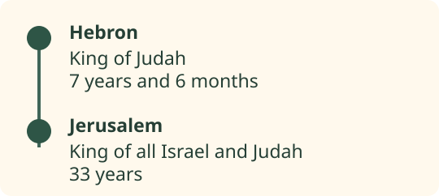

# 1 Chronicles 11 — David becomes king over all Israel

**About this chapter**

Israel’s leaders meet David at Hebron and make him king. David moves to Jerusalem. The record names the warriors who helped him and tells why he would not drink the water three of them brought him.

## The elders make David king

## 1 Chronicles 11:1

All Israel gathered around David at Hebron.

The people said, “David, we are your own family.

## 1 Chronicles 11:2

Even when Saul was king, you led Israel’s troops out and brought them home.

The LORD your God told you, ‘You will care for my people Israel as a shepherd cares for sheep.

You will rule over them.’”

## 1 Chronicles 11:3

All Israel’s elders came to King David at Hebron.

There David made a covenant with them before the LORD.

A covenant is a solemn agreement.

The elders poured oil on David to mark him as king over Israel.

This was what the LORD had said through Samuel.

## David moves to Jerusalem

## 1 Chronicles 11:4

David and the Israelites marched to Jerusalem.

The city was also called Jebus.

The Jebusites lived there.

## 1 Chronicles 11:5

The people of Jebus told David, “You will never get in here!” But David captured Zion, their strong place of defense.

It became the City of David.

## 1 Chronicles 11:6

David had promised to make the first man to strike down a Jebusite his chief commander.

Joab, the son of Zeruiah, went up first.

So Joab became chief commander.

## 1 Chronicles 11:7

David went to live inside the stronghold.

That is why people called it the City of David.

Find Hebron, where the elders met David. Follow the line to Jerusalem, where he went to live.

## 1 Chronicles 11:8

David built up the city around the stronghold.

The work stretched from the terraces that supported the city to its outer wall.

Joab repaired the rest of the city.

## 1 Chronicles 11:9

David grew more and more powerful.

The LORD, who commands heaven’s armies, was with him.

## Warriors who stood with David

## 1 Chronicles 11:10

These were the leaders among David’s mighty warriors.

They joined all Israel in making his kingdom strong.

This was what the LORD had promised Israel.

## 1 Chronicles 11:11

Here is the record of David’s mighty warriors.

Jashobeam, son of Hachmoni, led the officers.

In one battle he killed 300 men with his spear.

## 1 Chronicles 11:12

Eleazar, son of Dodo the Ahohite, came next.

Eleazar belonged to a group of warriors called the Three.

## 1 Chronicles 11:13

Eleazar was with David at Pas-dammim.

The Philistines gathered there to fight.

Near a field full of barley, Israel’s troops ran away.

## 1 Chronicles 11:14

Eleazar and David stayed in the middle of that field.

They defended it and struck down the Philistines.

The LORD gave them a great victory.

## Water from Bethlehem

## 1 Chronicles 11:15

Three of the thirty leaders went down to meet David.

David was at the rock by the cave of Adullam.

Philistine troops had camped in the Valley of Rephaim.

## 1 Chronicles 11:16

David was in his stronghold.

Philistine soldiers held Bethlehem.

## 1 Chronicles 11:17

David wanted a drink of water.

He said, “I wish I could drink water from the well by the gate of Bethlehem!”

## 1 Chronicles 11:18

The Three broke through the Philistine camp.

They drew water from the well by Bethlehem’s gate.

They brought it back to David.

David poured it out as a gift to the LORD.

## 1 Chronicles 11:19

David said, “My God, I could never drink this! It would be like drinking the blood of these men.” He meant that they could have died getting the water.

That was why David refused to drink it.

This was one brave deed of the Three.

**Pause and answer**

Why did David refuse to drink the water?

## Abishai and Benaiah

## 1 Chronicles 11:20

Abishai, Joab’s brother, led the Three.

He killed 300 men with his spear.

He became famous along with the Three.

## 1 Chronicles 11:21

Abishai received twice the honor the Three received.

He commanded them, though he was never one of the Three himself.

## 1 Chronicles 11:22

Benaiah, son of Jehoiada, came from Kabzeel.

He did many brave things.

He killed two champions from Moab.

On a snowy day he went down into a pit and killed a lion.

## 1 Chronicles 11:23

Benaiah also defeated a huge Egyptian man.

The man stood five cubits tall, well over two meters.

His spear was as thick as a pole for weaving cloth.

Benaiah carried a club.

He took the Egyptian’s spear and killed him with it.

## 1 Chronicles 11:24

These deeds made Benaiah, son of Jehoiada, famous along with the Three.

## 1 Chronicles 11:25

Benaiah received the highest honor among the Thirty.

He never became one of the Three.

David put him in charge of his personal guard.

## The names of David’s warriors

## 1 Chronicles 11:26

The record names more of David’s mighty warriors.

Asahel was Joab’s brother.

Elhanan was the son of Dodo from Bethlehem.

## 1 Chronicles 11:27

Shammoth the Harorite and Helez the Pelonite also served David.

## 1 Chronicles 11:28

Ira was the son of Ikkesh from Tekoa.

Abiezer came from Anathoth.

## 1 Chronicles 11:29

Sibbecai the Hushathite served with Ilai the Ahohite.

## 1 Chronicles 11:30

Maharai and Heled came from Netophah.

Heled was Baanah’s son.

## 1 Chronicles 11:31

Ithai, Ribai’s son, came from Gibeah in Benjamin.

Benaiah came from Pirathon.

## 1 Chronicles 11:32

Hurai came from the streams of Gaash.

Abiel the Arbathite also served.

## 1 Chronicles 11:33

The record names Azmaveth the Baharumite and Eliahba the Shaalbonite.

## More names from the record

## 1 Chronicles 11:34

The sons of Hashem the Gizonite were among the warriors.

So was Jonathan, son of Shagee the Hararite.

## 1 Chronicles 11:35

Ahiam was the son of Sachar the Hararite.

Eliphal was Ur’s son.

## 1 Chronicles 11:36

Hepher the Mecherathite and Ahijah the Pelonite also served.

## 1 Chronicles 11:37

The record names Hezro the Carmelite and Naarai, son of Ezbai.

## 1 Chronicles 11:38

Joel was Nathan’s brother.

Mibhar was Hagri’s son.

## 1 Chronicles 11:39

Zelek came from Ammon.

Naharai from Beeroth carried the armor of Joab, son of Zeruiah.

## 1 Chronicles 11:40

Ira and Gareb were Ithrites.

## 1 Chronicles 11:41

Uriah the Hittite also served, as did Zabad, son of Ahlai.

## Adina and other warriors

## 1 Chronicles 11:42

Adina was the son of Shiza from Reuben.

Adina led men from Reuben.

Thirty men served with him.

## 1 Chronicles 11:43

Hanan, son of Maacah, and Joshaphat the Mithnite also served.

## 1 Chronicles 11:44

The record names Uzzia the Ashterathite.

It also names Shama and Jeiel, sons of Hotham from Aroer.

## 1 Chronicles 11:45

Jediael, son of Shimri, served with his brother Joha the Tizite.

## 1 Chronicles 11:46

Eliel the Mahavite and Ithmah from Moab also served.

So did Jeribai and Joshaviah, sons of Elnaam.

## 1 Chronicles 11:47

The record ends with Eliel, Obed, and Jaasiel the Mezobaite.

**Pause and answer**

Whom did David choose to lead his personal guard?
