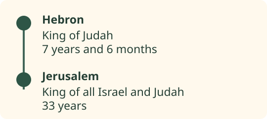

# 1 Chronicles 12 — Israel gathers to make David king

**About this chapter**

When David lived far from King Saul, men came to help him. Later, people from every part of Israel met at Hebron. They wanted David to be their king.

## Men from Benjamin join David

## 1 Chronicles 12:1

King Saul, the son of Kish, had forced David to stay away from him.

While David lived in Ziklag, men came to join him.

These brave men helped David in battle.

## 1 Chronicles 12:2

They were relatives of Saul from the tribe of Benjamin.

They could use either hand to sling stones or shoot arrows.

## 1 Chronicles 12:3

Their leader was Ahiezer.

Ahiezer and Joash were sons of Shemaah from Gibeah.

Jeziel and Pelet were sons of Azmaveth.

Beracah and Jehu from Anathoth also came.

## 1 Chronicles 12:4

Ishmaiah from Gibeon came too.

He was a brave member and leader of the group called the Thirty.

Jeremiah, Jahaziel, Johanan, and Jozabad from Gederah also came.

## 1 Chronicles 12:5

Others were Eluzai, Jerimoth, Bealiah, Shemariah, and Shephatiah the Haruphite.

## 1 Chronicles 12:6

Elkanah, Isshiah, Azarel, Joezer, and Jashobeam belonged to Korah’s family.

## 1 Chronicles 12:7

Joelah and Zebadiah also joined David.

Their father was Jeroham from Gedor.

## Men from Gad join David

## 1 Chronicles 12:8

Some men from Gad changed sides.

They joined David at his safe place in the wilderness.

They were brave and skilled with shields and spears.

They looked fierce like lions.

They ran as fast as gazelles, animals that race across the mountains.

## 1 Chronicles 12:9

Ezer was their leader.

Obadiah ranked second and Eliab third.

## 1 Chronicles 12:10

Mishmannah ranked fourth and Jeremiah fifth.

## 1 Chronicles 12:11

Attai ranked sixth and Eliel seventh.

## 1 Chronicles 12:12

Johanan ranked eighth and Elzabad ninth.

## 1 Chronicles 12:13

Jeremiah ranked tenth and Machbanai eleventh.

## 1 Chronicles 12:14

These men from Gad commanded troops.

Even the least of them was a match for a hundred men.

The greatest was a match for a thousand.

## 1 Chronicles 12:15

They crossed the Jordan River in the first month of the year.

The river had flooded its banks.

They drove away the people in the valleys on both sides of the river.

## David asks why the men have come

## 1 Chronicles 12:16

Other men from Benjamin and Judah came to David at his safe place.

## 1 Chronicles 12:17

David went out to meet them.

He said, “If you come in peace to help me, I will stand with you.

I have done no violence against you.

If you hand me over to my enemies, may the God of our ancestors see it and judge you.”

## 1 Chronicles 12:18

Then God’s Spirit came upon Amasai, leader of the Thirty.

Amasai said, “David, we belong to you! Son of Jesse, we stand with you! Peace to you and to everyone who helps you.

Your God is helping you.” David welcomed them and put them in charge of troops.

**Pause and answer**

What did David do after Amasai promised to help him?

## Commanders from Manasseh join David

## 1 Chronicles 12:19

Some men from Manasseh joined David when he went with the Philistines to fight Saul.

David and his men never fought for the Philistines.

The Philistine rulers talked together and sent David away.

They said, “If David goes back to his master Saul, it will cost us our lives.”

## 1 Chronicles 12:20

On David’s way to Ziklag, these men from Manasseh joined him.

They were Adnah, Jozabad, Jediael, Michael, another Jozabad, Elihu, and Zillethai.

They commanded groups of a thousand in Manasseh.

## 1 Chronicles 12:21

These brave army commanders helped David fight the raiders.

## 1 Chronicles 12:22

Day after day men came to help David.

His army grew so large it was like the army of God.

## The tribes gather at Hebron

## 1 Chronicles 12:23

Armed men came to David at Hebron.

The LORD had said David would receive Saul’s kingdom.

They came to make that happen.

Here is how many came from each tribe.

Find Hebron at the top of the picture. This is where the tribes came to meet David.

## 1 Chronicles 12:24

Judah sent 6,800 men with shields and spears.

## 1 Chronicles 12:25

Simeon sent 7,100 brave men ready to fight.

## 1 Chronicles 12:26

Levi sent 4,600 men.

## 1 Chronicles 12:27

Among them was Jehoiada, leader of Aaron’s family.

He came with 3,700 men.

## 1 Chronicles 12:28

Zadok, a brave young man, also came.

With him were 22 commanders from his own family.

## 1 Chronicles 12:29

Benjamin, Saul’s tribe, sent 3,000 men.

Until then, most of them had stayed loyal to Saul’s family.

## More tribes send men

## 1 Chronicles 12:30

Ephraim sent 20,800 brave men.

Their families knew them well for their courage.

## 1 Chronicles 12:31

Half the tribe of Manasseh sent 18,000 men.

Their people chose them by name to come and make David king.

## 1 Chronicles 12:32

Issachar sent 200 leaders.

They understood what was happening and knew what Israel should do.

All their relatives followed their orders.

## 1 Chronicles 12:33

Zebulun sent 50,000 men ready for service.

They had trained with many kinds of weapons.

They all gave David their full support.

## 1 Chronicles 12:34

Naphtali sent 1,000 commanders.

With them came 37,000 men carrying shields and spears.

## 1 Chronicles 12:35

Dan sent 28,600 men ready for battle.

## 1 Chronicles 12:36

Asher sent 40,000 men ready to serve and fight.

## 1 Chronicles 12:37

From east of the Jordan River came 120,000 men.

They came from Reuben, Gad, and the half of Manasseh that lived there.

They carried every kind of weapon.

## Israel celebrates together

## 1 Chronicles 12:38

These men came to Hebron in battle formation.

They had firmly decided to make David king over all Israel.

The rest of Israel also wanted David as king.

## 1 Chronicles 12:39

They ate and drank with David for three days.

Their relatives had brought food for them.

## 1 Chronicles 12:40

Neighbors came from as far away as Issachar, Zebulun, and Naphtali.

Donkeys, camels, mules, and oxen carried the food.

There was plenty of flour, fig cakes, raisin cakes, wine, and oil.

The neighbors also brought oxen and sheep.

The people of Israel were full of joy.

**Pause and answer**

How did the neighbors help feed the people at Hebron?
