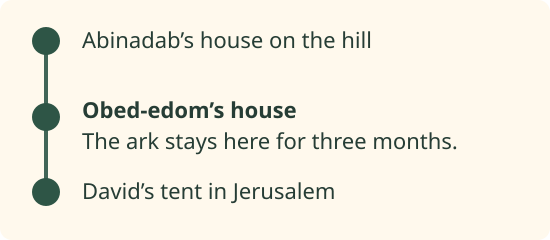

# 1 Chronicles 13 — David brings the ark to Obed-edom’s house

**About this chapter**

David gathers Israel to bring back the ark of God. The journey begins with music. After Uzzah dies, David takes the ark to Obed-edom’s house.

## David asks the people to come together

## 1 Chronicles 13:1

David talked with all his leaders.

Some commanded thousands of soldiers.

Others commanded hundreds.

## 1 Chronicles 13:2

Then David spoke to the people of Israel who had gathered.

“Does this seem right to you?

Is this what the LORD our God wants?

If so, let us send word throughout Israel.

Let us invite the rest of our people to join us.

Invite the priests and Levites from their towns and pasturelands too.”

## 1 Chronicles 13:3

David said, “Let us bring back the ark of our God.

When Saul was king, we did not ask God to guide us.”

The ark was a sacred chest.

## 1 Chronicles 13:4

Everyone thought this was the right thing to do.

All the people gathered there agreed.

## The people celebrate as the ark sets out

## 1 Chronicles 13:5

David gathered people from all over Israel.

They came from the Shihor River in Egypt to Lebo-hamath.

They would bring the ark from Kiriath-jearim.

## 1 Chronicles 13:6

David and the people went to Baalah in Judah.

Baalah was another name for Kiriath-jearim.

They went there to get the ark that bore the LORD’s name.

Above it were figures of winged beings called cherubim.

The LORD sits as King between them.

## 1 Chronicles 13:7

They brought the ark out of Abinadab’s house.

They set it on a new cart.

Uzzah and Ahio guided the cart.

## 1 Chronicles 13:8

David and all Israel celebrated before God with all their strength.

They sang and played harps and lyres, two instruments with strings.

They also played tambourines, cymbals, and trumpets.

## The oxen stumble

## 1 Chronicles 13:9

They reached Chidon’s threshing floor, a place for separating grain.

The oxen pulling the cart stumbled.

Uzzah reached out and took hold of the ark.

## 1 Chronicles 13:10

The LORD was angry with Uzzah for touching the ark.

The LORD struck Uzzah down.

Uzzah died there before God.

## 1 Chronicles 13:11

David was angry because the LORD had struck Uzzah.

David named that place Perez-uzzah.

The name recalls how the LORD broke out against Uzzah.

The place kept that name.

## The ark stays with Obed-edom

## 1 Chronicles 13:12

That day David was afraid of God.

David asked, “How can I bring God’s ark to me?”

## 1 Chronicles 13:13

David stopped the journey to the City of David.

He took the ark to the house of Obed-edom the Gittite.

## 1 Chronicles 13:14

The ark stayed with Obed-edom’s family for three months.

The LORD blessed the family and everything Obed-edom owned.

**Pause and answer**

How long did the ark stay with Obed-edom’s family?
