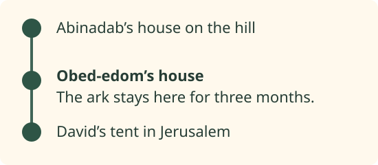

# 1 Chronicles 16 — A song of thanks at the ark

**About this chapter**

The ark was a sacred chest. It reminded Israel of God’s covenant, his agreement with his people. When the ark arrived, David gave the musicians a song. The song invites the whole earth to praise God.

## David blesses the people

## 1 Chronicles 16:1

The people brought the ark of God into David’s tent.

They gave God burnt offerings.

They also gave peace offerings to celebrate peace with God.

The last stop in the picture is the tent David set up for the ark.

## 1 Chronicles 16:2

David finished giving the burnt offerings and peace offerings.

Then he blessed the people in the LORD’s name.

## 1 Chronicles 16:3

David gave food to every man and woman in Israel.

Each received a loaf of bread, a date cake, and a raisin cake.

## David chooses the musicians

## 1 Chronicles 16:4

David chose some Levites to serve at the LORD’s ark.

They would celebrate what the LORD had done.

They would thank and praise the LORD, Israel’s God.

## 1 Chronicles 16:5

Asaph led the musicians.

Zechariah came second.

The other musicians were Jeiel, Shemiramoth, Jehiel, Mattithiah, Eliab, Benaiah, Obed-edom, and Jeiel.

The musicians played stringed instruments called harps and lyres.

Asaph struck the cymbals, a pair of metal plates.

## 1 Chronicles 16:6

Two priests, Benaiah and Jahaziel, played the trumpets.

They did this regularly in front of the ark of God’s covenant.

## 1 Chronicles 16:7

That day David first gave Asaph and the other musicians this song of thanks to the LORD.

## Remember what the LORD has done

## 1 Chronicles 16:8

Thank the LORD.

Call on him when you pray.

Tell people in every nation what he has done.

## 1 Chronicles 16:9

Sing to the LORD.

Praise him with songs.

Tell about all the wonderful things he has done.

## 1 Chronicles 16:10

Take joy in the LORD’s holy name.

Let everyone who seeks the LORD be glad.

## 1 Chronicles 16:11

Turn to the LORD for strength.

Always seek his face.

Keep turning to him to be near him.

## 1 Chronicles 16:12

Remember the wonderful things the LORD has done.

Remember the decisions he has announced as judge.

## 1 Chronicles 16:13

This song is for you, the family of Israel.

Jacob was also called Israel.

He served God, and God chose you, Jacob’s family.

## 1 Chronicles 16:14

The LORD is our God.

His decisions reach the whole earth.

## God keeps his promise

## 1 Chronicles 16:15

Always remember God’s covenant.

He gave his word for a thousand generations.

## 1 Chronicles 16:16

God made this covenant with Abraham.

He made a solemn promise to Abraham’s son Isaac.

## 1 Chronicles 16:17

God confirmed the same promise to Jacob.

For Israel, this covenant would last forever.

## 1 Chronicles 16:18

God said, “I will give you the land of Canaan.

This land will belong to you and your family after you.”

## 1 Chronicles 16:19

At first there were very few of them.

They lived in the land as strangers.

## 1 Chronicles 16:20

They traveled from nation to nation.

They went from one kingdom to another.

## 1 Chronicles 16:21

God let no one mistreat them.

He even warned kings to protect his people.

## 1 Chronicles 16:22

God said, “Keep your hands off the people I have chosen.

Do no harm to my prophets.” Prophets speak God’s messages.

**Pause and answer**

What land did God promise to give Abraham’s family?

## Every nation can praise the LORD

## 1 Chronicles 16:23

Everyone on earth, sing to the LORD! Tell people every day how he saves.

## 1 Chronicles 16:24

Tell every nation how great he is.

Tell every people about the wonders he has done.

## 1 Chronicles 16:25

The LORD is great.

He deserves great praise.

Stand in awe of him above all gods.

## 1 Chronicles 16:26

The nations worship idols, images they treat as gods.

The LORD made the heavens.

## 1 Chronicles 16:27

In the LORD’s presence there is beauty fit for a king.

Where he lives, there is strength and joy.

## 1 Chronicles 16:28

Families of every nation, honor the LORD.

Tell how great and strong he is.

## 1 Chronicles 16:29

Give the LORD the honor his name deserves.

Bring a gift and come before him.

Worship the LORD in the beauty of his holiness.

## 1 Chronicles 16:30

Let the whole earth tremble before him.

The LORD has set the world firmly in place.

Nothing can move it.

## The whole earth rejoices

## 1 Chronicles 16:31

Let the heavens be glad.

Let the earth rejoice.

Tell the nations, “The LORD is King!”

## 1 Chronicles 16:32

Let the sea roar with everything in it.

Let the fields be joyful with everything in them.

## 1 Chronicles 16:33

Let the forest trees sing for joy before the LORD.

The song pictures all creation celebrating together.

The LORD is coming to judge the earth.

## 1 Chronicles 16:34

Thank the LORD because he is good.

His faithful love lasts forever.

## 1 Chronicles 16:35

Call out, “God our Savior, save us! Gather us together and rescue us from the nations.

Then we can thank you for your holy name.

We can rejoice as we praise you.”

## 1 Chronicles 16:36

Praise the LORD, the God of Israel, forever and ever.

Then all the people said, “Amen!” They agreed with the song.

They said, “Praise the LORD!”

## The people serve each day

## 1 Chronicles 16:37

David left Asaph and the other musicians at the ark of the LORD’s covenant.

Each day they did the work that day required.

## 1 Chronicles 16:38

Obed-edom and his 68 relatives also served there.

Obed-edom son of Jeduthun and Hosah guarded the gates.

## 1 Chronicles 16:39

David left Zadok and the other priests at Gibeon.

The LORD’s sacred tent stood at the place of worship there.

## 1 Chronicles 16:40

Morning and evening the priests burned whole offerings on the altar.

They followed the LORD’s written law.

The LORD had told Israel to obey it.

## 1 Chronicles 16:41

Heman, Jeduthun, and others chosen by name served there too.

They thanked the LORD with these words.

“His faithful love lasts forever.”

## 1 Chronicles 16:42

Heman and Jeduthun had trumpets, cymbals, and other instruments.

They made music for the songs of praise to God.

Jeduthun’s sons guarded the gate.

## 1 Chronicles 16:43

Then the people went home.

David also went home to bless his family.

**Pause and answer**

What words did the singers use to thank the LORD for his love?
