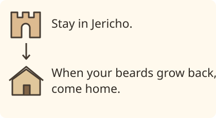

# 1 Chronicles 19 — David sends comfort, but Hanun suspects his messengers

**About this chapter**

David sends men to comfort a king whose father has died.

The king listens to people who call the men spies.

His treatment of the messengers leads to war.

## David sends messengers to Ammon

## 1 Chronicles 19:1

Nahash, king of the Ammonites, died.

His son became king in his place.

## 1 Chronicles 19:2

David said, “Nahash was kind to me.

I will show kindness to his son Hanun.”

David sent messengers to comfort Hanun after his father’s death.

The messengers came to the land of Ammon.

## 1 Chronicles 19:3

The Ammonite leaders said to Hanun, “Do you think David really wants to honor your father?

His men have come to look over our land.

They are spies who want to help David take it.”

## 1 Chronicles 19:4

Hanun seized David’s men and shaved off their beards.

He cut their clothes short at the hips and sent them away.

## 1 Chronicles 19:5

Someone told David what had happened.

His men felt deeply ashamed, so David sent messengers to meet them.

He said, “Stay in Jericho until your beards grow back.

Then come home.”

## The Ammonites hire an army

## 1 Chronicles 19:6

The Ammonites knew how angry David was with them.

Hanun and his people sent a thousand talents of silver.

A talent was a measure of weight.

They used the silver to hire chariots and soldiers on horses.

These came from Aram-naharaim, Aram-maacah, and Zobah.

## 1 Chronicles 19:7

The Ammonites hired 32,000 chariots.

They also hired the king of Maacah and his soldiers.

The hired forces camped near Medeba.

The Ammonites gathered men from their cities and went out to fight.

## 1 Chronicles 19:8

David heard what was happening.

He sent Joab and his whole army of strong fighters.

## Joab and his brother promise to help each other

## 1 Chronicles 19:9

The Ammonites stood ready for battle at the city entrance.

The kings who had come to help them stayed out in the open country.

## 1 Chronicles 19:10

Joab saw enemies both in front of him and behind him.

He chose some of Israel’s best soldiers to face the Arameans.

## 1 Chronicles 19:11

His brother Abishai led the rest of Israel’s soldiers.

Abishai and his men faced the Ammonites.

## 1 Chronicles 19:12

Joab told Abishai, “If the Arameans are too strong for me, come help me.

If the Ammonites are too strong for you, I will help you.

## 1 Chronicles 19:13

“Be strong!

Let us be brave for our people and the cities of our God.

May the LORD do what he sees is good.”

## 1 Chronicles 19:14

Joab and his soldiers moved toward the Arameans to fight.

The Arameans ran away from them.

## 1 Chronicles 19:15

The Ammonites saw the Arameans run away.

So they ran from Abishai and went back inside their city.

Then Joab returned to Jerusalem.

## The Arameans make peace with David

## 1 Chronicles 19:16

The Arameans knew Israel had defeated them.

They sent for more Arameans from beyond the Euphrates River.

Shophach, the commander of Hadadezer’s army, led these men.

## 1 Chronicles 19:17

When David heard the news, he gathered all Israel.

They crossed the Jordan River and went toward the Arameans.

David’s army lined up, and the Arameans fought him.

## 1 Chronicles 19:18

The Arameans fled from Israel.

David’s forces killed 7,000 men who rode in chariots.

They also killed 40,000 soldiers who fought on foot.

Shophach, the commander of the Aramean army, was among those David killed.

## 1 Chronicles 19:19

The people under Hadadezer saw that Israel had defeated them.

They made peace with David and accepted his rule.

After that the Arameans would no longer help the Ammonites.

**Pause and answer**

Why did David send his first messengers to Hanun?
