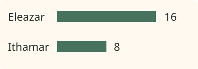

# 1 Chronicles 24 — The priests take turns serving

**About this chapter**

David arranges the work of the priests.

Each family group gets a turn to serve.

The other Levites also draw lots.

## Two branches of Aaron’s family

## 1 Chronicles 24:1

Aaron’s family served in groups.

Aaron had four sons.

Their names were Nadab, Abihu, Eleazar, and Ithamar.

## 1 Chronicles 24:2

Nadab and Abihu died before Aaron did.

Neither had any sons.

So Eleazar and Ithamar served as priests.

## 1 Chronicles 24:3

King David organized the priests into groups for their work.

Zadok, from Eleazar’s family, helped David.

Ahimelech, from Ithamar’s family, also helped.

## 1 Chronicles 24:4

Eleazar’s family had more leaders than Ithamar’s family.

Sixteen family heads came from Eleazar’s family.

Eight came from Ithamar’s family.

## 1 Chronicles 24:5

Both families had leaders who served God in his holy place.

They drew lots to decide when each group would serve.

Drawing lots meant using marked objects to make a choice.

## 1 Chronicles 24:6

Shemaiah wrote down the names.

He was a Levite and the son of Nethanel.

They drew a family from Eleazar’s line, then one from Ithamar’s.

The king and his officers watched.

So did Zadok the priest and Ahimelech, son of Abiathar.

Leaders of the priests and the other Levites watched too.

## Turns 1 to 8

## 1 Chronicles 24:7

Jehoiarib’s group had turn 1.

Jedaiah’s group had turn 2.

## 1 Chronicles 24:8

Harim’s group had turn 3.

Seorim’s group had turn 4.

## 1 Chronicles 24:9

Malchijah’s group had turn 5.

Mijamin’s group had turn 6.

## 1 Chronicles 24:10

Hakkoz’s group had turn 7.

Abijah’s group had turn 8.

## Turns 9 to 16

## 1 Chronicles 24:11

Jeshua’s group had turn 9.

Shecaniah’s group had turn 10.

## 1 Chronicles 24:12

Eliashib’s group had turn 11.

Jakim’s group had turn 12.

## 1 Chronicles 24:13

Huppah’s group had turn 13.

Jeshebeab’s group had turn 14.

## 1 Chronicles 24:14

Bilgah’s group had turn 15.

Immer’s group had turn 16.

## Turns 17 to 24

## 1 Chronicles 24:15

Hezir’s group had turn 17.

Happizzez’s group had turn 18.

## 1 Chronicles 24:16

Pethahiah’s group had turn 19.

Jehezkel’s group had turn 20.

## 1 Chronicles 24:17

Jachin’s group had turn 21.

Gamul’s group had turn 22.

## 1 Chronicles 24:18

Delaiah’s group had turn 23.

Maaziah’s group had turn 24.

## 1 Chronicles 24:19

The priests entered the LORD’s house to serve in that order.

Their ancestor Aaron had given them rules for their work.

The LORD, the God of Israel, had given Aaron those commands.

## Other families from the tribe of Levi

## 1 Chronicles 24:20

These are other families from the tribe of Levi.

Shubael came from Amram’s family.

Jehdeiah came from Shubael’s family.

## 1 Chronicles 24:21

Isshiah was the first of Rehabiah’s sons.

## 1 Chronicles 24:22

Shelomoth came from Izhar’s family.

Jahath came from Shelomoth’s family.

## 1 Chronicles 24:23

Hebron’s first son was Jeriah.

Amariah was second, Jahaziel third, and Jekameam fourth.

## 1 Chronicles 24:24

Micah came from Uzziel’s family.

Shamir came from Micah’s family.

## 1 Chronicles 24:25

Micah’s brother was Isshiah.

Zechariah came from Isshiah’s family.

## Merari’s family

## 1 Chronicles 24:26

Merari had two sons, Mahli and Mushi.

Jaaziah had a son named Beno.

## 1 Chronicles 24:27

One branch of Merari’s family came through Jaaziah.

It included Beno, Shoham, Zaccur, and Ibri.

## 1 Chronicles 24:28

Eleazar came from Mahli’s family.

Eleazar had no sons.

## 1 Chronicles 24:29

Kish had a son named Jerahmeel.

## 1 Chronicles 24:30

Mushi had three sons, Mahli, Eder, and Jerimoth.

This is how the record groups the Levites by family.

## 1 Chronicles 24:31

These Levites drew lots just as their relatives from Aaron’s family did.

The family heads and their younger brothers took part alike.

King David, Zadok, and Ahimelech watched.

The leaders of the priests and the other Levites watched too.

**Pause and answer**

How did the families decide whose turn it was to serve?
