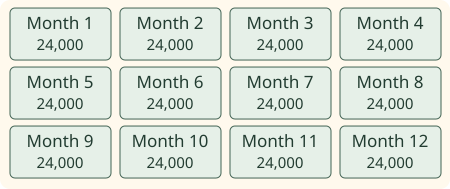

# 1 Chronicles 27 — The people who served King David

**About this chapter**

David’s army served in groups. A different group served each month. Other people led tribes, cared for David’s property, or gave him advice.

## The army takes turns

## 1 Chronicles 27:1

Israel’s family leaders and army officers served the king.

Some commanded thousands of men and some commanded hundreds.

They organized the groups that took turns serving each month.

Each group had 24,000 men.

Each box shows one month of service.

## 1 Chronicles 27:2

Month 1.

Jashobeam, son of Zabdiel, led the first group.

His group had 24,000 men.

## 1 Chronicles 27:3

Jashobeam came from the family of Perez.

He led all the army commanders for month 1.

## 1 Chronicles 27:4

Month 2.

Dodai the Ahohite was in charge.

Mikloth was a leader in his group of 24,000 men.

## 1 Chronicles 27:5

Month 3.

Benaiah led this group of 24,000 men.

His father was Jehoiada the priest.

## 1 Chronicles 27:6

Benaiah was a great warrior among the men called the Thirty.

He led the Thirty.

His son Ammizabad was in charge of Benaiah’s monthly group.

## 1 Chronicles 27:7

Month 4.

Asahel, Joab’s brother, led the group.

Then Asahel’s son Zebadiah took his place.

Their group had 24,000 men.

## 1 Chronicles 27:8

Month 5.

Shamhuth the Izrahite led the group of 24,000 men.

## 1 Chronicles 27:9

Month 6.

Ira led the group of 24,000 men.

He was the son of Ikkesh from Tekoa.

## The groups for months 7 to 12

## 1 Chronicles 27:10

Month 7.

Helez the Pelonite led the group of 24,000 men.

He belonged to the tribe of Ephraim.

## 1 Chronicles 27:11

Month 8.

Sibbecai the Hushathite led the group of 24,000 men.

He came from the family of Zerah.

## 1 Chronicles 27:12

Month 9.

Abiezer from Anathoth led the group of 24,000 men.

He belonged to the tribe of Benjamin.

## 1 Chronicles 27:13

Month 10.

Maharai from Netophah led the group of 24,000 men.

He came from the family of Zerah.

## 1 Chronicles 27:14

Month 11.

Benaiah from Pirathon led the group of 24,000 men.

He belonged to the tribe of Ephraim.

## 1 Chronicles 27:15

Month 12.

Heldai from Netophah led the group of 24,000 men.

He came from the family of Othniel.

**Pause and answer**

How many men served in each monthly group?

## Leaders of the tribes

## 1 Chronicles 27:16

These men led the tribes of Israel.

Eliezer, son of Zichri, led Reuben.

Shephatiah, son of Maacah, led Simeon.

## 1 Chronicles 27:17

Hashabiah, son of Kemuel, led Levi.

Zadok led Aaron’s family.

## 1 Chronicles 27:18

Elihu, one of David’s brothers, led Judah.

Omri, son of Michael, led Issachar.

## 1 Chronicles 27:19

Ishmaiah, son of Obadiah, led Zebulun.

Jerimoth, son of Azriel, led Naphtali.

## 1 Chronicles 27:20

Hoshea, son of Azaziah, led Ephraim.

Joel, son of Pedaiah, led half the tribe of Manasseh.

## 1 Chronicles 27:21

Iddo, son of Zechariah, led the other half of Manasseh in Gilead.

Jaasiel, son of Abner, led Benjamin.

## 1 Chronicles 27:22

Azarel, son of Jeroham, led Dan.

These were Israel’s tribal leaders.

## The unfinished count

## 1 Chronicles 27:23

David left everyone aged 20 or younger out of the count.

The LORD had promised to make Israel’s people as many as the stars in the sky.

That meant there would be very many people.

## 1 Chronicles 27:24

Joab, son of Zeruiah, began counting the men.

He never finished because this count brought God’s anger on Israel.

So the record of King David’s reign gave no total.

## People who care for the king’s property

## 1 Chronicles 27:25

Azmaveth, son of Adiel, looked after the king’s storehouses.

Jonathan, son of Uzziah, looked after storehouses across the country.

These included stores in cities, villages, and forts.

## 1 Chronicles 27:26

Ezri, son of Chelub, led the workers who prepared the soil in the fields.

## 1 Chronicles 27:27

Shimei from Ramah cared for the vineyards, where grapes grow.

Zabdi the Shiphmite looked after the grape harvest for the large wine containers.

## 1 Chronicles 27:28

Baal-hanan the Gederite cared for the olive and sycamore trees in the low hills.

Joash looked after the stored olive oil.

## 1 Chronicles 27:29

Shitrai from Sharon cared for the herds feeding there.

Shaphat, son of Adlai, cared for the herds in the valleys.

## 1 Chronicles 27:30

Obil the Ishmaelite cared for the camels.

Jehdeiah the Meronothite cared for the donkeys.

## 1 Chronicles 27:31

Jaziz the Hagrite cared for the flocks.

All these men looked after King David’s property.

## The king’s advisers and friends

## 1 Chronicles 27:32

David’s uncle Jonathan gave him advice.

Jonathan understood things well and worked as a scribe, a trained writer.

Jehiel, son of Hachmoni, looked after the king’s sons.

## 1 Chronicles 27:33

Ahithophel gave the king advice.

Hushai the Archite was the king’s friend.

## 1 Chronicles 27:34

Jehoiada, son of Benaiah, took Ahithophel’s place.

Then Abiathar took that job.

Joab commanded the king’s army.

**Pause and answer**

Who looked after the stored olive oil?
