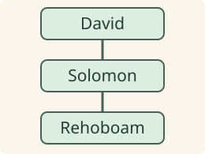

# 1 Chronicles 29 — The people give freely and Solomon becomes king

**About this chapter**

David asks the people to help Solomon build a temple for the LORD. The leaders bring gifts. David thanks God, and the people welcome Solomon as king.

## David gives from his own treasure

## 1 Chronicles 29:1

King David spoke to everyone gathered there.

“God chose my son Solomon.

He is young and still has much to learn.

This is a great task.

The house he will build is for the LORD God himself.

## 1 Chronicles 29:2

I have done all I can to supply the house of my God.

I have gathered gold, silver, bronze, iron, and wood for the things we must make.

I have onyx stones to set in place.

I have turquoise, stones of many colors, and other valuable stones.

I also have many large slabs of marble.

## 1 Chronicles 29:3

I love the house of my God.

So I am adding gold and silver from my own treasure.

This is an extra gift for the holy temple.

## 1 Chronicles 29:4

I give 3,000 talents of gold from Ophir.

I also give 7,000 talents of pure silver.

A talent is a large unit of weight.

The workers can cover the walls with these metals.

## 1 Chronicles 29:5

Skilled workers can use them for all the gold and silver work.

Who else will freely give themselves to the LORD today?”

## The leaders give freely

## 1 Chronicles 29:6

The family leaders and tribal officers gave freely.

So did the commanders of thousands and hundreds.

The officials who managed the king’s work also gave.

## 1 Chronicles 29:7

For God’s house they gave 5,000 talents of gold.

They also gave 10,000 gold coins called darics.

They gave 10,000 talents of silver and 18,000 talents of bronze.

They gave 100,000 talents of iron.

## 1 Chronicles 29:8

Those who owned precious stones gave them too.

Jehiel, from Gershon’s family, cared for them in the temple treasury.

The treasury was the place for keeping valuable gifts safe.

## 1 Chronicles 29:9

The people saw their leaders give to the LORD.

The leaders gave freely and with all their hearts.

This made the people glad.

King David was very glad too.

## David thanks God

## 1 Chronicles 29:10

David praised the LORD in front of everyone.

He prayed, “LORD, you are the God of our ancestor Israel.

May people praise you forever and ever.

## 1 Chronicles 29:11

LORD, greatness, power, beauty, and royal honor are yours.

Everything in heaven and on earth belongs to you.

The kingdom is yours.

You rule over all.

## 1 Chronicles 29:12

Wealth and honor come from you.

You rule everyone.

You have the power to give anyone strength or honor.

## 1 Chronicles 29:13

So we thank you, our God.

We praise your glorious name.

## 1 Chronicles 29:14

Who am I, and who are my people, to give so much? Everything comes from you.

All we have given you came from your own hand.

## 1 Chronicles 29:15

We are guests and strangers before you.

So were our ancestors.

Our days on earth pass like a shadow.

We cannot hope to stay here forever.

## 1 Chronicles 29:16

LORD our God, we have gathered so much to build this house to honor your holy name.

You gave us all of it.

It all belongs to you.

**Pause and answer**

Who did David say had given the people everything they brought?

## David prays for the people and Solomon

## 1 Chronicles 29:17

My God, you see why people do things.

You are pleased when people act honestly.

I gave these things freely and honestly.

Now I have seen your people gladly choose to give to you.

## 1 Chronicles 29:18

LORD, you are the God of our ancestors Abraham, Isaac, and Israel.

Help your people always want to give like this.

Keep their hearts turned toward you.

## 1 Chronicles 29:19

Help my son Solomon serve you with his whole heart.

Help him carry out all your commands and laws.

Help him build the house I have prepared for.”

## 1 Chronicles 29:20

Then David said to everyone, “Praise the LORD your God.” They all praised the LORD, the God of their ancestors.

They bowed low to honor the LORD and the king.

## The people welcome their king

## 1 Chronicles 29:21

The next day they gave burnt offerings to the LORD.

They offered 1,000 bulls, 1,000 rams, and 1,000 lambs.

They also brought drink offerings and many other sacrifices for all Israel.

## 1 Chronicles 29:22

That day the people ate and drank joyfully before the LORD.

For the second time they named David’s son Solomon king.

They anointed Solomon as ruler and Zadok as priest before the LORD.

To anoint someone meant pouring oil on them to mark them out for this work.

## 1 Chronicles 29:23

Solomon took his father David’s place on the LORD’s throne.

He did well as king, and all Israel obeyed him.

## 1 Chronicles 29:24

The officials and the great warriors promised to be loyal to Solomon.

All King David’s sons made that promise too.

## 1 Chronicles 29:25

The LORD gave Solomon great honor in front of all Israel.

No earlier king of Israel had received such royal honor.

## The years David ruled

## 1 Chronicles 29:26

David, the son of Jesse, ruled over all Israel.

## 1 Chronicles 29:27

David ruled for 40 years in all.

He ruled in Hebron for 7 years.

Then he ruled in Jerusalem for 33 years.

## 1 Chronicles 29:28

David lived a long life.

When he died, he had great wealth and honor.

His son Solomon ruled in his place.

Start with David at the top. The next name shows his son who became king.

## 1 Chronicles 29:29

Three records tell what David did from beginning to end.

They are the records of Samuel the seer, Nathan the prophet, and Gad the seer.

Seers and prophets received messages from God.

## 1 Chronicles 29:30

These records tell how David ruled and how powerful he was.

They tell what happened to David, to Israel, and to the kingdoms around them.

**Pause and answer**

Who became king after David?
