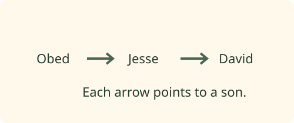

# 1 Chronicles 2 — Judah’s family and the line to David

**About this chapter**

This record begins with Israel’s sons. It follows the families that came from one son, Judah. In one branch of this family, a man named Jesse had a son named David.

## Israel’s sons

## 1 Chronicles 2:1

Israel was another name for Jacob.

His sons included Reuben, Simeon, Levi, Judah, Issachar, and Zebulun.

## 1 Chronicles 2:2

His other sons were Dan, Joseph, Benjamin, Naphtali, Gad, and Asher.

## Judah and his grandchildren

## 1 Chronicles 2:3

Judah and Bath-shua, a Canaanite woman, had three sons.

They were Er, Onan, and Shelah.

Er was the oldest.

The LORD saw that Er was wicked.

So the LORD put him to death.

## 1 Chronicles 2:4

Judah and his daughter-in-law Tamar had Perez and Zerah.

Judah had five sons in all.

## 1 Chronicles 2:5

Perez had two sons, Hezron and Hamul.

## 1 Chronicles 2:6

Zerah had five sons.

They were Zimri, Ethan, Heman, Calcol, and Dara.

## 1 Chronicles 2:7

Carmi’s son Achar brought trouble on Israel.

He took things set apart for God that no one was allowed to take.

## 1 Chronicles 2:8

Ethan’s son was Azariah.

## The family line to David

## 1 Chronicles 2:9

Hezron had three sons.

They were Jerahmeel, Ram, and Caleb.

## 1 Chronicles 2:10

Ram was Amminadab’s father.

Amminadab’s son Nahshon led people from Judah’s family.

## 1 Chronicles 2:11

Nahshon was Salmon’s father.

Salmon was Boaz’s father.

## 1 Chronicles 2:12

Boaz was Obed’s father.

Obed was Jesse’s father.

## 1 Chronicles 2:13

Jesse’s first son was Eliab.

Abinadab came second and Shimea third.

## 1 Chronicles 2:14

Nethanel came fourth and Raddai fifth.

## 1 Chronicles 2:15

Ozem came sixth and David seventh.

Follow the family line from Obed to his grandson David.

**Pause and answer**

Who was David’s father?

## 1 Chronicles 2:16

Their sisters were Zeruiah and Abigail.

Zeruiah’s three sons were Abishai, Joab, and Asahel.

## 1 Chronicles 2:17

Abigail and Jether the Ishmaelite were Amasa’s parents.

## Caleb and his father Hezron

## 1 Chronicles 2:18

Caleb, son of Hezron, had children with his wife Azubah.

He also had children with Jerioth.

Azubah’s sons were Jesher, Shobab, and Ardon.

## 1 Chronicles 2:19

After Azubah died, Caleb married Ephrath.

Their son was Hur.

## 1 Chronicles 2:20

Hur was Uri’s father.

Uri was Bezalel’s father.

## 1 Chronicles 2:21

Hezron was 60 when he married a daughter of Machir.

Machir was Gilead’s father.

Hezron and his wife had a son named Segub.

## 1 Chronicles 2:22

Segub’s son Jair owned 23 towns in the land of Gilead.

## 1 Chronicles 2:23

Geshur and Aram captured Havvoth-jair.

They also took Kenath and the 60 villages around it.

These families came from Machir, Gilead’s father.

## 1 Chronicles 2:24

Hezron died in Caleb-ephrathah.

Later his wife Abijah gave birth to their son Ashhur.

Ashhur was the father of Tekoa.

## Jerahmeel’s family

## 1 Chronicles 2:25

Jerahmeel was Hezron’s oldest son.

Jerahmeel’s first son was Ram.

His other sons were Bunah, Oren, Ozem, and Ahijah.

## 1 Chronicles 2:26

Jerahmeel had another wife named Atarah.

Their son was Onam.

## 1 Chronicles 2:27

Ram, Jerahmeel’s oldest son, had three sons.

They were Maaz, Jamin, and Eker.

## 1 Chronicles 2:28

Onam’s sons were Shammai and Jada.

Shammai’s sons were Nadab and Abishur.

## 1 Chronicles 2:29

Abishur and his wife Abihail had two sons.

Their names were Ahban and Molid.

## 1 Chronicles 2:30

Nadab’s sons were Seled and Appaim.

Seled died without children.

## 1 Chronicles 2:31

Appaim’s son was Ishi.

Ishi’s son was Sheshan.

The family record lists Ahlai as Sheshan’s son.

## 1 Chronicles 2:32

Shammai’s brother Jada had two sons, Jether and Jonathan.

Jether died without children.

## 1 Chronicles 2:33

Jonathan’s sons were Peleth and Zaza.

All these people came from Jerahmeel’s family.

## Sheshan’s daughter and her family

## 1 Chronicles 2:34

The record also says that Sheshan had only daughters.

Sheshan had an Egyptian servant named Jarha.

## 1 Chronicles 2:35

Sheshan gave his daughter to Jarha in marriage.

She and Jarha had a son named Attai.

## 1 Chronicles 2:36

Attai was Nathan’s father.

Nathan was Zabad’s father.

## 1 Chronicles 2:37

Zabad was Ephlal’s father.

Ephlal was Obed’s father.

## 1 Chronicles 2:38

Obed was Jehu’s father.

Jehu was Azariah’s father.

## 1 Chronicles 2:39

Azariah was Helez’s father.

Helez was Elasah’s father.

## 1 Chronicles 2:40

Elasah was Sismai’s father.

Sismai was Shallum’s father.

## 1 Chronicles 2:41

Shallum was Jekamiah’s father.

Jekamiah was Elishama’s father.

## More names from Caleb’s family

## 1 Chronicles 2:42

Caleb was Jerahmeel’s brother.

Caleb’s first son was Mesha, the father of Ziph.

His second son was Mareshah, the father of Hebron.

## 1 Chronicles 2:43

Hebron’s sons were Korah, Tappuah, Rekem, and Shema.

## 1 Chronicles 2:44

Shema was Raham’s father.

Raham was Jorkeam’s father.

Rekem was Shammai’s father.

## 1 Chronicles 2:45

Shammai was Maon’s father.

Maon was the father of Beth-zur.

## 1 Chronicles 2:46

Ephah was Caleb’s concubine, a partner with fewer rights than a wife.

Her children were Haran, Moza, and Gazez.

Haran also had a son named Gazez.

## 1 Chronicles 2:47

Jahdai’s sons were Regem, Jotham, Geshan, Pelet, Ephah, and Shaaph.

## 1 Chronicles 2:48

Maacah was also Caleb’s concubine.

Her children included Sheber and Tirhanah.

## 1 Chronicles 2:49

Maacah was also the mother of Shaaph and Sheva.

Shaaph was the father of Madmannah.

Sheva was the father of Machbenah and Gibea.

Caleb had a daughter named Acsah.

## Families and the towns where they lived

## 1 Chronicles 2:50

These people came from Caleb’s family.

Hur was Ephrathah’s first son.

Hur’s sons included Shobal, the father of Kiriath-jearim.

## 1 Chronicles 2:51

Hur’s other sons were Salma and Hareph.

Salma was the father of Bethlehem.

Hareph was the father of Beth-gader.

## 1 Chronicles 2:52

Shobal was the father of Kiriath-jearim.

Haroeh and half the Manahathites came from Shobal’s family.

## 1 Chronicles 2:53

So did these families of Kiriath-jearim.

They were the Ithrites, Puthites, Shumathites, and Mishraites.

The Zorathites and Eshtaolites came from these families.

## 1 Chronicles 2:54

Salma’s family included Bethlehem, the Netophathites, and Atroth-beth-joab.

It also included half the Manahathites and the Zorites.

## 1 Chronicles 2:55

Families of scribes at Jabez also belonged to this family.

Scribes were trained writers.

These families were the Tirathites, Shimeathites, and Sucathites.

They were Kenites from the family of Hammath.

Rechab’s family came from Hammath.

**Pause and answer**

What work did the scribes at Jabez do?
