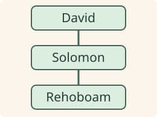

# 1 Chronicles 3 — David’s family

**About this chapter**

This family record begins with King David’s children. Then it follows the family of his son Solomon through many generations.

## David’s sons born in Hebron

## 1 Chronicles 3:1

David had sons in Hebron.

His first son was Amnon.

Amnon’s mother was Ahinoam from Jezreel.

David’s second son was Daniel.

Daniel’s mother was Abigail from Carmel.

## 1 Chronicles 3:2

David’s third son was Absalom.

His mother was Maacah, daughter of King Talmai of Geshur.

David’s fourth son was Adonijah.

Adonijah’s mother was Haggith.

## 1 Chronicles 3:3

David’s fifth son was Shephatiah.

His mother was Abital.

David’s sixth son was Ithream.

His mother was David’s wife Eglah.

## 1 Chronicles 3:4

These six sons were born in Hebron.

David ruled there for seven years and six months.

He also ruled in Jerusalem for thirty-three years.

## David’s children in Jerusalem

## 1 Chronicles 3:5

In Jerusalem, David and Bathsheba had four sons.

Their names were Shimea, Shobab, Nathan, and Solomon.

Bathsheba was the daughter of Ammiel.

## 1 Chronicles 3:6

David had other sons in Jerusalem too.

The list starts with Ibhar, Elishua, and Eliphelet.

## 1 Chronicles 3:7

Next come Nogah, Nepheg, and Japhia.

## 1 Chronicles 3:8

Last come Elishama, Eliada, and Eliphelet.

That makes nine names in this list.

## 1 Chronicles 3:9

David also had sons with women called concubines.

These women were his partners but had fewer rights than wives.

Their sons are outside this list.

Tamar was the sister of David’s sons.

## From Solomon to Josiah

## 1 Chronicles 3:10

Solomon was the father of Rehoboam.

Rehoboam was the father of Abijah.

Abijah was the father of Asa.

Asa was the father of Jehoshaphat.

## 1 Chronicles 3:11

Jehoshaphat was the father of Joram.

Joram was the father of Ahaziah.

Ahaziah was the father of Joash.

## 1 Chronicles 3:12

Joash was the father of Amaziah.

Amaziah was the father of Azariah.

Azariah was the father of Jotham.

## 1 Chronicles 3:13

Jotham was the father of Ahaz.

Ahaz was the father of Hezekiah.

Hezekiah was the father of Manasseh.

## 1 Chronicles 3:14

Manasseh was the father of Amon.

Amon was the father of Josiah.

## Josiah’s family

## 1 Chronicles 3:15

Josiah’s oldest son was Johanan.

His second son was Jehoiakim.

His third son was Zedekiah.

His fourth son was Shallum.

## 1 Chronicles 3:16

Jehoiakim’s son Jeconiah came after him.

Zedekiah also followed Jehoiakim.

## 1 Chronicles 3:17

Enemies took Jeconiah prisoner.

His family line continued.

Shealtiel was his son.

## 1 Chronicles 3:18

Jeconiah’s family also included Malchiram, Pedaiah, and Shenazzar.

The other names are Jekamiah, Hoshama, and Nedabiah.

## The family of Pedaiah

## 1 Chronicles 3:19

Pedaiah had two sons, Zerubbabel and Shimei.

Zerubbabel’s children included Meshullam and Hananiah.

Their sister was Shelomith.

## 1 Chronicles 3:20

Zerubbabel had five more children.

Their names were Hashubah, Ohel, Berechiah, Hasadiah, and Jushab-hesed.

## 1 Chronicles 3:21

Hananiah’s family line included Pelatiah and Jeshaiah.

It also included the sons of Rephaiah, Arnan, Obadiah, and Shecaniah.

## 1 Chronicles 3:22

Shecaniah’s family list has six names.

One is Shemaiah.

The other five are Shemaiah’s sons.

Their names are Hattush, Igal, Bariah, Neariah, and Shaphat.

## 1 Chronicles 3:23

Neariah had three sons.

Their names were Elioenai, Hizkiah, and Azrikam.

## 1 Chronicles 3:24

Elioenai had seven sons.

Their names were Hodaviah, Eliashib, Pelaiah, Akkub, Johanan, Delaiah, and Anani.

**Pause and answer**

Who was the father of Rehoboam?
