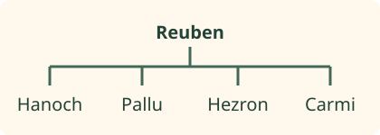

# 1 Chronicles 5 — The families east of the Jordan River

**About this chapter**

Three groups from Israel lived east of the Jordan River. They came from Reuben, Gad, and part of Manasseh’s tribe. This chapter names their families and tells how they came to lose their land.

## Reuben and his sons

## 1 Chronicles 5:1

Reuben was Israel’s oldest son.

As firstborn, he had special rights in the family.

But he slept with his father’s partner.

Reuben lost those rights, and the sons of his brother Joseph received them.

The family record does not give Reuben those rights.

## 1 Chronicles 5:2

Judah became the strongest among his brothers.

A ruler came from his family.

But the rights of the firstborn belonged to Joseph.

## 1 Chronicles 5:3

Reuben, Israel’s firstborn, had four sons.

They were Hanoch, Pallu, Hezron, and Carmi.

## 1 Chronicles 5:4

Here is one family line from Joel.

Joel was the father of Shemaiah.

Shemaiah was the father of Gog, and Gog was the father of Shimei.

## 1 Chronicles 5:5

Shimei was the father of Micah.

Micah was the father of Reaiah, and Reaiah was the father of Baal.

## 1 Chronicles 5:6

Baal’s son Beerah led people from Reuben’s tribe.

King Tiglath-pileser of Assyria took Beerah away from his homeland.

## Where Reuben’s families lived

## 1 Chronicles 5:7

The family records also name Beerah’s relatives.

They include Jeiel, their chief, and Zechariah.

## 1 Chronicles 5:8

Another relative was Bela.

His father was Azaz, his grandfather was Shema, and his great-grandfather was Joel.

These families lived in Aroer and as far as Nebo and Baal-meon.

## 1 Chronicles 5:9

Their herds grew large in Gilead.

So the families spread east as far as the edge of the desert that stretches to the Euphrates River.

## 1 Chronicles 5:10

When Saul was king, Reuben’s tribe fought and defeated the Hagrites.

They moved into the Hagrites’ homes across the land east of Gilead.

## Gad’s families live nearby

## 1 Chronicles 5:11

Gad’s descendants lived beside Reuben’s people in Bashan.

Their homes reached as far as Salecah.

## 1 Chronicles 5:12

Joel was their chief.

Shapham was second in charge.

Jaanai and Shaphat also lived in Bashan.

## 1 Chronicles 5:13

Their family records name seven relatives.

They were Michael, Meshullam, Sheba, Jorai, Jacan, Zia, and Eber.

## 1 Chronicles 5:14

These seven were sons of Abihail.

To follow this family from its earliest name, start with Buz.

Buz was the father of Jahdo, and Jahdo was the father of Jeshishai.

Jeshishai was the father of Michael, and Michael was the father of Gilead.

Gilead was the father of Jaroah.

Jaroah was the father of Huri, and Huri was the father of Abihail.

## 1 Chronicles 5:15

Ahi led their family.

His father was Abdiel, and his grandfather was Guni.

## 1 Chronicles 5:16

Gad’s people lived in Gilead and in Bashan and its towns.

They also lived throughout the grasslands of Sharon.

## 1 Chronicles 5:17

The family lists included all these people.

The records date from the reigns of Jotham, king of Judah, and Jeroboam, king of Israel.

**Pause and answer**

Which tribe lived beside Reuben’s people in Bashan?

## Three groups call to God for help

## 1 Chronicles 5:18

Reuben, Gad, and half the tribe of Manasseh had 44,760 trained soldiers.

These brave men carried shields and swords and used bows.

## 1 Chronicles 5:19

They fought the Hagrites and the peoples called Jetur, Naphish, and Nodab.

## 1 Chronicles 5:20

In battle they called to God for help.

They trusted him, and he answered their prayer.

With God’s help they defeated the Hagrites and all who fought beside them.

## 1 Chronicles 5:21

They took 50,000 camels, 250,000 sheep, and 2,000 donkeys from the Hagrites.

They also took 100,000 people prisoner.

## 1 Chronicles 5:22

Many others died in the fight, because the battle belonged to God.

The tribes lived on that land until enemies forced them to leave.

## Manasseh’s families and the exile

## 1 Chronicles 5:23

Many people belonged to the half of Manasseh’s tribe that lived here.

Their land stretched from Bashan to Baal-hermon, also called Senir or Mount Hermon.

## 1 Chronicles 5:24

Their family leaders were Epher, Ishi, Eliel, Azriel, Jeremiah, Hodaviah, and Jahdiel.

People knew them as brave warriors and leaders.

## 1 Chronicles 5:25

Yet the tribes broke faith with the God their ancestors worshiped.

They gave their love and worship to other gods.

These were the gods of people God had destroyed before them.

## 1 Chronicles 5:26

So Israel’s God moved the king of Assyria to act.

The king’s name was Pul, also called Tiglath-pileser.

He forced Reuben, Gad, and half the tribe of Manasseh into exile.

Exile meant living far from their own land.

He took them to Halah, Habor, Hara, and the river of Gozan.

They still lived there when this account was written.

**Pause and answer**

Where did the people have to live when the king took them into exile?
