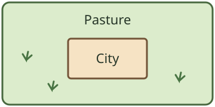

# 1 Chronicles 6 — Levi’s family, their work, and their towns

**About this chapter**

The people of Levi’s family were called Levites. Some were priests. Some led the singing. Israel’s other tribes gave them towns to live in and grassland for their animals.

## From Levi to Aaron

## 1 Chronicles 6:1

Levi had three sons.

Their names were Gershon, Kohath, and Merari.

## 1 Chronicles 6:2

Kohath’s sons were Amram, Izhar, Hebron, and Uzziel.

## 1 Chronicles 6:3

Amram’s children were Aaron, Moses, and Miriam.

Aaron’s sons were Nadab, Abihu, Eleazar, and Ithamar.

## The family line of the priests

## 1 Chronicles 6:4

Eleazar was Phinehas’s father.

Phinehas was Abishua’s father.

## 1 Chronicles 6:5

Abishua was Bukki’s father.

Bukki was Uzzi’s father.

## 1 Chronicles 6:6

Uzzi was Zerahiah’s father.

Zerahiah was Meraioth’s father.

## 1 Chronicles 6:7

Meraioth was Amariah’s father.

Amariah was Ahitub’s father.

## 1 Chronicles 6:8

Ahitub was Zadok’s father.

Zadok was Ahimaaz’s father.

## 1 Chronicles 6:9

Ahimaaz was Azariah’s father.

Azariah was Johanan’s father.

## A priest in Solomon’s temple

## 1 Chronicles 6:10

Johanan’s son was also named Azariah.

This Azariah served as a priest in the temple Solomon built in Jerusalem.

## 1 Chronicles 6:11

Azariah was Amariah’s father.

Amariah was Ahitub’s father.

## 1 Chronicles 6:12

Ahitub was Zadok’s father.

Zadok was Shallum’s father.

## 1 Chronicles 6:13

Shallum was Hilkiah’s father.

Hilkiah was Azariah’s father.

## 1 Chronicles 6:14

Azariah was Seraiah’s father.

Seraiah was Jehozadak’s father.

## 1 Chronicles 6:15

The LORD used King Nebuchadnezzar to take the people of Judah and Jerusalem away from home.

Jehozadak went with them as a prisoner.

## The three branches of Levi’s family

## 1 Chronicles 6:16

Levi’s three sons were Gershom, Kohath, and Merari.

Earlier in this record Gershom’s name is spelled Gershon.

## 1 Chronicles 6:17

Gershom’s sons were Libni and Shimei.

## 1 Chronicles 6:18

Kohath’s sons were Amram, Izhar, Hebron, and Uzziel.

## 1 Chronicles 6:19

Merari’s sons were Mahli and Mushi.

The record groups the Levite families by their fathers.

## 1 Chronicles 6:20

Gershom was Libni’s father.

Libni was Jahath’s father.

Jahath was Zimmah’s father.

## 1 Chronicles 6:21

Zimmah was Joah’s father.

Joah was Iddo’s father.

Iddo was Zerah’s father.

Zerah was Jeatherai’s father.

## Kohath’s family

## 1 Chronicles 6:22

Kohath was Amminadab’s father.

Amminadab was Korah’s father.

Korah was Assir’s father.

## 1 Chronicles 6:23

Assir was Elkanah’s father.

Elkanah was Ebiasaph’s father.

Ebiasaph had a son also named Assir.

## 1 Chronicles 6:24

This Assir was Tahath’s father.

Tahath was Uriel’s father.

Uriel was Uzziah’s father.

Uzziah was Shaul’s father.

## 1 Chronicles 6:25

Elkanah’s family included Amasai and Ahimoth.

## 1 Chronicles 6:26

Next in this family line came Elkanah.

Elkanah was Zophai’s father.

Zophai was Nahath’s father.

## 1 Chronicles 6:27

Nahath was Eliab’s father.

Eliab was Jeroham’s father.

Jeroham was Elkanah’s father.

## 1 Chronicles 6:28

Samuel’s first son was Joel.

His second son was Abijah.

## Merari’s family

## 1 Chronicles 6:29

Merari’s family included Mahli.

Mahli was Libni’s father.

Libni was Shimei’s father.

Shimei was Uzzah’s father.

## 1 Chronicles 6:30

Uzzah was Shimea’s father.

Shimea was Haggiah’s father.

Haggiah was Asaiah’s father.

## David chooses musicians

## 1 Chronicles 6:31

The ark was the sacred chest of Israel.

After the ark came to rest, David chose men to lead the music in the LORD’s house.

## 1 Chronicles 6:32

The men sang in front of the sacred tent, the Tent of Meeting.

They served there until Solomon built the LORD’s temple in Jerusalem.

They followed the instructions for their work.

## 1 Chronicles 6:33

The musicians served with their sons.

Heman the singer came from Kohath’s family.

Heman’s father was Joel.

Joel’s father was Samuel.

## Heman’s family line

## 1 Chronicles 6:34

Samuel’s father was Elkanah.

Elkanah’s father was Jeroham.

Jeroham’s father was Eliel.

Eliel’s father was Toah.

## 1 Chronicles 6:35

Toah’s father was Zuph.

Zuph’s father was Elkanah.

Elkanah’s father was Mahath.

Mahath’s father was Amasai.

## 1 Chronicles 6:36

Amasai’s father was Elkanah.

Elkanah’s father was Joel.

Joel’s father was Azariah.

Azariah’s father was Zephaniah.

## 1 Chronicles 6:37

Zephaniah’s father was Tahath.

Tahath’s father was Assir.

Assir’s father was Ebiasaph.

Ebiasaph’s father was Korah.

## 1 Chronicles 6:38

Korah’s father was Izhar.

Izhar’s father was Kohath.

Kohath’s father was Levi.

Levi’s father was Israel.

## Asaph serves on the right

## 1 Chronicles 6:39

Heman’s relative Asaph served on Heman’s right.

Asaph’s father was Berechiah.

Berechiah’s father was Shimea.

## 1 Chronicles 6:40

Shimea’s father was Michael.

Michael’s father was Baaseiah.

Baaseiah’s father was Malchijah.

## 1 Chronicles 6:41

Malchijah’s father was Ethni.

Ethni’s father was Zerah.

Zerah’s father was Adaiah.

## 1 Chronicles 6:42

Adaiah’s father was Ethan.

Ethan’s father was Zimmah.

Zimmah’s father was Shimei.

## 1 Chronicles 6:43

Shimei’s father was Jahath.

Jahath’s father was Gershom.

Gershom’s father was Levi.

## Ethan serves on the left

## 1 Chronicles 6:44

Relatives from Merari’s family served on Heman’s left.

One was Ethan.

Ethan’s father was Kishi.

Kishi’s father was Abdi.

Abdi’s father was Malluch.

## 1 Chronicles 6:45

Malluch’s father was Hashabiah.

Hashabiah’s father was Amaziah.

Amaziah’s father was Hilkiah.

## 1 Chronicles 6:46

Hilkiah’s father was Amzi.

Amzi’s father was Bani.

Bani’s father was Shemer.

## 1 Chronicles 6:47

Shemer’s father was Mahli.

Mahli’s father was Mushi.

Mushi’s father was Merari.

Merari’s father was Levi.

**Pause and answer**

Who served on Heman’s right?

## The work of the priests

## 1 Chronicles 6:48

The other Levites did all kinds of work at the sacred tent, the house of God.

## 1 Chronicles 6:49

Aaron and his sons did all the work of the Most Holy Place.

They burned offerings on one altar.

On another they burned incense, which gives off sweet-smelling smoke.

They did this to make atonement for Israel.

This meant dealing with the people’s sins so they could be right with God.

They followed the commands of Moses, God’s servant.

## 1 Chronicles 6:50

Here is Aaron’s family line again.

Aaron was Eleazar’s father.

Eleazar was Phinehas’s father.

Phinehas was Abishua’s father.

## 1 Chronicles 6:51

Abishua was Bukki’s father.

Bukki was Uzzi’s father.

Uzzi was Zerahiah’s father.

## 1 Chronicles 6:52

Zerahiah was Meraioth’s father.

Meraioth was Amariah’s father.

Amariah was Ahitub’s father.

## 1 Chronicles 6:53

Ahitub was Zadok’s father.

Zadok was Ahimaaz’s father.

## Towns for Aaron’s family

## 1 Chronicles 6:54

The Israelites drew lots to decide where families would live.

They used marked pieces to make the choice.

The first lot went to Aaron’s family, part of Kohath’s family.

## 1 Chronicles 6:55

They received Hebron in Judah and the grassland around it.

Their animals could feed on the grass.

The families lived in the town. Their animals grazed outside it.

## 1 Chronicles 6:56

Caleb, the son of Jephunneh, received the farm fields and villages around Hebron.

## 1 Chronicles 6:57

Aaron’s family received Hebron, a city of refuge.

A person who killed someone by accident could go there for protection.

The family also received Libnah, Jattir, and Eshtemoa.

## 1 Chronicles 6:58

They received Hilen and Debir.

## 1 Chronicles 6:59

They also received Ashan, Juttah, and Beth-shemesh.

The towns came with grassland.

## 1 Chronicles 6:60

Benjamin’s tribe gave them Gibeon, Geba, Alemeth, and Anathoth with their grassland.

In all, Aaron’s families had 13 towns.

## How the tribes share their towns

## 1 Chronicles 6:61

The other families of Kohath received 10 towns by lot from half the tribe of Manasseh.

## 1 Chronicles 6:62

Gershom’s families received 13 towns by lot.

These came from Issachar, Asher, Naphtali, and the people of Manasseh in Bashan.

## 1 Chronicles 6:63

Merari’s families received 12 towns by lot.

These came from Reuben, Gad, and Zebulun.

## 1 Chronicles 6:64

This is how the Israelites gave the Levites towns and grassland.

## 1 Chronicles 6:65

They used lots to assign the towns named above from Judah, Simeon, and Benjamin.

## Towns for the other families of Kohath

## 1 Chronicles 6:66

Some families of Kohath received towns in Ephraim’s land.

## 1 Chronicles 6:67

They received Shechem and its grassland in the hills of Ephraim.

Shechem was a city of refuge.

They also received Gezer.

## 1 Chronicles 6:68

Other towns were Jokmeam and Beth-horon.

## 1 Chronicles 6:69

They also received Aijalon and Gath-rimmon.

The towns came with grassland.

## 1 Chronicles 6:70

Half the tribe of Manasseh gave Aner and Bileam to the remaining families of Kohath.

These towns also came with grassland.

## Towns for Gershom’s families

## 1 Chronicles 6:71

Gershom’s families received Golan in Bashan and Ashtaroth with their grassland.

These towns came from half the tribe of Manasseh.

## 1 Chronicles 6:72

Issachar’s tribe gave them Kedesh and Daberath.

## 1 Chronicles 6:73

It also gave them Ramoth and Anem.

These towns came with grassland.

## 1 Chronicles 6:74

Asher’s tribe gave them Mashal and Abdon.

## 1 Chronicles 6:75

It also gave them Hukok and Rehob.

These towns came with grassland.

## 1 Chronicles 6:76

Naphtali’s tribe gave them Kedesh in Galilee, Hammon, and Kiriathaim.

These towns came with grassland.

## Towns for Merari’s families

## 1 Chronicles 6:77

The remaining Levites were Merari’s families.

Zebulun’s tribe gave them Rimmono and Tabor with their grassland.

## 1 Chronicles 6:78

Reuben’s tribe gave them towns east of the Jordan River, across from Jericho.

These included Bezer in the wilderness and Jahzah.

## 1 Chronicles 6:79

Reuben also gave them Kedemoth and Mephaath.

These towns came with grassland.

## 1 Chronicles 6:80

Gad’s tribe gave them Ramoth in Gilead and Mahanaim.

## 1 Chronicles 6:81

It also gave them Heshbon and Jazer.

These towns came with grassland.

**Pause and answer**

What did the tribes give the Levites along with their towns?
