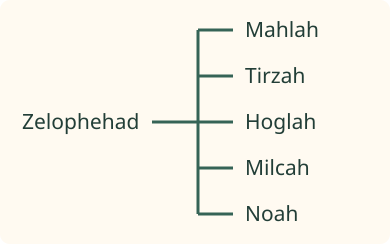

# 1 Chronicles 7 — Family records from six tribes of Israel

**About this chapter**

Israel’s families kept records of parents and children. Some records also counted those who could serve in the army. One family remembered how relatives came to comfort a father whose sons had died.

## Issachar’s family

## 1 Chronicles 7:1

Issachar had four sons.

Their names were Tola, Puah, Jashub, and Shimron.

## 1 Chronicles 7:2

Tola’s sons were Uzzi, Rephaiah, Jeriel, Jahmai, Ibsam, and Shemuel.

They led their families.

In David’s time the family records listed 22,600 brave warriors from Tola’s family.

## 1 Chronicles 7:3

Uzzi’s son was Izrahiah.

Izrahiah’s sons were Michael, Obadiah, Joel, and Isshiah.

Izrahiah and his four sons were all leaders.

## 1 Chronicles 7:4

Their families had many wives and children.

The records listed another 36,000 men ready to fight.

## 1 Chronicles 7:5

The records counted the brave warriors from all the families of Issachar.

There were 87,000 in all.

## Benjamin’s family

## 1 Chronicles 7:6

Benjamin had three sons named Bela, Becher, and Jediael.

## 1 Chronicles 7:7

Bela had five sons.

They were Ezbon, Uzzi, Uzziel, Jerimoth, and Iri.

Each led a family.

Their family records listed 22,034 brave warriors.

## 1 Chronicles 7:8

Becher’s sons included Zemirah, Joash, Eliezer, Elioenai, and Omri.

Jeremoth, Abijah, Anathoth, and Alemeth were also his sons.

## 1 Chronicles 7:9

The records grouped these families under their leaders.

They listed 20,200 brave warriors.

## 1 Chronicles 7:10

Jediael’s son was Bilhan.

Bilhan’s sons included Jeush, Benjamin, Ehud, and Chenaanah.

Zethan, Tarshish, and Ahishahar were also his sons.

## 1 Chronicles 7:11

These men from Jediael’s family were brave warriors and family leaders.

Their families had 17,200 men ready to fight.

## 1 Chronicles 7:12

The Shuppites and Huppites came from Ir’s family.

The Hushites came from Aher’s family.

## Naphtali’s family

## 1 Chronicles 7:13

Naphtali’s sons were Jahziel, Guni, Jezer, and Shallum.

They all belonged to Bilhah’s family.

## Manasseh’s family

## 1 Chronicles 7:14

Manasseh had a concubine from Aram.

A concubine was a partner with fewer rights than a wife.

Asriel came from her family.

She also had a son named Machir.

Machir was Gilead’s father.

## 1 Chronicles 7:15

Machir married a woman from among the Huppites and Shuppites.

Machir had a sister named Maacah.

Another member of the family was Zelophehad.

All his children were daughters.

Start at Zelophehad’s name. Each line leads to one of his daughters.

## 1 Chronicles 7:16

Machir’s wife Maacah had a son.

She named him Peresh.

Peresh had a brother named Sheresh.

Sheresh’s sons were Ulam and Rekem.

## 1 Chronicles 7:17

Ulam’s son was Bedan.

These men belonged to Gilead’s family.

Gilead’s father was Machir, and Machir’s father was Manasseh.

## 1 Chronicles 7:18

Gilead’s sister Hammolecheth had three children.

Their names were Ishhod, Abiezer, and Mahlah.

## 1 Chronicles 7:19

Shemida’s sons were Ahian, Shechem, Likhi, and Aniam.

## Ephraim’s family grieves

## 1 Chronicles 7:20

Here is one line of Ephraim’s family.

Ephraim’s son Shuthelah was Bered’s father.

Bered was Tahath’s father.

Tahath was Eleadah’s father.

Eleadah had a son also named Tahath.

## 1 Chronicles 7:21

This Tahath was Zabad’s father.

Zabad had a son named Shuthelah.

Ezer and Elead went down to take livestock from the people of Gath.

The people of Gath killed them.

## 1 Chronicles 7:22

Their father Ephraim grieved for many days.

His relatives came to comfort him.

## 1 Chronicles 7:23

Later Ephraim and his wife slept together.

She became pregnant and gave birth to a son.

Ephraim named him Beriah because terrible trouble had come to the family.

**Pause and answer**

Who came to comfort Ephraim?

## Builders, families, and towns

## 1 Chronicles 7:24

Ephraim’s daughter Sheerah built three towns.

They were Lower Beth-horon, Upper Beth-horon, and Uzzen-sheerah.

## 1 Chronicles 7:25

Another son of Ephraim was Rephah.

Rephah was Resheph’s father.

Resheph was Telah’s father.

Telah was Tahan’s father.

## 1 Chronicles 7:26

Tahan was Ladan’s father.

Ladan was Ammihud’s father.

Ammihud was Elishama’s father.

## 1 Chronicles 7:27

Elishama was Nun’s father.

Nun was Joshua’s father.

## 1 Chronicles 7:28

The family held Bethel and its villages.

They also held Naaran to the east and Gezer and its villages to the west.

Their land included Shechem and its villages.

It reached as far as Ayyah and its villages.

## 1 Chronicles 7:29

Along Manasseh’s border were Beth-shean, Taanach, Megiddo, and Dor.

Each town had villages around it.

The family of Joseph, Israel’s son, lived in these towns.

## Asher’s family

## 1 Chronicles 7:30

Asher’s sons were Imnah, Ishvah, Ishvi, and Beriah.

Their sister was Serah.

## 1 Chronicles 7:31

Beriah’s sons were Heber and Malchiel.

Malchiel was Birzaith’s father.

## 1 Chronicles 7:32

Heber’s sons were Japhlet, Shomer, and Hotham.

Their sister was Shua.

## 1 Chronicles 7:33

Japhlet’s sons were Pasach, Bimhal, and Ashvath.

## 1 Chronicles 7:34

Shemer’s sons were Ahi, Rohgah, Hubbah, and Aram.

## 1 Chronicles 7:35

Shemer’s brother Helem had four sons.

They were Zophah, Imna, Shelesh, and Amal.

## More names from Asher’s family

## 1 Chronicles 7:36

Zophah’s sons included Suah, Harnepher, Shual, Beri, and Imrah.

## 1 Chronicles 7:37

Bezer, Hod, Shamma, Shilshah, Ithran, and Beera were also Zophah’s sons.

## 1 Chronicles 7:38

Jether’s sons were Jephunneh, Pispa, and Ara.

## 1 Chronicles 7:39

Ulla’s sons were Arah, Hanniel, and Rizia.

## 1 Chronicles 7:40

These men from Asher’s family led their families.

They were outstanding warriors and chiefs among the leaders.

Their family records listed 26,000 men ready to fight.

**Pause and answer**

What did Sheerah build?
