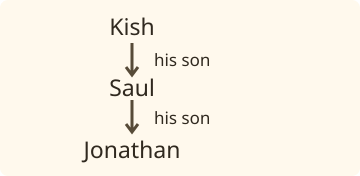

# 1 Chronicles 8 — Benjamin’s family and the family of Saul

**About this chapter**

This record begins with Benjamin and his five sons.

It follows several branches of Benjamin’s family.

One branch includes Saul and his son Jonathan.

## Benjamin and his sons

## 1 Chronicles 8:1

Benjamin’s first son was Bela.

Ashbel was his second son.

Aharah was his third.

## 1 Chronicles 8:2

Nohah was Benjamin’s fourth son.

Rapha was his fifth.

## 1 Chronicles 8:3

Bela’s sons included Addar, Gera, and Abihud.

## 1 Chronicles 8:4

Abishua, Naaman, and Ahoah were also Bela’s sons.

## 1 Chronicles 8:5

The list of Bela’s sons ends with Gera, Shephuphan, and Huram.

## Families in Geba and Moab

## 1 Chronicles 8:6

Some of Ehud’s descendants led the families in Geba.

Those families had to leave their homes for Manahath.

## 1 Chronicles 8:7

Their leaders were Naaman, Ahijah, and Gera.

Gera took the families away to Manahath.

Gera had two sons, Uzza and Ahihud.

## 1 Chronicles 8:8

Shaharaim divorced his wives Hushim and Baara.

Later he had sons in the land of Moab.

## 1 Chronicles 8:9

Shaharaim and his wife Hodesh had sons there.

Their sons included Jobab, Zibia, Mesha, and Malcam.

## 1 Chronicles 8:10

Jeuz, Sachia, and Mirmah were their sons too.

The sons of Hodesh and Shaharaim became family leaders.

## 1 Chronicles 8:11

Shaharaim and Hushim also had two sons together.

Their sons were Abitub and Elpaal.

## Elpaal’s family

## 1 Chronicles 8:12

Elpaal’s sons included Eber, Misham, and Shemed.

Shemed built Ono and Lod and the villages around Lod.

## 1 Chronicles 8:13

Beriah and Shema were also Elpaal’s sons.

They led the families living in Aijalon.

They drove the people of Gath out of their homes.

## 1 Chronicles 8:14

Beriah’s sons included Ahio, Shashak, and Jeremoth.

## 1 Chronicles 8:15

Zebadiah, Arad, and Eder were also Beriah’s sons.

## 1 Chronicles 8:16

Michael, Ishpah, and Joha were sons of Beriah too.

## 1 Chronicles 8:17

Elpaal’s family also included these sons.

Their names included Zebadiah, Meshullam, Hizki, and Heber.

## 1 Chronicles 8:18

Ishmerai, Izliah, and Jobab were also Elpaal’s sons.

## Families who lived in Jerusalem

## 1 Chronicles 8:19

Shimei’s sons included Jakim, Zichri, and Zabdi.

## 1 Chronicles 8:20

Elienai, Zillethai, and Eliel were also Shimei’s sons.

## 1 Chronicles 8:21

Adaiah, Beraiah, and Shimrath were sons of Shimei too.

## 1 Chronicles 8:22

Shashak’s sons included Ishpan, Eber, and Eliel.

## 1 Chronicles 8:23

Abdon, Zichri, and Hanan were also Shashak’s sons.

## 1 Chronicles 8:24

Hananiah, Elam, and Anthothijah were sons of Shashak too.

## 1 Chronicles 8:25

Iphdeiah and Penuel were also Shashak’s sons.

## 1 Chronicles 8:26

Jeroham’s sons included Shamsherai, Shehariah, and Athaliah.

## 1 Chronicles 8:27

Jaareshiah, Elijah, and Zichri were also Jeroham’s sons.

## 1 Chronicles 8:28

All these leaders lived in Jerusalem.

The family records name them as heads of families.

## Jeiel and his children

## 1 Chronicles 8:29

Jeiel was the father of Gibeon.

He lived in the town of Gibeon.

His wife’s name was Maacah.

## 1 Chronicles 8:30

Jeiel’s oldest son was Abdon.

Then came Zur, Kish, Baal, and Nadab.

## 1 Chronicles 8:31

Gedor, Ahio, and Zecher were also Jeiel’s sons.

## 1 Chronicles 8:32

Mikloth was another son of Jeiel.

Mikloth had a son named Shimeah.

This family lived near their relatives in Jerusalem.

## Saul and the generations after him

## 1 Chronicles 8:33

Ner had a son named Kish.

Kish was Saul’s father.

Saul’s sons were Jonathan, Malchishua, Abinadab, and Esh-baal.

## 1 Chronicles 8:34

Jonathan had a son named Merib-baal.

Merib-baal had a son named Micah.

## 1 Chronicles 8:35

Micah’s sons were Pithon, Melech, Tarea, and Ahaz.

## 1 Chronicles 8:36

Ahaz had a son named Jehoaddah.

Jehoaddah had three sons, Alemeth, Azmaveth, and Zimri.

Zimri had a son named Moza.

## 1 Chronicles 8:37

Moza had a son named Binea.

Binea’s son was Raphah.

Raphah’s son was Eleasah.

Eleasah’s son was Azel.

## 1 Chronicles 8:38

Azel had six sons.

Three were Azrikam, Bocheru, and Ishmael.

The other three were Sheariah, Obadiah, and Hanan.

## 1 Chronicles 8:39

Azel had a brother named Eshek.

Eshek’s oldest son was Ulam.

Jeush was his second son, and Eliphelet was his third.

## 1 Chronicles 8:40

Ulam’s sons were brave fighters who shot arrows with bows.

Together they had 150 sons and grandsons.

All these families came from Benjamin.

**Pause and answer**

Who was Saul’s father?
