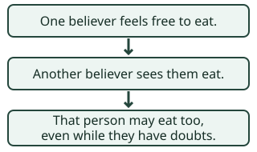

# 1 Corinthians 8 — Love guides what we choose to eat

**About this chapter**

Two people can sit down to the same meal and understand it differently.

Paul asks the believers in Corinth to think about each other.

## Love helps others grow

## 1 Corinthians 8:1

Now about food people offer to idols.

We know that we all have some knowledge.

Knowing things can make us proud.

Loving people helps them grow stronger.

**Help with these words**

An idol is an object people worship as a god. People sometimes brought food to an idol as a gift.

## 1 Corinthians 8:2

Someone may think, “I understand this.”

That person still has more to learn.

## 1 Corinthians 8:3

God knows the person who loves him.

**Pause and answer**

What helps another person grow stronger?

## One God and one Lord

## 1 Corinthians 8:4

Can we eat food that people have offered to idols?

We know an idol has no power as a god.

There is only one God.

## 1 Corinthians 8:5

People speak of gods in heaven and on earth.

They give many the title “god” or “lord.”

## 1 Corinthians 8:6

For us there is one God, the Father.

Everything comes from him.

We live for him.

There is one Lord, Jesus Christ.

Everything came into being through him.

We live through him too.

**Pause and answer**

Who is the one Lord Paul names?

## A meal can mean different things to different people

## 1 Corinthians 8:7

Some believers still find this hard to understand.

They remember worshipping idols.

Eating the food still seems to them like worshipping the idol.

When they eat, they go against their conscience.

**Help with these words**

Your conscience helps you judge whether what you do is right or wrong.

## 1 Corinthians 8:8

Food does not bring us closer to God.

We lose nothing by leaving that food alone.

We gain nothing by eating it.

## 1 Corinthians 8:9

You may feel free to eat.

Take care that your choice does not make another believer stumble.

**Help with these words**

Here “stumble” means doing something you believe is wrong because you see another believer do it.

## 1 Corinthians 8:10

Suppose you know that an idol is no god.

A believer who still has doubts sees you eating in an idol’s temple.

Seeing you there may encourage them to eat that food too.

**Pause and answer**

Why might a believer eat the food even while they have doubts?

## Paul says what he would give up

## 1 Corinthians 8:11

Your knowledge can ruin the believer who still has doubts.

Christ died for that person.

## 1 Corinthians 8:12

You hurt other believers when you lead them to go against their conscience.

When you sin against them this way, you sin against Christ.

## 1 Corinthians 8:13

Suppose eating meat makes another believer stumble.

Then I will never eat meat again.

I do not want my choice to lead that person into sin.

**Pause and answer**

What is Paul willing to give up for another believer?
