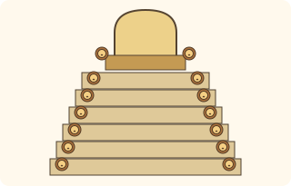

# 1 Kings 10 — The queen of Sheba visits Solomon

**About this chapter**

The queen of Sheba wants to know whether the reports about Solomon are true. She comes to hear his answers for herself.

## The queen brings her questions

## 1 Kings 10:1

The queen of Sheba heard how famous Solomon was.

She heard that his fame was connected with the name of the LORD.

She came to test Solomon with hard questions.

## 1 Kings 10:2

Many people traveled with her to Jerusalem.

Their camels carried spices, great amounts of gold, and valuable stones.

The queen told Solomon everything on her mind.

## 1 Kings 10:3

Solomon answered every question.

He could explain everything she asked about.

## The queen sees Solomon’s palace

## 1 Kings 10:4

The queen saw how wise Solomon was.

She saw the palace he had built.

## 1 Kings 10:5

She saw the food on his table and where his servants sat.

She saw how his servants worked and what they wore.

She saw the men who served his drinks.

She saw his burnt offerings at the LORD’s temple.

All this amazed her.

## The queen praises the LORD

## 1 Kings 10:6

She told Solomon, “At home I heard about your words and your wisdom.

What I heard was true.

## 1 Kings 10:7

I did not believe it until I saw for myself.

People had not told me even half the story.

You are far wiser and richer than I had heard.

## 1 Kings 10:8

How blessed your people are!

How blessed are the servants who stay with you and hear your wisdom!

## 1 Kings 10:9

Praise the LORD your God!

He was pleased with you and made you king of Israel.

The LORD loves Israel forever.

He made you king to judge fairly and do what is right.”

**Pause and answer**

Why did the queen say the LORD made Solomon king?

## The queen and the king exchange gifts

## 1 Kings 10:10

The queen gave Solomon 120 talents of gold.

She also gave him spices and valuable stones.

Never again did anyone bring Solomon so many spices.

## 1 Kings 10:11

Hiram’s ships brought gold from Ophir.

They also brought a great load of almug wood and valuable stones from there.

## 1 Kings 10:12

Solomon used the almug wood for steps at the temple and the palace.

He also made lyres and harps for the singers.

No one had brought in wood like this before.

When this account was written, no one had seen its like again.

**Reading help**

Almug is a kind of wood. Lyres and harps are instruments with strings.

## 1 Kings 10:13

Solomon gave the queen of Sheba everything she asked for.

He also gave her gifts from his own royal wealth.

Then the queen and her servants went home.

## Gold comes to Solomon

## 1 Kings 10:14

Each year Solomon received 666 talents of gold.

## 1 Kings 10:15

He received still more from merchants and traders.

The kings of Arabia and the governors of the land also sent him payments.

## 1 Kings 10:16

Solomon had workers make 200 large shields of hammered gold.

Each shield used 600 shekels of gold.

## 1 Kings 10:17

They also made 300 small shields of hammered gold.

Each small shield used three minas of gold.

Solomon put the shields in the House of the Forest of Lebanon.

**Reading help**

A shekel, a mina, and a talent were units of weight. Here they tell how much gold there was.

## Lions beside the throne

## 1 Kings 10:18

Solomon had workers make a large throne of ivory.

They covered it with pure gold.

## 1 Kings 10:19

Six steps led up to the throne.

The top of its back was rounded.

Beside each armrest stood a figure of a lion.

## 1 Kings 10:20

Twelve more lions stood on the steps.

One stood at each end of each step.

No other kingdom had anything like this throne.

**Pause and answer**

How many lions stood on the steps?

## Ships bring goods from overseas

## 1 Kings 10:21

All Solomon’s drinking cups were gold.

Even the utensils in the House of the Forest of Lebanon were pure gold.

None were silver. People valued silver very little in Solomon’s time.

## 1 Kings 10:22

Solomon’s ships of Tarshish sailed with Hiram’s ships.

Every three years they brought back gold, silver, and ivory.

They also brought apes and peacocks.

## Visitors come to hear Solomon

## 1 Kings 10:23

Solomon was richer and wiser than any other king on earth.

## 1 Kings 10:24

People from all over the world wanted to meet him.

They wanted to hear the wisdom God had given him.

## 1 Kings 10:25

Year after year the visitors brought gifts to honor Solomon.

They brought things made of silver and gold.

They brought clothing, weapons, spices, horses, and mules.

## Horses and chariots

## 1 Kings 10:26

Solomon gathered 1,400 chariots and 12,000 horses.

He kept some in cities set aside for chariots.

He kept others with him in Jerusalem.

## 1 Kings 10:27

Solomon made silver as common in Jerusalem as stones.

Cedar wood became as plentiful as sycamore trees in the foothills.

**Reading help**

The comparison with stones tells how easy it was to find silver in Jerusalem.

## 1 Kings 10:28

Solomon’s horses came from Egypt and Kue.

The king’s traders bought horses from Kue.

## 1 Kings 10:29

A chariot from Egypt cost 600 shekels of silver.

A horse cost 150 shekels of silver.

The traders also sold chariots and horses to the kings of the Hittites and of Aram.

**Pause and answer**

What did people from other countries want to hear when they visited Solomon?
