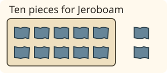

# 1 Kings 11 — Solomon turns away from the LORD

**About this chapter**

Solomon worships other gods. The LORD tells him that his son will lose much of the kingdom. A prophet brings a message to one of Solomon’s servants.

## Solomon marries women from other nations

## 1 Kings 11:1

Solomon loved Pharaoh’s daughter and many other foreign women.

They included women from Moab, Ammon, Edom, and Sidon.

Some were Hittite women.

## 1 Kings 11:2

The LORD had warned Israel about those nations.

“Do not marry people from those nations.

They will lead you to worship their gods.”

Yet Solomon held on to the women he loved.

## 1 Kings 11:3

Solomon had 700 wives from royal families and 300 concubines.

His wives led him away from the LORD.

**Reading help**

A concubine lived with a man as his partner. She had less standing in the household than a wife.

## 1 Kings 11:4

When Solomon grew old, his wives led him to follow other gods.

His father David had loved the LORD with his whole heart.

Solomon no longer served the LORD that way.

## Solomon worships other gods

## 1 Kings 11:5

Solomon worshiped Ashtoreth, the goddess of the Sidonians.

He also worshiped Milcom, the detestable god of the Ammonites.

## 1 Kings 11:6

The LORD saw that Solomon did evil.

Solomon did not follow the LORD fully as David had.

## 1 Kings 11:7

On a hill east of Jerusalem, Solomon built a place to worship Chemosh, the detestable god of Moab.

He also built a place for Molech, the detestable god of the Ammonites.

## 1 Kings 11:8

Solomon did the same for all his foreign wives.

They burned incense and gave sacrifices to their gods.

## The LORD tells Solomon what will happen

## 1 Kings 11:9

The LORD, the God of Israel, had appeared to Solomon twice.

Now the LORD was angry because Solomon had turned away from him.

## 1 Kings 11:10

The LORD had clearly warned Solomon against following other gods.

Solomon disobeyed him.

## 1 Kings 11:11

The LORD said, “Solomon, you have broken my covenant and disobeyed my laws.

So I will tear the kingdom away from you.

I will give it to your servant.

## 1 Kings 11:12

Because of your father David, I will wait until you die.

Then I will take the kingdom from your son.

## 1 Kings 11:13

I will leave one tribe for your son to rule.

I will do this for my servant David and for Jerusalem, the city I chose.”

**Pause and answer**

When did the LORD say he would take the kingdom from Solomon’s family?

## Hadad escapes from Edom

## 1 Kings 11:14

The LORD raised up an enemy against Solomon.

His name was Hadad, and he belonged to Edom’s royal family.

## 1 Kings 11:15

Years earlier, David had been in Edom.

Joab, his army commander, went to bury the dead.

There he killed the men of Edom.

## 1 Kings 11:16

Joab and the Israelites stayed there six months.

Joab stayed until he had killed every male in Edom.

## 1 Kings 11:17

Hadad was a young boy then.

He escaped to Egypt with some of his father’s Edomite servants.

## 1 Kings 11:18

On their journey they left Midian and went to Paran.

Men from Paran joined them on the way to Egypt.

Pharaoh, the king of Egypt, gave Hadad a house, land, and food.

## Hadad asks to go home

## 1 Kings 11:19

Pharaoh liked Hadad very much.

He gave Hadad the sister of his wife, Queen Tahpenes, to marry.

## 1 Kings 11:20

Hadad and his wife had a son named Genubath.

Queen Tahpenes cared for him in the palace as he stopped drinking milk from the breast.

Genubath lived there with Pharaoh’s sons.

## 1 Kings 11:21

In Egypt, Hadad heard that David and Joab had died.

He asked Pharaoh, “Please let me return to my country.”

## 1 Kings 11:22

Pharaoh asked, “What have you lacked here with me?

Why do you want to go home now?”

Hadad answered, “I lack nothing. Please let me go.”

## Rezon rules in Damascus

## 1 Kings 11:23

God raised up another enemy against Solomon.

His name was Rezon, son of Eliada.

He had fled from his master Hadadezer, king of Zobah.

## 1 Kings 11:24

Rezon gathered men around him.

When David killed men from Zobah, Rezon led a band of raiders.

They settled in Damascus and took control there.

## 1 Kings 11:25

Rezon was Israel’s enemy throughout Solomon’s reign.

He added to the trouble Hadad caused.

Rezon ruled Aram and remained hostile to Israel.

## Jeroboam works for Solomon

## 1 Kings 11:26

Jeroboam, son of Nebat, served Solomon.

He came from Zeredah in Ephraim.

His mother, Zeruah, was a widow.

Jeroboam rebelled against Solomon.

## 1 Kings 11:27

Here is how the trouble began.

Solomon built the supporting terraces and repaired a gap in the wall of the City of David.

## 1 Kings 11:28

Jeroboam was brave and able.

Solomon saw how hard the young man worked.

He put Jeroboam in charge of all the workers from Joseph’s tribes.

## Ahijah tears his cloak

## 1 Kings 11:29

One day Jeroboam was leaving Jerusalem.

Ahijah, a prophet from Shiloh, met him on the road.

Ahijah wore a new cloak.

The two men were alone in the open country.

## 1 Kings 11:30

Ahijah took his new cloak and tore it into twelve pieces.

## 1 Kings 11:31

He told Jeroboam, “Take ten pieces for yourself.

The LORD, the God of Israel, says, ‘I will tear the kingdom away from Solomon.

I will give you ten tribes.

**Reading help**

A cloak is an outer garment. The torn cloak shows that the kingdom will divide. The ten pieces stand for the ten tribes Jeroboam will rule.

## 1 Kings 11:32

One tribe will remain for the sake of my servant David.

It will also remain for the sake of Jerusalem, the city I chose from all Israel.

## Ahijah explains why the kingdom will divide

## 1 Kings 11:33

My people left me to worship Ashtoreth of Sidon, Chemosh of Moab, and Milcom of Ammon.

They have disobeyed my laws and done wrong in my sight.

Solomon’s father David followed my ways.

## 1 Kings 11:34

I chose my servant David, who kept my commands.

For David’s sake I will let Solomon rule throughout his life.

## 1 Kings 11:35

Then I will take ten tribes from Solomon’s son.

I will give them to you.

## 1 Kings 11:36

I will give his son one tribe.

My servant David will always have a lamp before me in Jerusalem.

That is the city I chose to bear my name.

**Reading help**

Here the lamp is a picture of David’s family continuing to rule in Jerusalem.

## The LORD makes Jeroboam a promise

## 1 Kings 11:37

Jeroboam, I will choose you to rule the people you long to rule.

You will be king over Israel.

## 1 Kings 11:38

Listen to all my commands. Live my way and do right, as David did.

If you obey me, I will be with you.

I will give you Israel.

I will establish your family as rulers for generations, as I did for David.

## 1 Kings 11:39

Because of this, I will bring David’s descendants low.

But that will not last forever.’”

**Pause and answer**

What did the LORD ask Jeroboam to do as king?

## Jeroboam flees to Egypt

## 1 Kings 11:40

Solomon tried to kill Jeroboam.

Jeroboam fled to Shishak, the king of Egypt.

He stayed in Egypt until Solomon died.

## Solomon’s son becomes king

## 1 Kings 11:41

The Book of the Acts of Solomon tells more about his deeds and his wisdom.

## 1 Kings 11:42

Solomon ruled all Israel from Jerusalem for 40 years.

## 1 Kings 11:43

Then Solomon died.

The people buried him in the City of David, his father.

His son Rehoboam became king in his place.

**Reading help**

Jeroboam was the servant who fled to Egypt. Rehoboam was Solomon’s son.
