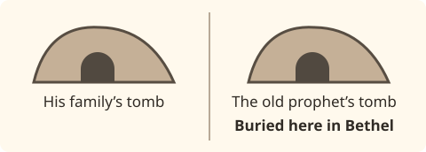

# 1 Kings 13 — A man from Judah brings a warning to Bethel

**About this chapter**

A man from Judah brings the LORD’s message to King Jeroboam. Later, an old prophet asks the man to come back to Bethel.

## The man from Judah warns the king

## 1 Kings 13:1

King Jeroboam stood beside the altar at Bethel to burn incense.

Just then a man arrived from Judah.

The LORD had sent him.

## 1 Kings 13:2

The man from Judah called out the LORD’s message.

“Altar! Altar! The LORD says a boy named Josiah will be born into David’s family.

On this altar Josiah will sacrifice the priests who burn incense here at the high places.

People will burn human bones on this altar.”

## 1 Kings 13:3

That day the man from Judah announced a sign.

“The LORD says this altar will split apart.

Its ashes will spill out.”

**Reading help**

An altar is a place for offerings. The man speaks to the altar where the king can hear him. The broken altar will be a sign that the warning comes from the LORD.

## The altar splits apart

## 1 Kings 13:4

Jeroboam heard the warning against the altar.

He stretched out his hand and shouted, “Seize him!”

But the king’s hand became stiff and weak.

He could not pull it back.

## 1 Kings 13:5

The altar split apart, and its ashes spilled out.

This was the sign the LORD’s messenger had announced.

## 1 Kings 13:6

Jeroboam said, “Please pray to the LORD your God for me.

Ask him to heal my hand.”

The man from Judah prayed, and the king’s hand became well again.

## The king offers a reward

## 1 Kings 13:7

Jeroboam said, “Come home with me and have some food.

I will give you a reward.”

## 1 Kings 13:8

The man from Judah answered, “Even if you gave me half of everything you own, I would not go.

I will not eat bread or drink water here.

## 1 Kings 13:9

The LORD told me, ‘Do not eat bread or drink water there.

Go home by a different road.’”

## 1 Kings 13:10

So the man from Judah left Bethel by a different road.

**Pause and answer**

Why did the man from Judah leave by a different road?

## An old prophet hears the news

## 1 Kings 13:11

An old prophet lived in Bethel.

His sons told him what the man from Judah had done that day.

They repeated what he had said to the king.

## 1 Kings 13:12

Their father asked, “Which way did he go?”

His sons showed him the road the man had taken.

## 1 Kings 13:13

The old prophet said, “Saddle my donkey for me.”

His sons put the saddle on, and he got on the donkey.

## 1 Kings 13:14

The old prophet went after the man from Judah.

He found him sitting under an oak tree.

“Are you the man of God from Judah?” he asked.

The man answered, “I am.”

## The old prophet invites the man home

## 1 Kings 13:15

The old prophet said, “Come home with me and eat some bread.”

## 1 Kings 13:16

The man from Judah answered, “I cannot go home with you.

I will not eat bread or drink water with you here.

## 1 Kings 13:17

The LORD told me, ‘Do not eat bread or drink water there.

Go home by a different road.’”

## 1 Kings 13:18

The old prophet said, “I am a prophet like you.

An angel gave me a message from the LORD.

The angel told me to bring you home for bread and water.”

The old prophet was lying.

## 1 Kings 13:19

The man from Judah went back with him.

He ate bread and drank water in the old prophet’s house.

**Reading help**

Both men speak about the LORD. The man from Judah repeats the command he received. The old prophet makes up the story about the angel.

**Pause and answer**

What did the man from Judah do after hearing the old prophet’s story?

## The LORD speaks at the table

## 1 Kings 13:20

As they sat at the table, the LORD spoke to the old prophet.

## 1 Kings 13:21

The old prophet called out to the man from Judah.

“This is what the LORD says.

You disobeyed the LORD your God.

You refused to keep his command.

## 1 Kings 13:22

You came back to the place he told you about.

You ate bread and drank water there, though he had forbidden it.

Because of this, no one will bury you in your family’s tomb.”

**Reading help**

A tomb is a place for burying the dead. Families sometimes buried their relatives together in one tomb.

## 1 Kings 13:23

After the man from Judah finished eating and drinking, the old prophet saddled a donkey for him.

## A lion on the road

## 1 Kings 13:24

The man from Judah set off.

On the road a lion met him and killed him.

His body lay on the road.

The donkey and the lion stood beside it.

## 1 Kings 13:25

People passing by saw the body and the lion beside it.

They told the news in Bethel, where the old prophet lived.

## 1 Kings 13:26

The old prophet heard the news.

He said, “That is the man who disobeyed the LORD’s command.

The LORD let the lion attack and kill him.

The LORD did what he had said.”

## The old prophet brings the body home

## 1 Kings 13:27

The old prophet told his sons, “Saddle my donkey.”

They did as he asked.

## 1 Kings 13:28

He went and found the body on the road.

The lion and the donkey stood beside it.

The lion had neither eaten the body nor hurt the donkey.

## 1 Kings 13:29

The old prophet lifted the body onto his donkey.

He brought the man from Judah back to Bethel to mourn for him and bury him.

## 1 Kings 13:30

The old prophet laid the body in his own tomb.

They cried out in grief, “Oh, my brother!”

## The old prophet speaks to his sons

## 1 Kings 13:31

After the burial, the old prophet told his sons, “When I die, bury me in this same tomb.

Lay my bones beside his.

## 1 Kings 13:32

The LORD sent him to speak against the altar at Bethel and the places of worship in the towns of Samaria.

What he said will come true.”

## Jeroboam keeps doing wrong

## 1 Kings 13:33

Even after all this, Jeroboam kept doing wrong.

He still chose priests from all sorts of people.

Anyone who wanted to serve at the high places could become a priest.

## 1 Kings 13:34

This sin brought Jeroboam’s family to ruin.

In the end his whole family was wiped out.

**Pause and answer**

Where did the old prophet ask his sons to bury him?
