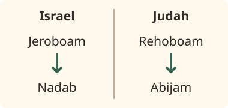

# 1 Kings 14 — A message for Jeroboam and trouble in Judah

**About this chapter**

Jeroboam sends his wife to ask about their sick son. Later the account turns to Rehoboam, who rules in Jerusalem.

## Jeroboam sends his wife to Shiloh

## 1 Kings 14:1

Jeroboam’s son Abijah became sick.

## 1 Kings 14:2

Jeroboam told his wife, “Change how you look so no one will know you are my wife.

Go to Shiloh. Ahijah the prophet lives there.

He told me I would be king over these people.

## 1 Kings 14:3

Take ten loaves of bread, some cakes, and a jar of honey.

Ahijah will tell you what will happen to our boy.”

## 1 Kings 14:4

Jeroboam’s wife did as he asked.

She went to Ahijah’s house in Shiloh.

Ahijah had grown old and could no longer see.

**Reading help**

Abijah is the sick boy. Ahijah is the prophet his mother visits.

## Ahijah knows his visitor

## 1 Kings 14:5

The LORD had told Ahijah, “Jeroboam’s wife is coming.

She wants to ask about her sick son.

She will try to hide who she is.”

The LORD told Ahijah what to say to her.

## 1 Kings 14:6

Ahijah heard her footsteps at the door.

He said, “Come in, Jeroboam’s wife!

Why are you hiding who you are?

The LORD has sent me to give you bad news.

**Pause and answer**

How did Ahijah know who was coming?

## The LORD’s message for Jeroboam

## 1 Kings 14:7

Go and tell Jeroboam what the LORD, the God of Israel, says.

‘I chose you from among the people.

I made you ruler over my people Israel.

## 1 Kings 14:8

I tore the kingdom away from David’s family and gave it to you.

My servant David kept my commands.

He followed me with his whole heart and did what was right.

You have not done that.

## 1 Kings 14:9

You have done more evil than anyone before you.

You made other gods for yourself from melted metal.

You made me angry and turned your back on me.

## 1 Kings 14:10

Because of this I will bring disaster on your family.

Every male in your family in Israel will die, both slave and free.

I will burn up your family as someone burns dung until nothing remains.

## 1 Kings 14:11

Dogs will eat the bodies of your family members who die in the city.

Birds will eat the bodies of those who die in the fields.’

The LORD has spoken.

## Ahijah speaks about the child

## 1 Kings 14:12

Now go home. When you enter the city, your child will die.

## 1 Kings 14:13

All Israel will mourn for him and bury him.

He alone in Jeroboam’s family will have a proper burial.

Of that whole family, the LORD found good only in this child.

## Ahijah warns Israel

## 1 Kings 14:14

The LORD will raise up a king over Israel.

That king will bring Jeroboam’s family to an end.

The time has come, even today!

## 1 Kings 14:15

The LORD will strike Israel. Israel will shake like a reed in water.

He will pull Israel out of the good land he gave their ancestors.

He will scatter them beyond the Euphrates River.

They made Asherah poles and angered the LORD.

**Reading help**

A reed is a tall, thin plant that bends in the water. Ahijah uses it to show how unsteady Israel will be. An Asherah pole was a wooden object used to worship the goddess Asherah.

## 1 Kings 14:16

Jeroboam sinned and led Israel into sin.

Because of those sins the LORD will give Israel up.”

## Jeroboam’s wife returns home

## 1 Kings 14:17

Jeroboam’s wife went home to Tirzah.

As she stepped through the doorway of her house, her boy died.

## 1 Kings 14:18

The people buried him. All Israel mourned for him.

This happened as the LORD had said through his prophet Ahijah.

**Pause and answer**

What did the people of Israel do when the boy died?

## Nadab becomes king of Israel

## 1 Kings 14:19

The Book of the Chronicles of the Kings of Israel tells more about Jeroboam.

It describes his wars and how he ruled.

## 1 Kings 14:20

Jeroboam ruled for 22 years. Then he died.

His son Nadab became king in his place.

## Rehoboam rules in Judah

## 1 Kings 14:21

Meanwhile Solomon’s son Rehoboam was king in Judah.

He became king at 41 and ruled for 17 years in Jerusalem.

Of all Israel’s cities, the LORD chose Jerusalem to bear his name.

Rehoboam’s mother was Naamah from Ammon.

## 1 Kings 14:22

The people of Judah did evil in the LORD’s sight.

Their sins stirred his jealous anger even more than their ancestors’ sins had done.

## 1 Kings 14:23

They built worship places and set up sacred stone pillars and Asherah poles.

They did this on every high hill and under every green tree.

## 1 Kings 14:24

Men even worked as prostitutes at places of worship.

The people copied all the practices the LORD hated among the nations he had driven out before Israel.

## Egypt’s king takes the gold shields

## 1 Kings 14:25

In Rehoboam’s fifth year as king, Shishak attacked Jerusalem.

Shishak was the king of Egypt.

## 1 Kings 14:26

Shishak took the treasures from the LORD’s temple and the palace.

He took everything, including all the gold shields Solomon had made.

## 1 Kings 14:27

Rehoboam had bronze shields made to replace the gold ones.

He gave them to the captains who guarded the palace entrance.

## 1 Kings 14:28

Whenever Rehoboam went to the LORD’s temple, the guards carried the shields.

Afterward they put the shields back in the guardroom.

**Pause and answer**

Why did Rehoboam have new shields made?

## Abijam becomes king of Judah

## 1 Kings 14:29

The Book of the Chronicles of the Kings of Judah tells more about what Rehoboam did.

## 1 Kings 14:30

Rehoboam and Jeroboam were at war throughout their lives.

## 1 Kings 14:31

Rehoboam died. The people buried him with his ancestors in the City of David.

His mother was Naamah from Ammon.

Rehoboam’s son Abijam became king in his place.

