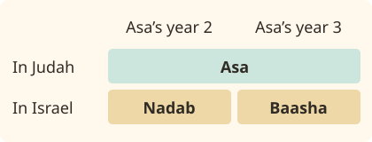

# 1 Kings 15 — Asa rules Judah while kings change in Israel

**About this chapter**

Abijam and then his son Asa rule Judah. During Asa’s reign, Baasha takes the throne of Israel from Nadab.

## Abijam becomes king of Judah

## 1 Kings 15:1

Abijam became king of Judah in the eighteenth year that Jeroboam ruled Israel.

Jeroboam was the son of Nebat.

## 1 Kings 15:2

Abijam ruled in Jerusalem for three years.

His mother was Maacah, the daughter of Abishalom.

## 1 Kings 15:3

Abijam committed the same sins as his father.

His ancestor David had served the LORD with his whole heart.

Abijam did not serve the LORD that way.

## David’s family keeps ruling in Jerusalem

## 1 Kings 15:4

Yet for David’s sake, the LORD kept a lamp burning in Jerusalem.

He gave Abijam a son to rule after him and made Jerusalem strong.

**Reading help**

The lamp is a picture of David’s family continuing to rule. Abijam’s son will be the next king.

## 1 Kings 15:5

David did what was right in the LORD’s eyes.

Throughout his life he obeyed the LORD’s commands, except in what he did to Uriah the Hittite.

## 1 Kings 15:6

The families of Rehoboam and Jeroboam were at war throughout Abijam’s life.

## 1 Kings 15:7

The Book of the Chronicles of the Kings of Judah tells more about Abijam and his deeds.

Abijam fought against Jeroboam.

## 1 Kings 15:8

Abijam died. The people buried him in the City of David.

His son Asa became king in his place.

## Asa becomes king of Judah

## 1 Kings 15:9

Asa became king of Judah in the twentieth year that Jeroboam ruled Israel.

## 1 Kings 15:10

Asa ruled in Jerusalem for 41 years.

His grandmother was Maacah, the daughter of Abishalom.

## 1 Kings 15:11

Asa did what was right in the LORD’s eyes, as his ancestor David had done.

## Asa removes idols

## 1 Kings 15:12

Asa sent away the men who worked as prostitutes at places of worship.

He removed all the idols his ancestors had made.

## 1 Kings 15:13

His grandmother Maacah had made an Asherah pole that the LORD hated.

So Asa took away her position as queen mother.

He cut down the pole and burned it in the Kidron Valley.

**Reading help**

An Asherah pole was a wooden object used to worship the goddess Asherah. Maacah held a position of honor in the royal family.

## 1 Kings 15:14

The places of worship on the hills remained.

Yet Asa served the LORD with his whole heart all his life.

## 1 Kings 15:15

Asa brought silver, gold, and other objects into the LORD’s temple.

He and his father had set them apart for the LORD.

## Baasha goes to war against Judah

## 1 Kings 15:16

Asa and Baasha, king of Israel, were at war throughout their reigns.

## 1 Kings 15:17

Baasha attacked Judah. He strengthened the town of Ramah.

He wanted to stop people from entering or leaving Asa’s land.

## 1 Kings 15:18

Asa took all the silver and gold left in the temple and palace storerooms.

His servants carried it to Ben-hadad, king of Aram, in Damascus.

Ben-hadad was Tabrimmon’s son and Hezion’s grandson.

Asa sent him this message.

## Asa asks the king of Aram for help

## 1 Kings 15:19

“Let us make an agreement, as our fathers did.

I am sending you silver and gold as a gift.

Break your agreement with Baasha so he will leave me alone.”

## 1 Kings 15:20

Ben-hadad agreed. He sent his army commanders against Israel’s cities.

They captured Ijon, Dan, and Abel-beth-maacah.

They also took all of Naphtali, including the area around Chinnereth.

## 1 Kings 15:21

When Baasha heard the news, he stopped work at Ramah.

He went back to Tirzah.

## 1 Kings 15:22

Asa called every man in Judah to help.

They carried away the stone and wood Baasha had used at Ramah.

Asa used it to build up Geba in Benjamin and the town of Mizpah.

**Pause and answer**

What did Asa do with the wood and stone from Ramah?

## Jehoshaphat succeeds Asa in Judah

## 1 Kings 15:23

The Book of the Chronicles of the Kings of Judah tells more about Asa.

It describes his power, his deeds, and the cities he built.

In his old age, Asa had a disease in his feet.

## 1 Kings 15:24

Asa died. The people buried him with his ancestors in the City of David.

His son Jehoshaphat became king in his place.

## Earlier in Israel, Nadab becomes king

## 1 Kings 15:25

In Asa’s second year as king of Judah, Nadab became king of Israel.

Nadab was Jeroboam’s son. He ruled for two years.

**Reading help**

The story goes back to Asa’s early years. Asa was already ruling Judah when Nadab became king of Israel.

## 1 Kings 15:26

Nadab did evil in the LORD’s eyes.

He followed his father Jeroboam, who had led Israel into sin.

## 1 Kings 15:27

Baasha, son of Ahijah, belonged to the tribe of Issachar.

He plotted against Nadab.

Nadab and Israel’s army were surrounding the Philistine city of Gibbethon.

There Baasha attacked Nadab.

## 1 Kings 15:28

Baasha killed Nadab and became king in his place.

This happened in Asa’s third year as king of Judah.

## Jeroboam’s family comes to an end

## 1 Kings 15:29

As soon as Baasha became king, he killed everyone in Jeroboam’s household.

No one survived.

This fulfilled the LORD’s message through his servant Ahijah from Shiloh.

## 1 Kings 15:30

Jeroboam had sinned and led Israel into sin.

He had made the LORD, the God of Israel, angry.

## 1 Kings 15:31

The Book of the Chronicles of the Kings of Israel tells more about Nadab and what he did.

## Baasha rules Israel from Tirzah

## 1 Kings 15:32

Asa of Judah and Baasha of Israel were at war throughout their reigns.

## 1 Kings 15:33

Baasha, son of Ahijah, became king of all Israel in Asa’s third year.

Baasha ruled in Tirzah for 24 years.

## 1 Kings 15:34

Baasha did evil in the LORD’s eyes.

He followed Jeroboam’s example and shared in the sin Jeroboam had led Israel to commit.

**Pause and answer**

Who became king of Israel after Nadab?
