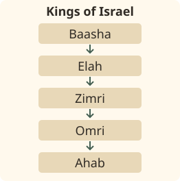

# 1 Kings 16 — From Baasha to Ahab, kings of Israel

**About this chapter**

Asa is king of Judah while several men rule Israel. In Israel, Omri builds the city of Samaria. Later his son Ahab rules there.

## Jehu brings Baasha a warning

## 1 Kings 16:1

The LORD gave Jehu, son of Hanani, a message for King Baasha.

## 1 Kings 16:2

“I lifted you out of the dust.

I made you ruler over my people Israel.

But you followed Jeroboam’s example and led my people into sin.

Their sins made me angry.

**Reading help**

The LORD speaks of lifting Baasha out of the dust. Baasha once had little power. The LORD gave him authority to rule Israel.

## 1 Kings 16:3

So I will destroy you and your family, Baasha.

Your family will suffer the same end as the family of Jeroboam, Nebat’s son.

## 1 Kings 16:4

Dogs will eat the bodies of your people who die in the city.

Birds will eat the bodies of those who die in the fields.”

## Elah succeeds his father Baasha

## 1 Kings 16:5

The Book of the Chronicles of the Kings of Israel tells more about Baasha.

It tells about his power and what he did.

## 1 Kings 16:6

Baasha died, and the people buried him in Tirzah.

His son Elah became king in his place.

## 1 Kings 16:7

The LORD spoke against Baasha and his family through Jehu the prophet.

Baasha had made the LORD angry by doing evil.

He had followed the example of Jeroboam’s family.

He had also killed Jeroboam’s family.

## Zimri turns against Elah

## 1 Kings 16:8

Elah became king of Israel in Asa’s twenty-sixth year as king of Judah.

Elah ruled in Tirzah for two years.

## 1 Kings 16:9

Arza managed the king’s household in Tirzah.

Elah was getting drunk at Arza’s house.

Meanwhile Zimri, who commanded half of Elah’s chariots, plotted against him.

## 1 Kings 16:10

Zimri went in and killed Elah.

Then Zimri became king of Israel.

This happened in Asa’s twenty-seventh year as king of Judah.

## Baasha’s family comes to an end

## 1 Kings 16:11

As soon as Zimri took the throne, he killed Baasha’s whole household.

He left no male relative or friend of Baasha alive.

## 1 Kings 16:12

So Baasha’s family came to an end.

The LORD had said through Jehu the prophet that this would happen.

## 1 Kings 16:13

Baasha and his son Elah had sinned and led Israel into sin.

They had made the LORD, Israel’s God, angry by worshiping worthless idols.

## 1 Kings 16:14

The Book of the Chronicles of the Kings of Israel tells what else Elah did.

**Pause and answer**

Who brought the LORD’s warning to Baasha?

## The army chooses Omri

## 1 Kings 16:15

In Asa’s twenty-seventh year as king of Judah, Zimri ruled in Tirzah for seven days.

Israel’s army was camped outside Gibbethon, a Philistine city.

## 1 Kings 16:16

The men in the camp heard that Zimri had killed the king.

That very day they chose their commander Omri to be king of Israel.

## 1 Kings 16:17

Omri and the Israelites marched from Gibbethon and surrounded Tirzah.

## 1 Kings 16:18

Zimri saw that Omri’s army had taken the city.

He went into the stronghold of the palace.

He set the palace on fire and died inside.

## 1 Kings 16:19

Zimri died because he did evil in the LORD’s sight.

He followed Jeroboam’s example and shared in the sin Jeroboam had led Israel to commit.

## 1 Kings 16:20

The Book of the Chronicles of the Kings of Israel tells more about Zimri.

It tells how he turned against his king.

## Israel divides over who should be king

## 1 Kings 16:21

The people of Israel divided into two groups.

Half wanted Tibni, son of Ginath, as king.

The other half wanted Omri.

## 1 Kings 16:22

Omri’s followers were stronger than Tibni’s followers.

Tibni died, and Omri became king.

**Pause and answer**

Whom did half the people support while the other half supported Omri?

## 1 Kings 16:23

Omri became king over Israel in Asa’s thirty-first year as king of Judah.

Omri ruled for twelve years. He spent six of those years in Tirzah.

## Omri builds Samaria

## 1 Kings 16:24

Omri bought a hill from Shemer for two talents of silver.

He built a city on the hill.

He named the city Samaria after Shemer, who had owned the hill.

**Reading help**

A talent was a unit of weight. Here it measures the silver Omri paid for the hill.

## 1 Kings 16:25

Omri did evil in the LORD’s sight.

He did more wrong than any king of Israel before him.

## 1 Kings 16:26

Omri followed the ways of Jeroboam, son of Nebat.

Like Jeroboam, he led Israel into sin.

Their worthless idols made the LORD, Israel’s God, angry.

## 1 Kings 16:27

The Book of the Chronicles of the Kings of Israel tells more about Omri.

It describes his power and what he accomplished.

## 1 Kings 16:28

Omri died, and the people buried him in Samaria.

His son Ahab became king in his place.

## Ahab rules from Samaria

## 1 Kings 16:29

Ahab became king of Israel in Asa’s thirty-eighth year as king of Judah.

Ahab ruled in Samaria for 22 years.

## 1 Kings 16:30

Ahab did evil in the LORD’s sight.

He did more wrong than any king of Israel before him.

## 1 Kings 16:31

Ahab followed the sinful ways of Jeroboam, son of Nebat.

He also married Jezebel, the daughter of Ethbaal, king of the Sidonians.

Then Ahab began to serve and worship Baal.

## 1 Kings 16:32

Ahab built a temple for Baal in Samaria.

Inside it he set up an altar for Baal.

## 1 Kings 16:33

Ahab also set up an Asherah pole.

He made the LORD, Israel’s God, angrier than any king of Israel before him.

**Reading help**

An altar is a place for offerings. An Asherah pole was a wooden object used to worship the goddess Asherah.

## Hiel rebuilds Jericho

## 1 Kings 16:34

During Ahab’s reign, Hiel from Bethel rebuilt Jericho.

When Hiel laid its foundations, his oldest son Abiram died.

When Hiel put up its gates, his youngest son Segub died.

The LORD had said this would happen through Joshua, son of Nun.
