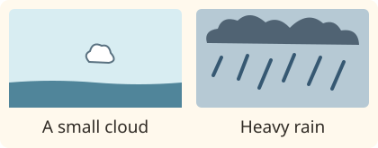

# 1 Kings 18 — The LORD answers Elijah on Mount Carmel

**About this chapter**

After years without rain, Elijah meets King Ahab. On Mount Carmel, the people wait to see who will answer when the prophets call.

## The LORD promises rain

## 1 Kings 18:1

It was the third year without rain.

The LORD told Elijah, “Go and meet Ahab.

I will send rain on the land.”

## 1 Kings 18:2

Elijah set out to meet Ahab.

People in Samaria had very little food.

## 1 Kings 18:3

Ahab called for Obadiah, the man who managed his palace.

Obadiah deeply honored the LORD.

## 1 Kings 18:4

Jezebel had been killing the LORD’s prophets.

Obadiah had hidden 100 prophets in caves, 50 in each cave.

He had brought them food and water.

**Pause and answer**

How did Obadiah care for the prophets he hid?

## Ahab and Obadiah search for grass

## 1 Kings 18:5

Ahab told Obadiah, “Search every spring and valley.

Perhaps we can find grass to keep our horses and mules alive.

Then we will not have to kill any of our animals.”

## 1 Kings 18:6

They divided the land between them to search it.

Ahab went alone in one direction.

Obadiah went alone in another.

## Obadiah meets Elijah

## 1 Kings 18:7

On his way Obadiah suddenly met Elijah.

He recognized Elijah and bowed with his face to the ground.

He asked, “Is it really you, my lord Elijah?”

## 1 Kings 18:8

Elijah answered, “Yes. Go tell your master, ‘Elijah is here.’”

## 1 Kings 18:9

Obadiah asked, “What wrong have I done?

Why would you put me in Ahab’s hands to die?

## 1 Kings 18:10

As surely as the LORD your God lives, Ahab has sent people to every kingdom to find you.

When they said you were absent, Ahab made them swear they had not found you.

## 1 Kings 18:11

Now you tell me to go to my master and say, ‘Elijah is here.’

## Obadiah is afraid to tell Ahab

## 1 Kings 18:12

When I leave, the Spirit of the LORD may carry you somewhere else.

If Ahab comes and cannot find you, he will kill me.

I have honored the LORD since I was young.

## 1 Kings 18:13

Have you heard what I did when Jezebel was killing the LORD’s prophets?

I hid 100 of them, 50 in each cave.

I brought them food and water.

## 1 Kings 18:14

Now you tell me to say, ‘Elijah is here.’

Ahab will kill me!”

## 1 Kings 18:15

Elijah answered, “I serve the LORD who commands armies.

As surely as he lives, I will meet Ahab today.”

## Elijah meets Ahab

## 1 Kings 18:16

Obadiah went and told Ahab.

Then Ahab went to meet Elijah.

## 1 Kings 18:17

Ahab asked, “Is that you, the man who brings trouble on Israel?”

## 1 Kings 18:18

Elijah answered, “You and your father’s family brought this trouble on Israel.

You left the LORD’s commands and worshiped the Baals.

## 1 Kings 18:19

Gather all Israel to meet me on Mount Carmel.

Bring Baal’s 450 prophets and Asherah’s 400 prophets.

They eat at Jezebel’s table.”

**Reading help**

Eating at Jezebel’s table means these prophets received food and support from her.

## The people gather on Mount Carmel

## 1 Kings 18:20

Ahab sent word throughout Israel.

He gathered the prophets on Mount Carmel.

## 1 Kings 18:21

Elijah went up to the people.

“How long will you keep changing sides?

If the LORD is God, follow him.

If Baal is God, follow him.”

The people gave no answer.

## 1 Kings 18:22

Elijah said, “I am the only prophet of the LORD left.

Baal has 450 prophets.

## Elijah asks for two bulls

## 1 Kings 18:23

Bring two bulls. Let Baal’s prophets choose one.

They can prepare it and place the pieces on the wood.

I will prepare the other bull and put it on wood.

Neither side will light a fire.

## 1 Kings 18:24

You will call to your god. I will call to the LORD.

The one who answers with fire is God.”

The people agreed.

## 1 Kings 18:25

Elijah told Baal’s prophets, “There are many of you.

Choose your bull and prepare it first.

Call to your god. Leave the wood unlit.”

## Baal’s prophets call for an answer

## 1 Kings 18:26

They prepared the bull.

From morning until noon they cried, “Baal, answer us!”

They leaped around the altar they had made.

There was no sound. No one answered.

## 1 Kings 18:27

At noon Elijah made fun of them.

“Shout louder! Isn’t he a god?

Maybe he is thinking or busy or away on a journey.

Maybe he is asleep and needs to wake up!”

## 1 Kings 18:28

They shouted louder. As was their custom, they cut themselves until they bled.

## 1 Kings 18:29

They kept shouting wildly until the time of the evening offering.

No one answered. No one paid attention.

## Elijah repairs the LORD’s altar

## 1 Kings 18:30

Elijah called the people closer. They came to him.

The LORD’s altar lay in ruins, and Elijah repaired it.

## 1 Kings 18:31

Elijah took twelve stones, one for each tribe descended from Jacob.

The LORD had given Jacob the name Israel.

## 1 Kings 18:32

Elijah built the altar with those stones to honor the LORD.

He dug a ditch around it.

The ditch was large enough to hold two seahs of seed.

**Reading help**

An altar is a place for offerings. A seah was a measure of how much grain or seed a container could hold.

## The people pour water on the offering

## 1 Kings 18:33

He arranged the wood on the altar.

He cut up the bull and laid the pieces on the wood.

## 1 Kings 18:34

Elijah told the people to fill four jars with water.

They poured the water over the offering and the wood.

He asked them to do it a second time. They did.

He asked them to do it a third time. They did.

## 1 Kings 18:35

Water ran down around the altar and filled the ditch.

## Elijah calls to the LORD

## 1 Kings 18:36

At the time of the evening offering, Elijah came to the altar.

“LORD, God of Abraham, Isaac, and Israel, show today that you are God in Israel.

Show that I am your servant and that I did all this at your command.

## 1 Kings 18:37

Answer me, LORD! Answer me!

Then the people will know that you are God.

They will know that you are drawing them back to you.”

## 1 Kings 18:38

Fire from the LORD fell on the altar.

It burned up the offering, the wood, the stones, and the dust.

Even the water in the ditch was gone.

## The people answer

## 1 Kings 18:39

The people saw this and fell with their faces to the ground.

They cried, “The LORD is God! The LORD is God!”

**Pause and answer**

What did the people say when they saw the fire?

## 1 Kings 18:40

Elijah ordered the people to seize all the prophets of Baal.

The people seized them. None escaped.

Elijah took them to the Kishon Valley and killed them there.

## Elijah waits for rain

## 1 Kings 18:41

Elijah told Ahab, “Go up and eat and drink.

I hear the sound of heavy rain.”

## 1 Kings 18:42

Ahab went up to eat and drink.

Elijah climbed to the top of Mount Carmel.

He knelt low with his face between his knees.

## 1 Kings 18:43

Elijah told his servant, “Go and look toward the sea.”

The servant looked and said, “There is nothing there.”

Seven times Elijah told him to go back.

## A cloud rises from the sea

## 1 Kings 18:44

The seventh time, the servant said, “A cloud is rising from the sea.

It looks as small as a man’s hand.”

Elijah sent him to tell Ahab, “Get your chariot ready.

Go down before the rain stops you.”

## 1 Kings 18:45

Clouds darkened the sky. The wind blew, and heavy rain fell.

Ahab rode his chariot to Jezreel.

## 1 Kings 18:46

The LORD gave Elijah strength.

Elijah tucked his cloak into his belt to run.

He ran ahead of Ahab all the way to Jezreel.

**Pause and answer**

What did the servant see the seventh time he looked toward the sea?
