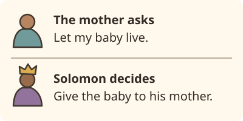

# 1 Kings 3 — Solomon asks for wisdom

**About this chapter**

God asks Solomon what he wants. Later two women bring Solomon a case that calls for the very wisdom he requested.

## Solomon worships at Gibeon

## 1 Kings 3:1

Solomon married the daughter of Pharaoh, the king of Egypt.

This marriage made the two kings allies.

Solomon brought her to the City of David.

She stayed there while he finished three building projects.

He built his palace, the LORD’s house, and the wall around Jerusalem.

## 1 Kings 3:2

People still offered sacrifices at places of worship called high places.

No one had yet built a house to honor the LORD’s name.

## 1 Kings 3:3

Solomon loved the LORD.

He followed the instructions his father David had given him.

Yet Solomon offered sacrifices and burned incense at the high places.

**Reading help**

Incense is something people burn for its sweet smell during worship.

## 1 Kings 3:4

Gibeon was the most important high place.

Solomon went there to worship.

He gave a thousand burnt offerings on the altar there.

## God speaks to Solomon in a dream

## 1 Kings 3:5

One night at Gibeon, the LORD appeared to Solomon in a dream.

God said, “Ask me for something. I will give it to you.”

## 1 Kings 3:6

Solomon answered, “You showed faithful love to my father David.

He served you faithfully and honestly.

He did what was right.

You still show him that love.

Today his son sits on his throne.

## Solomon asks for help to rule

## 1 Kings 3:7

LORD my God, you made me king in David’s place.

I feel like a little child.

I do not know how to lead.

## 1 Kings 3:8

I am here among the people you chose.

There are too many to count.

## 1 Kings 3:9

Give me an understanding heart so I can judge your people fairly.

Help me tell good from evil.

Who can rule so many people without help?”

**Reading help**

Solomon calls himself a little child because he feels inexperienced as king. An “understanding heart” means he wants to listen well and make good decisions.

**Pause and answer**

What did Solomon ask God to help him do?

## God answers Solomon

## 1 Kings 3:10

The Lord was pleased with what Solomon asked.

## 1 Kings 3:11

God said, “You could have asked for a long life or riches.

You could have asked for your enemies to die.

You asked for understanding so you could judge fairly.

## 1 Kings 3:12

I will give you what you asked for.

I will give you a wise and understanding heart.

No one before you has had wisdom like yours.

No one after you will have it either.

## 1 Kings 3:13

I will also give you riches and honor.

You did not ask for these gifts.

In your lifetime no one in any kingdom will equal you.

## 1 Kings 3:14

Follow my ways and obey my commands as your father David did.

If you do, I will give you a long life.”

## 1 Kings 3:15

Solomon woke up and knew it had been a dream.

He returned to Jerusalem and stood before the ark of the Lord’s covenant.

He gave burnt offerings and peace offerings.

Then he held a feast for all his servants.

**Reading help**

The ark was a sacred chest. It reminded Israel of God’s covenant, his solemn agreement with his people.

## Two women come to the king

## 1 Kings 3:16

Two women who worked as prostitutes came to see Solomon.

They stood before the king.

**Reading help**

A prostitute is someone who has sex for payment.

## 1 Kings 3:17

The first woman said, “My king, we live in the same house.

This woman was there when I gave birth.

## 1 Kings 3:18

Three days later she gave birth too.

No one else was in the house with us.

## The first woman tells her story

## 1 Kings 3:19

One night she rolled over on her son.

Her son died.

## 1 Kings 3:20

In the middle of the night she got up.

While I slept, she took my son from beside me.

She held my son close and laid her dead son beside me.

## 1 Kings 3:21

In the morning I got up to breastfeed my son.

The baby beside me was dead.

When I looked closely, I knew he was not the baby I had given birth to.”

## Both women claim the living baby

## 1 Kings 3:22

The other woman said, “The living boy is mine.

The boy who died is yours.”

The first woman answered, “No, the boy who died is yours.

My son is alive.”

The women argued before Solomon.

## 1 Kings 3:23

Solomon said, “Each of you says the same thing about the living boy.

Each says, ‘He is my son. Your son died.’”

## 1 Kings 3:24

Solomon said, “Bring me a sword.”

Someone brought him a sword.

## 1 Kings 3:25

Solomon said to divide the living baby in two.

He said each woman should receive half.

## Solomon gives his decision

## 1 Kings 3:26

The mother of the living baby felt deep love for her son.

She begged, “Please, my king! Give her the living baby.

Do not kill him!”

The other woman said, “Then neither of us will have him.

Divide him in two.”

## 1 Kings 3:27

Solomon gave his decision.

“Give the living baby to the woman who begged for his life.

Do not kill him. She is his mother.”

## 1 Kings 3:28

Everyone in Israel heard what Solomon had decided.

They held their king in great respect.

They saw that God had made him wise enough to judge fairly.

**Pause and answer**

What did the mother ask Solomon to do so her baby would live?
