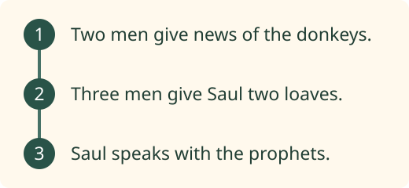

# 1 Samuel 10 — Israel welcomes Saul as king

**About this chapter**

Samuel tells Saul that God has chosen him to rule Israel. Later the people gather at Mizpah to learn who their king will be.

## Samuel pours oil on Saul

## 1 Samuel 10:1

Samuel poured oil from a small jar onto Saul’s head.

He kissed Saul and said, “The LORD has chosen you to rule Israel, his own people.

**Reading help**

Pouring oil on Saul’s head showed that God had chosen him to rule. The Bible calls this anointing.

## Three signs Saul will see

## 1 Samuel 10:2

After you leave me today, you will meet two men.

They will be at Rachel’s tomb at Zelzah, on Benjamin’s border.

They will tell you someone has found the donkeys.

Your father is worried about you now.

He keeps asking what he should do about his son.

## 1 Samuel 10:3

Next you will reach the oak tree at Tabor.

Three men will meet you there on their way to worship God at Bethel.

One will carry three young goats.

One will carry three loaves of bread.

One will carry wine in a bag made of animal skin.

## 1 Samuel 10:4

They will greet you and offer you two loaves.

Take the bread they give you.

## 1 Samuel 10:5

Then you will reach Gibeah of God.

Philistine soldiers have a post there.

Near the town you will meet a group of prophets.

They will come down from the place of worship on the hill.

Musicians will go ahead, playing harps, tambourines, flutes, and lyres.

The prophets will be speaking messages from God.

**Reading help**

A prophet is someone who speaks a message from God. A lyre is a musical instrument with strings.

## 1 Samuel 10:6

The LORD’s Spirit will come on you with power.

You too will speak messages from God.

You will become a different person.

## Samuel tells Saul to wait at Gilgal

## 1 Samuel 10:7

When these signs happen, do what needs to be done.

God is with you.

## 1 Samuel 10:8

Go ahead of me to Gilgal.

I will come to offer burnt offerings and peace offerings.

Wait seven days for me to come.

Then I will tell you what to do.”

**Pause and answer**

How long did Samuel tell Saul to wait at Gilgal?

## God changes Saul

## 1 Samuel 10:9

Saul turned to leave Samuel.

God changed Saul’s heart.

All the signs Samuel described happened that day.

**Reading help**

Here Saul’s heart means who he is on the inside.

## 1 Samuel 10:10

Saul and his servant reached Gibeah.

A group of prophets met Saul.

God’s Spirit came on Saul with power.

Saul spoke messages from God with the prophets.

## 1 Samuel 10:11

People who had known Saul saw him with the prophets.

They asked each other, “What has happened to Kish’s son?

Is Saul one of the prophets too?”

## 1 Samuel 10:12

A man who lived there asked, “And who is their father?”

People kept repeating the question about Saul.

It became a saying, “Is Saul one of the prophets too?”

## 1 Samuel 10:13

When Saul finished speaking God’s messages, he went up to the place of worship.

**Pause and answer**

What surprised the people who knew Saul?

## Saul speaks with his uncle

## 1 Samuel 10:14

Saul’s uncle asked Saul and his servant, “Where did you go?”

Saul said, “We went to look for the donkeys.

When we could not find them, we went to Samuel.”

## 1 Samuel 10:15

Saul’s uncle asked, “What did Samuel tell you?”

## 1 Samuel 10:16

Saul said, “Samuel told us someone had found the donkeys.”

Saul kept one thing from his uncle.

He kept quiet about becoming king.

**Pause and answer**

What did Saul keep from his uncle?

## Samuel gathers Israel at Mizpah

## 1 Samuel 10:17

Later Samuel called the people together at Mizpah to meet before the LORD.

## 1 Samuel 10:18

Samuel told them, “The LORD, the God of Israel, says, ‘I brought you out of Egypt.

I rescued you from the Egyptians.

I rescued you from every kingdom that treated you cruelly.’

## 1 Samuel 10:19

Your God saves you from all your troubles and suffering.

Yet today you have turned him away.

You have told him, ‘Give us a king.’

Now come before the LORD in your tribes and family groups.”

## The people look for Saul

## 1 Samuel 10:20

Samuel called all the tribes forward.

The choice fell on the tribe of Benjamin.

## 1 Samuel 10:21

Samuel called forward the family groups from Benjamin.

First came the choice of Matri’s family group.

Then came the choice of Saul, the son of Kish.

The people looked for Saul but could not find him.

## 1 Samuel 10:22

The people asked the LORD, “Has the man come here yet?”

The LORD answered, “He is hiding among the bags.”

## 1 Samuel 10:23

They ran to get Saul.

He stood among the people.

He was a head taller than anyone else.

## 1 Samuel 10:24

Samuel asked, “Do you see the man the LORD has chosen?

There is no one else like him among the people.”

Everyone shouted, “Long live the king!”

**Pause and answer**

Where did the people find Saul?

## Saul goes home

## 1 Samuel 10:25

Samuel explained the rights of a king to the people.

He wrote them on a scroll and put it before the LORD.

Then Samuel sent everyone home.

**Reading help**

A scroll was a long sheet people could write on and roll up.

## 1 Samuel 10:26

Saul went home to Gibeah.

Some brave men went with him.

God had moved them to go with Saul.

## 1 Samuel 10:27

Some men looked down on Saul.

They said, “How can this man save us?”

They brought Saul no gifts.

Saul said nothing about it.

**Pause and answer**

What did Saul say to the men who looked down on him?
