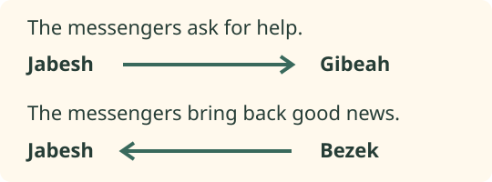

# 1 Samuel 11 — Saul helps rescue Jabesh

**About this chapter**

The people of Jabesh need help. Their messengers reach Saul’s town with bad news. Later the messengers bring good news back to Jabesh.

## Jabesh asks for time

## 1 Samuel 11:1

Nahash came from Ammon with his army.

They surrounded the town of Jabesh-gilead.

The men of Jabesh said to Nahash, “Make an agreement with us.

We will serve you.”

## 1 Samuel 11:2

Nahash said, “I will agree only if you let me blind each of you in the right eye.

That will bring shame on all Israel.”

## 1 Samuel 11:3

The leaders of Jabesh asked, “Give us seven days.

Let us send messengers throughout Israel.

If nobody comes to save us, we will surrender to you.”

**Pause and answer**

Why did the leaders of Jabesh ask for seven days?

## Saul hears the news

## 1 Samuel 11:4

The messengers came to Gibeah, where Saul lived.

They told the people what had happened.

Everyone cried aloud.

## 1 Samuel 11:5

Saul was coming home from the field behind his oxen.

He asked, “What has happened? Why are the people crying?”

They told Saul what the men from Jabesh had said.

**Reading help**

Oxen are cattle that people use for heavy work.

## 1 Samuel 11:6

When Saul heard the news, God’s Spirit came on him with power.

Saul became very angry.

## Saul gathers Israel

## 1 Samuel 11:7

Saul cut a pair of oxen into pieces.

Messengers carried the pieces throughout Israel with Saul’s warning.

Anyone who refused to follow Saul and Samuel would lose his oxen the same way.

The people feared the LORD and came together.

## 1 Samuel 11:8

Saul counted the men at Bezek.

There were 300,000 men from Israel and 30,000 from Judah.

## 1 Samuel 11:9

The men gave the messengers good news to take back.

“Tell Jabesh that help will come tomorrow, by the time the sun is hot.”

The messengers took this news to Jabesh.

The people there were glad.

**Pause and answer**

What made the people of Jabesh glad?

## Help comes to Jabesh

## 1 Samuel 11:10

The men of Jabesh told Nahash, “Tomorrow we will come out to you.

Then you can do what you wish with us.”

## 1 Samuel 11:11

The next morning Saul’s men fought in three groups.

They attacked the Ammonite camp and killed many men.

The fighting lasted until the hottest part of the day.

The surviving Ammonites scattered.

No two of them stayed together.

## 1 Samuel 11:12

The people said to Samuel, “Who said Saul should not be our king?

Bring those men here so we can kill them!”

## 1 Samuel 11:13

Saul ordered, “No one is to die today.

Today the LORD has saved Israel.”

**Pause and answer**

Why did Saul spare the men who had spoken against him?

## The people meet at Gilgal

## 1 Samuel 11:14

Samuel said, “Let us go to Gilgal.

There we can name Saul as our king again.”

## 1 Samuel 11:15

Everyone went to Gilgal.

There, before the LORD, they confirmed Saul as king.

They brought peace offerings to the LORD.

Saul and all Israel celebrated together.

**Reading help**

A peace offering was a gift to God.

People shared a meal when they brought this gift.
