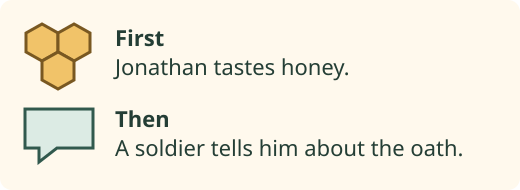

# 1 Samuel 14 — The people speak up for Jonathan

**About this chapter**

Jonathan trusts the LORD to help Israel. Later he eats a little honey. Only then does he learn what his father has told the soldiers.

## Jonathan leaves without telling Saul

## 1 Samuel 14:1

Jonathan was Saul’s son.

One day he spoke to the young man who carried his armor.

“Come across with me to the Philistine army post.”

Jonathan left without telling his father.

## 1 Samuel 14:2

Saul sat under a pomegranate tree at Migron, near Gibeah.

About 600 men were with him.

## 1 Samuel 14:3

Ahijah the priest was there wearing an ephod.

His father Ahitub was Ichabod’s brother.

Ahitub’s father was Phinehas, son of Eli.

Eli had served the LORD as priest at Shiloh.

The soldiers did not know Jonathan had left.

**Reading help**

An ephod was a garment a priest wore when serving God.

## 1 Samuel 14:4

On the way to the Philistine post, Jonathan came to a narrow pass.

A cliff stood on each side.

One was called Bozez and the other Seneh.

## 1 Samuel 14:5

One cliff faced north toward Michmash.

The other faced south toward Geba.

## Jonathan trusts the LORD

## 1 Samuel 14:6

Jonathan said to the man carrying his armor, “Let’s cross over to those uncircumcised Philistines.

Perhaps the LORD will help us.

He can save us with many people or with few.”

**Reading help**

Israelite men received the mark of circumcision as a sign of belonging to God’s people. Jonathan refers to the Philistines as people without that mark.

## 1 Samuel 14:7

His companion answered, “Do what you think is right.

I am with you all the way.”

**Pause and answer**

Why did Jonathan think the LORD could help just two men?

## 1 Samuel 14:8

Jonathan said, “We will cross over and let them see us.

## 1 Samuel 14:9

If they tell us to wait for them, we will stay where we are.

## 1 Samuel 14:10

If they invite us up, we will go.

That will be our sign that the LORD has given Israel victory over them.”

## The Philistines see Jonathan

## 1 Samuel 14:11

The Philistines saw the two men.

They said, “Look! The Hebrews are coming out of their hiding places!”

## 1 Samuel 14:12

They called, “Come up here! We will teach you a lesson!”

Jonathan told his companion, “Follow me.

The LORD has given Israel victory over them.”

## 1 Samuel 14:13

Jonathan climbed on his hands and feet.

His companion followed him.

Jonathan struck down Philistines, and his companion killed those who fell.

## 1 Samuel 14:14

In that first fight the two men killed about twenty soldiers.

It happened on about half an acre of ground.

## 1 Samuel 14:15

Fear spread through the camp and the fields.

Even the soldiers at the posts and those out raiding shook with fear.

The ground shook too.

God had sent this great fear.

## Saul finds out who is missing

## 1 Samuel 14:16

Saul’s lookouts at Gibeah in Benjamin saw the Philistine soldiers scattering in all directions.

## 1 Samuel 14:17

Saul told his soldiers, “Check who is missing.”

They found that Jonathan and the man carrying his armor had gone.

## 1 Samuel 14:18

Saul told Ahijah, “Bring the ark of God.”

This sacred chest was with the Israelites at that time.

## 1 Samuel 14:19

While Saul spoke to the priest, the noise in the Philistine camp grew louder.

Saul told the priest to stop what he was doing.

## The LORD saves Israel

## 1 Samuel 14:20

Saul and his men went to the battle.

The Philistines were so confused that they fought one another.

## 1 Samuel 14:21

Some Hebrews had gone to live in the Philistine camps.

Now they changed sides and joined Saul and Jonathan.

## 1 Samuel 14:22

Other Israelites had been hiding in the hills of Ephraim.

They heard that the Philistines were running away.

They too joined the chase.

## 1 Samuel 14:23

The LORD saved Israel that day.

The fighting went on beyond Beth-aven.

**Pause and answer**

Who does the account say saved Israel that day?

## Saul’s oath leaves the soldiers hungry

## 1 Samuel 14:24

Saul had put his soldiers under an oath that day.

He said, “May a curse fall on anyone who eats before evening, before I have taken revenge on my enemies.”

So the men went hungry and suffered.

**Reading help**

An oath is a serious promise. Here Saul warned that harm would come to anyone who ate.

## 1 Samuel 14:25

The soldiers went into a forest.

There was honey on the ground.

## 1 Samuel 14:26

They saw honey flowing there.

They were afraid to break the oath, so nobody tasted it.

## Jonathan tastes honey

## 1 Samuel 14:27

Jonathan had not heard his father’s oath.

He dipped the end of his walking stick into the honeycomb.

He tasted the honey, and his eyes grew bright.

**Reading help**

Bees store honey in a honeycomb. Jonathan’s bright eyes showed that he felt stronger.

## 1 Samuel 14:28

A soldier told him, “Your father put us under an oath.

He called down a curse on anyone who ate today.

That is why the men feel so weak.”

## 1 Samuel 14:29

Jonathan said, “My father has brought trouble on our people.

See how much better I feel after a little honey!

## 1 Samuel 14:30

If only the men had eaten some food they took from the enemy today!

Then they could have defeated many more Philistines.”

**Pause and answer**

Why did Jonathan eat when the other men would not?

## The hungry soldiers eat meat

## 1 Samuel 14:31

Israel fought the Philistines from Michmash to Aijalon that day.

By then the men were very weak.

## 1 Samuel 14:32

They rushed to take sheep, cattle, and calves from the enemy’s goods.

They killed the animals on the ground.

They ate the meat with the blood still in it.

## 1 Samuel 14:33

Someone told Saul, “The men are sinning against the LORD.

They are eating meat with the blood still in it.”

Saul said, “You have been unfaithful.

Roll a large stone over here.”

## 1 Samuel 14:34

Saul sent word for each man to bring his ox or sheep to the stone.

They were to kill the animals there before eating.

Saul warned them against eating meat with blood in it.

That night each man brought his ox and killed it there.

## 1 Samuel 14:35

Saul built an altar to the LORD.

It was the first altar he had built for the LORD.

## Saul asks God what to do

## 1 Samuel 14:36

Saul wanted to keep fighting through the night.

He wanted to take the Philistines’ goods and leave none of them alive.

The soldiers agreed, but the priest said, “Let us ask God first.”

## 1 Samuel 14:37

Saul asked God, “Should I go after the Philistines?

Will you give Israel victory?”

God gave Saul no answer that day.

**Pause and answer**

What happened when Saul asked God about fighting again?

## 1 Samuel 14:38

Saul called the army leaders together.

He said, “Let us find out what sin someone has committed today.

## 1 Samuel 14:39

As surely as the LORD who saves Israel lives, whoever did it must die.

Even if it was my son Jonathan, he must die.”

Every soldier kept silent.

## The lot points to Jonathan

## 1 Samuel 14:40

Saul put the men of Israel on one side.

He and Jonathan stood on the other.

The soldiers agreed to this.

## 1 Samuel 14:41

Saul asked, “LORD, God of Israel, why have you given me no answer today?

If Jonathan or I am at fault, answer with Urim.

If the men are at fault, answer with Thummim.”

The answer pointed to Saul and Jonathan and cleared the other men.

**Reading help**

Urim and Thummim were used to ask God for a decision. A lot was a way to show which person or group was chosen.

## 1 Samuel 14:42

Saul said, “Now cast the lot between Jonathan and me.”

This time the lot pointed to Jonathan.

## The people save Jonathan’s life

## 1 Samuel 14:43

Saul asked Jonathan what he had done.

Jonathan answered, “I tasted a little honey from the end of my stick.

Must I die for that?”

## 1 Samuel 14:44

Saul answered, “Jonathan, you must die.

May God punish me severely if you do not.”

## 1 Samuel 14:45

The people told Saul, “Jonathan helped save Israel today!

Must he die? Never!

As surely as the LORD lives, no one will harm him.

He did this today with God’s help.”

So the people saved Jonathan’s life.

**Pause and answer**

What reason did the people give for saving Jonathan?

## 1 Samuel 14:46

Saul stopped chasing the Philistines.

They went back to their own land.

## Saul’s battles and family

## 1 Samuel 14:47

As Israel’s king, Saul fought enemies on every side.

He fought Moab, Ammon, Edom, the kings of Zobah, and the Philistines.

Wherever he went, he drove his enemies back.

## 1 Samuel 14:48

Saul fought bravely and defeated the Amalekites.

He saved Israel from people who took their goods by force.

## 1 Samuel 14:49

Saul’s sons were Jonathan, Ishvi, and Malchishua.

His older daughter was Merab.

His younger daughter was Michal.

## 1 Samuel 14:50

Saul’s wife was Ahinoam, daughter of Ahimaaz.

Abner led Saul’s army.

Abner was the son of Saul’s uncle Ner.

## 1 Samuel 14:51

Saul’s father Kish and Abner’s father Ner were brothers.

Their father was Abiel.

**Pause and answer**

How were Saul’s father and Abner’s father related?

## 1 Samuel 14:52

Saul fought fierce battles with the Philistines throughout his reign.

Whenever Saul saw a strong or brave man, he took him into his army.
