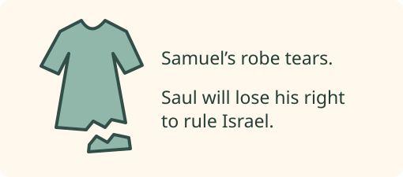

# 1 Samuel 15 — Samuel tells Saul why the LORD has rejected him

**About this chapter**

Saul says he has done what the LORD asked. Samuel hears sheep and cattle nearby. He asks Saul why those animals are still alive.

## Samuel brings the LORD’s command

## 1 Samuel 15:1

Samuel said to Saul, “The LORD sent me to pour oil on your head.

He chose you to rule his people Israel.

Now listen to what the LORD says.

## 1 Samuel 15:2

The LORD of Hosts says, ‘I saw what the Amalekites did.

They stood against Israel on the journey out of Egypt.’”

**Reading help**

“LORD of Hosts” means the LORD who commands armies.

## 1 Samuel 15:3

Samuel told Saul that the LORD had ordered him to attack Amalek and destroy everything there.

The order included killing men, women, children, and babies.

It also included the cattle, sheep, camels, and donkeys.

## Saul warns the Kenites

## 1 Samuel 15:4

Saul called his men together at Telaim and counted them.

There were 200,000 soldiers on foot and 10,000 men from Judah.

## 1 Samuel 15:5

Saul went to the city of Amalek.

He waited in the valley.

## 1 Samuel 15:6

Saul warned the Kenites to leave the Amalekites.

“You were kind to Israel when our people left Egypt.

Leave now, or you will die with the Amalekites.”

So the Kenites left.

## Saul keeps Agag and the best animals

## 1 Samuel 15:7

Saul struck down Amalekites from Havilah to Shur, east of Egypt.

## 1 Samuel 15:8

Saul captured their king, Agag, alive.

He killed the rest of the people with the sword.

## 1 Samuel 15:9

Saul and his men let Agag live.

They also kept the best sheep and cattle, including fat calves and lambs.

They kept everything else they valued.

They destroyed only what they thought was worthless.

**Pause and answer**

What did Saul and his soldiers decide to keep?

## Samuel hears from the LORD

## 1 Samuel 15:10

Then the LORD spoke to Samuel.

## 1 Samuel 15:11

The LORD said, “I regret making Saul king.

He has turned away from me.

He has disobeyed my orders.”

Samuel was deeply upset.

He cried out to the LORD all night.

## 1 Samuel 15:12

Early the next morning Samuel set out to speak to Saul.

Someone told him, “Saul went to Carmel.

There he set up a monument to honor himself.

Then he went down to Gilgal.”

**Reading help**

A monument is something people set up so others will remember a person or an event.

## Samuel hears sheep and cattle

## 1 Samuel 15:13

When Samuel reached Saul, Saul greeted him.

“May the LORD bless you!

I have done what the LORD told me.”

## 1 Samuel 15:14

Samuel asked, “Then why can I hear sheep calling?

Why can I hear cattle?”

## 1 Samuel 15:15

Saul answered, “The soldiers brought them from Amalek.

They kept the best sheep and cattle to offer to the LORD your God.

We destroyed the rest.”

**Pause and answer**

What could Samuel hear when Saul said he had obeyed?

## 1 Samuel 15:16

“Stop!” said Samuel. “Listen to what the LORD told me last night.”

“Tell me,” Saul answered.

## Samuel asks why Saul disobeyed

## 1 Samuel 15:17

Samuel said, “Once you thought you were unimportant.

Now you lead all the tribes of Israel.

The LORD chose you as king.

## 1 Samuel 15:18

He sent you to fight the Amalekites for their sins.

He told you to destroy them all.

## 1 Samuel 15:19

Why did you disobey the LORD?

You rushed to take things from the people you defeated.

The LORD saw that you did wrong.”

## 1 Samuel 15:20

Saul said, “But I did obey the LORD!

I went where he sent me.

I brought back Agag, their king.

I destroyed the Amalekites.

## 1 Samuel 15:21

The soldiers kept the best sheep and cattle we were to destroy.

They wanted to offer them to the LORD your God here at Gilgal.”

## Samuel says what matters to the LORD

## 1 Samuel 15:22

Samuel answered, “What pleases the LORD more than burnt offerings and sacrifices?

Listening to him and doing what he says.

Obeying him is better than giving him a sacrifice.

Listening to him is better than offering the fat of rams.

## 1 Samuel 15:23

Rebelling against God is as wrong as seeking answers through divination.

Insisting on your own way is as wrong as worshiping idols.

You rejected the LORD’s word.

So he has rejected you as king.”

**Reading help**

Divination means looking for hidden knowledge through signs or magic. Idols are objects people worship as gods.

**Pause and answer**

What did Samuel say pleased the LORD more than sacrifices?

## Saul admits he was afraid

## 1 Samuel 15:24

Saul told Samuel, “I have sinned.

I disobeyed the LORD’s command and your instructions.

I was afraid of the people, so I did what they wanted.

## 1 Samuel 15:25

Please forgive me.

Come back with me so I can worship the LORD.”

## 1 Samuel 15:26

Samuel answered, “I will not go back with you.

You rejected the LORD’s word.

Now the LORD has rejected you as king of Israel.”

## Samuel’s robe tears

## 1 Samuel 15:27

Samuel turned to go.

Saul grabbed the lower edge of Samuel’s robe.

The cloth tore.

## 1 Samuel 15:28

Samuel said, “Today the LORD has torn the kingdom of Israel away from you.

He has given it to another man, someone better than you.

**Reading help**

The torn cloth gives Saul a picture of his loss. God has taken away his right to rule Israel.

**Pause and answer**

What did Samuel use the torn robe to explain?

## 1 Samuel 15:29

God is the Glory of Israel.

He tells the truth.

He does not change his mind the way people do.”

## 1 Samuel 15:30

Saul said, “I have sinned.

Please show me honor before Israel and its leaders.

Come back with me so I can worship the LORD your God.”

## 1 Samuel 15:31

Then Samuel went back with Saul.

Saul worshiped the LORD.

## Samuel and Saul part ways

## 1 Samuel 15:32

Samuel asked for Agag, king of the Amalekites.

Agag came gladly.

He thought the danger of death had passed.

## 1 Samuel 15:33

Samuel told Agag, “You killed people with your sword.

Their mothers lost their children.

Now your own mother will lose her child.”

There at Gilgal, before the LORD, Samuel cut Agag to pieces.

## 1 Samuel 15:34

Samuel went home to Ramah.

Saul went home to Gibeah.

## 1 Samuel 15:35

Samuel never visited Saul again for the rest of his life.

Samuel grieved for Saul.

The LORD regretted making Saul king of Israel.

**Pause and answer**

How did Samuel feel about Saul after they parted?
