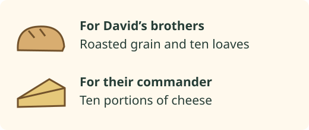

# 1 Samuel 17 — David faces Goliath

**About this chapter**

Jesse sends David to visit his brothers. At their camp David hears Goliath challenge Israel. David tells Saul why he trusts the LORD to help him.

## Two armies face each other

## 1 Samuel 17:1

The Philistines gathered their army at Socoh in Judah.

They camped at Ephes-dammim, between Socoh and Azekah.

## 1 Samuel 17:2

Saul gathered the men of Israel in the Valley of Elah.

They camped there and prepared to fight the Philistines.

## 1 Samuel 17:3

The Philistines stood on one hill.

The Israelites stood on another.

The valley lay between them.

## Goliath comes out from Gath

## 1 Samuel 17:4

A fighter named Goliath came out of the Philistine camp.

He was from Gath and fought on behalf of his people.

He stood about three meters tall.

## 1 Samuel 17:5

Goliath wore a bronze helmet.

His coat of bronze armor weighed about 57 kilograms.

## 1 Samuel 17:6

Bronze armor covered his legs.

He carried a bronze throwing spear on his back.

## 1 Samuel 17:7

His other spear had a thick shaft like a wooden bar on a loom.

The iron point alone weighed about seven kilograms.

A man carrying Goliath’s shield walked ahead of him.

**Reading help**

A loom is a frame for weaving cloth. Its thick wooden bar gives a picture of how large Goliath’s spear was.

## Goliath calls for one man to fight him

## 1 Samuel 17:8

Goliath shouted to the Israelites, “Why line up for battle?

I am a Philistine, and you serve Saul.

Choose one man to come down and fight me.

## 1 Samuel 17:9

If he kills me, we will serve you.

If I kill him, you will serve us.”

## 1 Samuel 17:10

Goliath shouted, “Today I challenge the whole army of Israel!

Send me someone to fight!”

## 1 Samuel 17:11

Saul and all the Israelites heard him.

They lost courage and were very afraid.

**Pause and answer**

How did Saul and his men feel when they heard Goliath?

## David and his older brothers

## 1 Samuel 17:12

David’s father was Jesse, an Ephrathite from Bethlehem in Judah.

Jesse had eight sons.

By the time Saul was king, Jesse was very old.

## 1 Samuel 17:13

Jesse’s three oldest sons went to fight with Saul.

Eliab was the oldest, Abinadab the second, and Shammah the third.

## 1 Samuel 17:14

David was the youngest.

His three oldest brothers stayed with Saul.

## 1 Samuel 17:15

David traveled back and forth between Saul and Bethlehem.

At home he cared for his father’s sheep.

## 1 Samuel 17:16

Goliath came forward every morning and evening for forty days.

## Jesse sends food to the camp

## 1 Samuel 17:17

Jesse told David, “Hurry to your brothers’ camp.

Take them this large measure of roasted grain and these ten loaves.

**Reading help**

The measure of grain was called an ephah. It held about 22 liters.

## 1 Samuel 17:18

Give these ten portions of cheese to their commander.

See how your brothers are doing.

Bring back something from them so I will know they are well.

## 1 Samuel 17:19

They are with Saul and Israel’s men in the Valley of Elah.

They are fighting the Philistines.”

**Pause and answer**

What news did Jesse want David to bring home?

## 1 Samuel 17:20

David got up early and left his sheep with another keeper.

He took the food and went as Jesse had asked.

He reached the camp as the soldiers went out shouting their battle cry.

## 1 Samuel 17:21

The two armies lined up facing each other.

## David hears the challenge

## 1 Samuel 17:22

David left the food with the man in charge of supplies.

He ran to his brothers and asked how they were.

## 1 Samuel 17:23

While David was speaking, Goliath came out from the Philistine ranks.

David heard him shout the same challenge as before.

## 1 Samuel 17:24

When Israel’s men saw Goliath, they ran away in fear.

## 1 Samuel 17:25

The men said, “Goliath keeps coming out to insult Israel.

The king will give great wealth to whoever kills him.

That man can marry the king’s daughter.

His father’s family will pay no taxes in Israel.”

## 1 Samuel 17:26

David asked, “What will the man receive who kills him and ends Israel’s shame?

Who is this uncircumcised Philistine to challenge the armies of the living God?”

**Reading help**

David calls Goliath uncircumcised because Goliath did not bear Israel’s sign of belonging to God’s covenant.

## 1 Samuel 17:27

The men told David what the king would give the man who killed Goliath.

## Eliab is angry with David

## 1 Samuel 17:28

Eliab heard his younger brother David and grew angry.

“Why are you here?

Who has those few sheep you left in the wilderness?

I know how proud you are and what you are thinking.

You just want to see the battle!”

## 1 Samuel 17:29

David answered, “What have I done now?

I only asked a question.”

## 1 Samuel 17:30

David turned to someone else and asked about the reward.

He got the same answer as before.

**Pause and answer**

Why did Eliab think David had come?

## 1 Samuel 17:31

Someone reported David’s words to Saul.

Saul sent for him.

## David tells Saul about the sheep

## 1 Samuel 17:32

David told Saul, “No one needs to lose courage because of Goliath.

I am your servant, and I will fight him.”

## 1 Samuel 17:33

Saul said, “You cannot fight this Philistine.

You are still a boy.

Goliath has fought since he was young.”

## 1 Samuel 17:34

David said, “I care for my father’s sheep.

Sometimes a lion or a bear carried off a lamb.

## 1 Samuel 17:35

I went after the animal and rescued the lamb from its mouth.

If the animal turned on me, I fought it and killed it.

## 1 Samuel 17:36

I have killed lions and bears.

This uncircumcised Philistine will end up like them.

He has challenged the armies of the living God.”

## 1 Samuel 17:37

David added, “The LORD rescued me from the lion and the bear.

He will rescue me from this Philistine.”

Saul said, “Go, and may the LORD be with you.”

**Pause and answer**

Why did David trust the LORD to rescue him?

## David takes off Saul’s armor

## 1 Samuel 17:38

Saul dressed David in his own clothes and armor.

He put a bronze helmet on David’s head.

## 1 Samuel 17:39

David put on the sword and tried to walk.

He told Saul, “I cannot walk in these.

I have never worn them before.”

So he took them off.

## 1 Samuel 17:40

David took his walking stick.

He chose five smooth stones from the stream and put them in his shepherd’s bag.

He carried his sling as he went to meet Goliath.

## Goliath speaks to David

## 1 Samuel 17:41

Goliath came closer to David.

The man with his shield walked in front of him.

## 1 Samuel 17:42

Goliath looked David over and looked down on him.

He saw a handsome boy with a reddish complexion.

## 1 Samuel 17:43

Goliath said, “Am I a dog, that you come at me with sticks?”

He called on his gods to curse David.

## 1 Samuel 17:44

Goliath shouted, “Come here!

I will leave your body for the birds and wild animals!”

## David says who will save Israel

## 1 Samuel 17:45

David answered, “You come with a sword and two kinds of spear.

I come in the name of the LORD who commands armies.

He is the God of Israel’s armies, whom you have challenged.

## 1 Samuel 17:46

Today the LORD will give me victory over you.

I will kill you and cut off your head.

Birds and wild animals will feed on the dead Philistines.

Then the whole world will know there is a God in Israel.

## 1 Samuel 17:47

Everyone here will know the LORD can save without a sword or spear.

This battle belongs to the LORD.

He will give us victory over you.”

**Reading help**

When David says the battle belongs to the LORD, he means the LORD decides who wins.

**Pause and answer**

What did David want the whole world to know?

## Goliath falls

## 1 Samuel 17:48

Goliath came forward to fight.

David ran to meet him.

## 1 Samuel 17:49

A stone from David’s sling struck Goliath in the forehead and sank in.

Goliath fell face down on the ground.

## 1 Samuel 17:50

David defeated Goliath with a sling and a stone.

He struck Goliath down without a sword of his own and killed him.

## 1 Samuel 17:51

David stood over Goliath and drew Goliath’s sword.

He cut off Goliath’s head.

The Philistines saw that their champion was dead and ran away.

## The Philistines flee

## 1 Samuel 17:52

Men from Israel and Judah shouted and chased the Philistines.

They chased them to the entrance of Gath and the gates of Ekron.

Dead Philistines lay along the road from Shaaraim toward both cities.

## 1 Samuel 17:53

The Israelites came back from the chase.

They took the goods the Philistines had left in their camps.

## 1 Samuel 17:54

David took Goliath’s head to Jerusalem.

He kept Goliath’s weapons in his own tent.

## Saul asks about David’s father

## 1 Samuel 17:55

Earlier, Saul had watched David go out to meet Goliath.

He asked Abner, his army commander, “Whose son is that young man?”

Abner answered, “As surely as you live, my king, I do not know.”

## 1 Samuel 17:56

Saul told Abner, “Find out whose son he is.”

## 1 Samuel 17:57

When David came back, he was still carrying Goliath’s head.

Abner brought David to Saul.

## 1 Samuel 17:58

Saul asked, “Young man, whose son are you?”

David answered, “My father is your servant Jesse of Bethlehem.”

**Pause and answer**

What did David tell Saul about his father?
