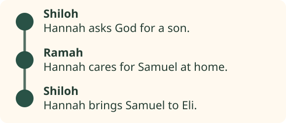

# 1 Samuel 1 — Hannah prays for a son

**About this chapter**

Hannah tells God why she is hurting. She asks for a son and makes a promise. Later she returns to Shiloh with her child.

## Elkanah’s family goes to Shiloh

## 1 Samuel 1:1

Elkanah lived in Ramathaim-zophim, in the hills of Ephraim.

His father was Jeroham.

Jeroham’s father was Elihu.

Elihu’s father was Tohu.

Tohu’s father was Zuph, a man from Ephraim.

## 1 Samuel 1:2

Elkanah had two wives, Hannah and Peninnah.

Peninnah had children.

Hannah had no children.

## 1 Samuel 1:3

Each year Elkanah went to Shiloh.

He worshiped the LORD of Hosts and offered a sacrifice.

Eli’s sons, Hophni and Phinehas, served there as priests.

**Reading help**

“LORD of Hosts” is a name for God. It means the LORD who commands armies. A sacrifice is a gift offered to God.

## Hannah cries at the meal

## 1 Samuel 1:4

On the day of the sacrifice, Elkanah shared the meat.

He gave some to Peninnah and each of her children.

## 1 Samuel 1:5

Elkanah gave Hannah twice as much because he loved her.

The LORD had kept Hannah from having children.

## 1 Samuel 1:6

Peninnah made fun of Hannah because of this.

She wanted to upset Hannah.

## 1 Samuel 1:7

This happened year after year at the LORD’s house.

Peninnah’s cruel words made Hannah cry.

Hannah would not eat.

## 1 Samuel 1:8

Elkanah asked, “Hannah, why are you crying?

Why won’t you eat?

What makes you so sad?

Don’t I mean more to you than ten sons?”

**Pause and answer**

What made Hannah cry each year at Shiloh?

## Hannah asks the LORD for a son

## 1 Samuel 1:9

After the meal at Shiloh, Hannah stood up.

Eli the priest sat beside the door of the LORD’s house.

## 1 Samuel 1:10

Hannah felt deep pain.

She cried as she prayed to the LORD.

## 1 Samuel 1:11

Hannah made a promise.

“LORD of Hosts, I am your servant.

Please see how much I hurt.

Remember me and give me a son.

I will give him to you for his whole life.

No one will ever shave his head.”

**Reading help**

Leaving the boy’s hair unshaved would show that he belonged to the LORD.

## Eli sees Hannah praying

## 1 Samuel 1:12

Hannah kept praying to the LORD.

Eli watched her mouth.

## 1 Samuel 1:13

Hannah moved her lips as she prayed silently.

Eli could hear no words.

He thought Hannah was drunk.

## 1 Samuel 1:14

Eli asked, “How long will you stay drunk?

Put your wine away!”

## 1 Samuel 1:15

Hannah answered, “No, sir.

I am deeply troubled.

I have had no wine or other strong drink.

I have told the LORD everything in my heart.

**Reading help**

Hannah is telling God about all her sadness. That is what it means to tell him everything in her heart.

## 1 Samuel 1:16

Please do not think I am a wicked woman.

I have prayed so long because I hurt so much.”

**Pause and answer**

Why did Eli think Hannah was drunk?

## Hannah goes home in peace

## 1 Samuel 1:17

Eli answered, “Go in peace.

May the God of Israel give you what you asked for.”

## 1 Samuel 1:18

Hannah said, “Please think kindly of me, sir.”

Then Hannah went away and ate.

Her face no longer looked sad.

## 1 Samuel 1:19

Early the next morning, the family bowed before the LORD.

Then they went home to Ramah.

Elkanah slept with his wife Hannah.

The LORD remembered her.

## 1 Samuel 1:20

In time Hannah became pregnant and had a son.

She named him Samuel.

She said, “I asked the LORD for him.”

**Pause and answer**

Why did Hannah choose the name Samuel?

## Hannah cares for Samuel at home

## 1 Samuel 1:21

When it was time for the yearly sacrifice, Elkanah took his family to Shiloh.

He also went to keep his promise to the LORD.

## 1 Samuel 1:22

Hannah stayed home.

She told Elkanah, “I will wait until Samuel stops drinking my milk.

Then I will take him to the LORD’s house.

He will stay there for good.”

## 1 Samuel 1:23

Elkanah answered, “Do what you think best.

Stay here until then.

May the LORD do what he has said.”

So Hannah stayed home and fed Samuel her milk until he no longer needed it.

## Hannah keeps her promise

## 1 Samuel 1:24

Samuel was still young when Hannah took him to the LORD’s house at Shiloh.

She brought a three-year-old bull and an ephah of flour.

She also brought wine in a bag made of animal skin.

**Reading help**

An ephah was a measure for dry food. It held about 22 liters.

## 1 Samuel 1:25

The family killed the bull as a sacrifice.

Then they brought Samuel to Eli.

## 1 Samuel 1:26

Hannah said, “Please listen, sir.

As surely as you live, I am the woman who stood beside you here.

I was praying to the LORD.

## 1 Samuel 1:27

I prayed for this boy.

The LORD gave me what I asked for.

## 1 Samuel 1:28

Now I give Samuel to the LORD.

He will belong to the LORD his whole life.”

There they worshiped the LORD.

**Pause and answer**

How did Hannah keep her promise?
