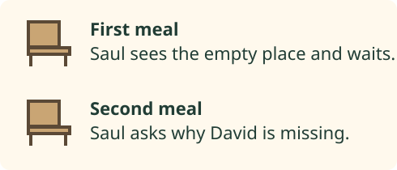

# 1 Samuel 20 — Jonathan keeps his promise to David

**About this chapter**

David fears for his life. Jonathan wants to know what his father Saul intends to do. The two friends promise to care for each other and their families.

## David asks his friend for help

## 1 Samuel 20:1

David fled from Naioth in Ramah and came to Jonathan.

He asked, “What wrong have I done to your father?

Why does he want me dead?”

## 1 Samuel 20:2

Jonathan answered, “You will not die!

My father tells me everything he does, big or small.

Why would he hide this from me?

I cannot believe it.”

## 1 Samuel 20:3

David swore, “Your father knows how much you care for me.

He wants to keep this from you because it would hurt you.

As surely as the LORD lives and you live, I am one step from death.”

**Reading help**

“One step from death” means David believes he could die very soon.

## 1 Samuel 20:4

Jonathan told David, “Tell me what you need.

I will do it.”

**Pause and answer**

Why did David think Saul had kept his plans from Jonathan?

## David expects to miss the feast

## 1 Samuel 20:5

David said, “Tomorrow is the New Moon feast.

I should be eating with the king.

Let me hide in the field until the third evening.

**Reading help**

The New Moon feast marked the start of a new month.

## 1 Samuel 20:6

If your father asks about me, tell him I begged to go home to Bethlehem.

Tell him my whole family gathers there each year to offer a sacrifice.

## 1 Samuel 20:7

If he accepts that, I am safe.

If he gets angry, you will know he means to hurt me.

## 1 Samuel 20:8

Be kind to me, your servant.

You made a covenant with me before the LORD.

If I have done wrong, kill me yourself.

Why hand me over to your father?”

**Reading help**

A covenant is a solemn promise. David is reminding Jonathan of their promise of friendship.

## 1 Samuel 20:9

Jonathan answered, “Never!

If I learned that my father meant to harm you, I would tell you.”

## 1 Samuel 20:10

David asked, “Who will tell me if your father gives you an angry answer?”

## Jonathan promises to warn David

## 1 Samuel 20:11

Jonathan said, “Come out to the field.”

The two friends went there together.

## 1 Samuel 20:12

Jonathan said, “I promise before the LORD, the God of Israel, to find out what my father thinks.

I will know by this time tomorrow or the next day.

If he means you well, I will send you word.

## 1 Samuel 20:13

If my father means you harm, I will warn you.

I will send you away safely.

May the LORD punish me severely if I fail you.

May the LORD be with you as he has been with my father.

## A promise for both families

## 1 Samuel 20:14

As long as I live, show me the faithful love the LORD shows.

Spare my life.

## 1 Samuel 20:15

Always show that same love to my family.

Remember them even after the LORD has removed all your enemies from the earth.”

## 1 Samuel 20:16

Jonathan made this covenant with David’s family.

He said, “May the LORD make David’s enemies answer for what they do.”

## 1 Samuel 20:17

Jonathan loved David as much as he loved himself.

Because of that love, he asked David to make his promise again.

**Pause and answer**

Who else did Jonathan ask David to show love to?

## Jonathan tells David what to listen for

## 1 Samuel 20:18

Jonathan said, “Tomorrow is the New Moon feast.

People will notice your empty seat.

## 1 Samuel 20:19

On the third day, go back to the place where you hid when this trouble began.

Stay beside the stone called Ezel.

## 1 Samuel 20:20

I will shoot three arrows near the stone as though I were aiming at a target.

## 1 Samuel 20:21

I will send a boy to look for them.

If I tell him the arrows are on this side of him, you can come back.

As surely as the LORD lives, you will be safe.

## 1 Samuel 20:22

If I tell him the arrows are beyond him, you must leave.

The LORD is sending you away.

## 1 Samuel 20:23

The LORD will always be a witness to what we have promised each other.”

## David’s place is empty

## 1 Samuel 20:24

David hid in the field.

When the New Moon feast began, King Saul sat down to eat.

## 1 Samuel 20:25

Saul sat by the wall as usual.

Jonathan sat opposite him and Abner sat beside him.

David’s place was empty.

## 1 Samuel 20:26

Saul said nothing that day.

He thought David must be unclean and unable to come to the feast.

**Reading help**

Here “unclean” means that under Israel’s worship rules David would have to wait before joining the meal. This was Saul’s guess about why David was away.

## 1 Samuel 20:27

On the second day David’s place was still empty.

Saul asked Jonathan, “Why has Jesse’s son missed both meals?”

**Pause and answer**

What did Saul notice at both meals?

## Jonathan answers his father

## 1 Samuel 20:28

Jonathan answered, “David begged me to let him go to Bethlehem.

## 1 Samuel 20:29

He said his family was offering a sacrifice there.

His brother had told him to come.

He asked me for the chance to see his brothers.

That is why he is missing from your table.”

## 1 Samuel 20:30

Saul was furious with Jonathan.

He said, “You son of a wicked, rebellious woman!

You have taken David’s side.

You bring shame on yourself and on your mother.

## 1 Samuel 20:31

As long as Jesse’s son lives, your place as king will never be secure.

Bring him here. He must die!”

## Jonathan learns what Saul intends

## 1 Samuel 20:32

Jonathan asked his father, “Why should David die?

What has he done?”

## 1 Samuel 20:33

Saul threw his spear at Jonathan to kill him.

Now Jonathan knew his father meant to kill David.

## 1 Samuel 20:34

Jonathan left the table in anger.

He ate nothing that second day.

He grieved over the shameful way Saul had treated David.

**Pause and answer**

Why did Jonathan leave the table in anger?

## Jonathan goes to the field

## 1 Samuel 20:35

In the morning Jonathan went to the field as he had promised David.

He took a young boy with him.

## 1 Samuel 20:36

Jonathan asked the boy to run and find his arrows.

As the boy ran, an arrow landed beyond him.

## 1 Samuel 20:37

The boy reached the place where the arrow had fallen.

Jonathan called, “Isn’t the arrow beyond you?”

## 1 Samuel 20:38

Jonathan called again, “Hurry! Do not wait!”

The boy picked up the arrow and came back.

## 1 Samuel 20:39

The boy knew nothing about the friends’ agreement.

Only David and Jonathan knew what the words meant.

## The friends say goodbye

## 1 Samuel 20:40

Jonathan gave his equipment to the boy.

He told him to take it back to town.

## 1 Samuel 20:41

After the boy left, David came from the south side of the stone.

He bowed low three times with his face to the ground.

The friends kissed each other and wept.

David wept even more than Jonathan.

## 1 Samuel 20:42

Jonathan said, “Go in peace.

We made our promise in the LORD’s name.

May the LORD always be a witness between us and between our families after us.”

David left, and Jonathan went back to town.

**Pause and answer**

What promise did Jonathan remember as David left?
