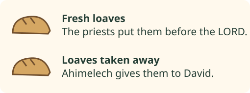

# 1 Samuel 21 — David asks for bread at Nob

**About this chapter**

David is running from Saul. At Nob he asks a priest for help. Later, in Gath, people recognize David from a song.

## Ahimelech meets David

## 1 Samuel 21:1

David went to Nob to see Ahimelech the priest.

Ahimelech trembled when he met David.

He asked, “Why are you here alone?”

## 1 Samuel 21:2

David answered, “The king gave me a task.

He told me to keep it secret.

I told my young men where to meet me.”

## 1 Samuel 21:3

David asked, “What food do you have here?

Please give me five loaves of bread, or whatever you have.”

## The priest gives David holy bread

## 1 Samuel 21:4

Ahimelech answered, “I have no ordinary bread.

I have some holy bread set apart for God.

The young men may eat it if they have kept away from sex.”

## 1 Samuel 21:5

David answered, “We have kept away from women.

That is what we do when I go on a journey.

Even on ordinary trips my men keep their bodies holy.

They have taken even more care today.”

## 1 Samuel 21:6

The only bread there was the Bread of the Presence.

The priests had taken those loaves from before the LORD.

That same day they had put hot bread in their place.

Ahimelech gave David the loaves the priests had taken away.

**Pause and answer**

Which loaves did Ahimelech give David?

## David asks about a sword

## 1 Samuel 21:7

One of Saul’s servants had to stay before the LORD that day.

His name was Doeg, and he came from Edom.

He was in charge of Saul’s shepherds.

## 1 Samuel 21:8

David asked Ahimelech, “Do you have a spear or a sword?

I brought no weapons with me.

The king’s business was urgent.”

## 1 Samuel 21:9

Ahimelech answered, “Goliath’s sword is here.

You killed that Philistine in the Valley of Elah.

His sword is wrapped in cloth behind the ephod.

It is the only sword here. You may take it.”

David said, “There is no other sword like it.

Please give it to me.”

**Reading help**

An ephod was a piece of clothing a priest wore.

**Pause and answer**

Whose sword did Ahimelech offer David?

## The servants of Achish recognize David

## 1 Samuel 21:10

That day David fled from Saul.

He went to Achish, the king of Gath.

## 1 Samuel 21:11

The king’s servants asked Achish, “Isn’t this David, the king of the land?

People sang about him as they danced.

They sang, ‘Saul has killed his thousands, and David his tens of thousands.’”

## 1 Samuel 21:12

David thought carefully about what the servants said.

He became very afraid of King Achish.

## David changes how he acts

## 1 Samuel 21:13

While the men held him, David pretended to have lost his senses.

He scratched marks on the doors of the town gate.

He let spit run down his beard.

## 1 Samuel 21:14

Achish told his servants, “Look at him!

You can see he has lost his senses.

Why did you bring him to me?

## 1 Samuel 21:15

Do I need another man here who acts like this?

Why should he come into my house?”

**Pause and answer**

What did Achish believe about David?
