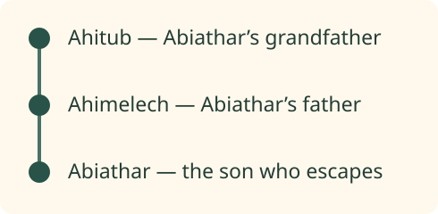

# 1 Samuel 22 — Abiathar escapes to David

**About this chapter**

Saul hears that a priest at Nob helped David. He calls the priests to answer him. Later one priest’s son brings David news of what happened.

## People join David at the cave

## 1 Samuel 22:1

David left Gath and found shelter in the cave of Adullam.

His brothers and the rest of his father’s family heard where he was.

They came to join him there.

## 1 Samuel 22:2

Other people came too.

Some were in trouble. Some owed money.

Others were unhappy with their lives.

David became their leader.

About 400 men were with him.

## David finds a place for his parents

## 1 Samuel 22:3

David went from there to Mizpeh in Moab.

He asked the king of Moab, “Please let my parents stay with you until I learn what God will do for me.”

## 1 Samuel 22:4

David left his parents in the king’s care.

They stayed there as long as David lived in his stronghold.

**Reading help**

A stronghold is a place where people can stay safe from attack.

## 1 Samuel 22:5

The prophet Gad told David, “Leave the stronghold and go to Judah.”

David went to the forest of Hereth.

**Pause and answer**

Who cared for David’s parents?

## Saul questions his servants

## 1 Samuel 22:6

Saul heard that someone had found David and his men.

Saul was sitting under a tamarisk tree on the hill at Gibeah.

He held his spear, and his servants stood around him.

## 1 Samuel 22:7

Saul said, “Listen, men of Benjamin!

Will Jesse’s son give you all fields and vineyards?

Will he put each of you in charge of a thousand men or a hundred?

## 1 Samuel 22:8

Have you all made plans against me?

My own son made a covenant with Jesse’s son.

None of you told me. No one cared about me.

My son has turned my own servant against me.

He is waiting to attack me, and no one warned me.”

**Reading help**

Jesse’s son is David. Saul’s son is Jonathan. A covenant is a solemn promise, like the one Jonathan and David made to each other.

## Doeg tells Saul what he saw

## 1 Samuel 22:9

Doeg from Edom stood with Saul’s servants.

He said, “I saw David go to Nob.

He went to Ahimelech, the son of Ahitub.

## 1 Samuel 22:10

Ahimelech asked the LORD for guidance for David.

He gave David food and the sword of Goliath the Philistine.”

**Pause and answer**

What did Doeg say Ahimelech had given David?

## 1 Samuel 22:11

Saul sent for Ahimelech the priest and his father’s whole family.

These men served as priests at Nob.

They all came to Saul.

## Ahimelech answers Saul

## 1 Samuel 22:12

Saul said, “Listen, son of Ahitub.”

Ahimelech answered, “Here I am, my king.”

## 1 Samuel 22:13

Saul asked, “Why have you and Jesse’s son made plans against me?

You gave him bread and a sword.

You asked God for guidance for him.

Now he is waiting to attack me.”

## 1 Samuel 22:14

Ahimelech answered, “Who serves you as faithfully as David?

He married your daughter. He leads the men who guard you.

Your family honors him.

## 1 Samuel 22:15

I have asked God for guidance for David before.

Please do not blame me or my father’s family.

I knew nothing at all about this matter.”

**Pause and answer**

Why did Ahimelech think he could help David?

## The guards refuse Saul’s order

## 1 Samuel 22:16

Saul said, “Ahimelech, you and your father’s whole family will die!”

## 1 Samuel 22:17

Saul ordered his guards to kill the LORD’s priests.

He said, “The priests sided with David.

They knew David was running away and kept it from me.”

The guards refused to harm the LORD’s priests.

## 1 Samuel 22:18

Then Saul told Doeg to kill the priests.

Doeg himself killed 85 men that day.

They wore the linen ephod.

**Reading help**

An ephod was a garment priests wore when they served the LORD. Linen is a kind of cloth.

## 1 Samuel 22:19

Doeg also attacked Nob, the town where the priests lived.

He killed men, women, children, and babies there.

He killed the cattle, donkeys, and sheep too.

**Pause and answer**

How did Saul’s guards respond when he ordered them to kill the priests?

## Abiathar tells David the news

## 1 Samuel 22:20

One son of Ahimelech escaped.

His name was Abiathar. His grandfather was Ahitub.

Abiathar fled to David.

## 1 Samuel 22:21

Abiathar told David that Saul had ordered the deaths of the LORD’s priests.

## 1 Samuel 22:22

David said, “I saw Doeg at Nob that day.

I knew he would tell Saul.

I am responsible for the deaths in your father’s family.

## 1 Samuel 22:23

Stay here with me. Do not be afraid.

The man who wants to kill you wants to kill me too.

You will be safe with me.”

**Pause and answer**

What did David offer Abiathar after he heard the news?
