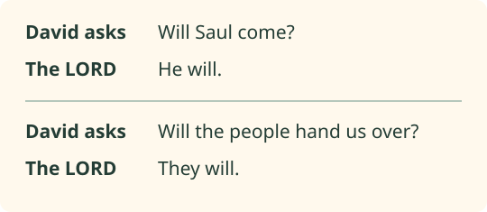

# 1 Samuel 23 — David saves the people of Keilah

**About this chapter**

David helps a town whose grain is being stolen. Then Saul comes looking for David. Jonathan visits David and helps him trust God.

## David asks about Keilah

## 1 Samuel 23:1

Someone told David, “The Philistines are attacking Keilah.

They are stealing grain from the threshing floors.”

**Reading help**

A threshing floor was a firm, flat place where people separated grain from its stalks.

## 1 Samuel 23:2

David asked the LORD, “Should I fight these Philistines?”

The LORD answered, “Go and fight them.

Save the people of Keilah.”

## 1 Samuel 23:3

David’s men said, “We are already afraid here in Judah.

How much more afraid will we be if we face the Philistine army at Keilah?”

## 1 Samuel 23:4

David asked the LORD again.

The LORD answered, “Go to Keilah now.

I will give you victory over the Philistines.”

## 1 Samuel 23:5

David and his men went to Keilah and fought the Philistines.

They defeated them and took their farm animals.

So David saved the people of Keilah.

**Pause and answer**

What did David do when his men said they were afraid?

## Saul hears where David is

## 1 Samuel 23:6

Abiathar was the son of Ahimelech the priest.

When Abiathar fled to David at Keilah, he brought the ephod with him.

**Reading help**

An ephod was a special garment a priest wore when serving God.

## 1 Samuel 23:7

Saul heard that David had gone to Keilah.

Saul said, “God has given David to me.

David has trapped himself in a town with gates that lock with bars.”

## 1 Samuel 23:8

Saul called up all his soldiers.

He planned to surround Keilah and capture David and his men.

## David brings his questions to the LORD

## 1 Samuel 23:9

David learned that Saul meant to harm him.

He told Abiathar the priest, “Bring the ephod.”

## 1 Samuel 23:10

David prayed, “LORD, God of Israel, I am your servant.

I have heard that Saul plans to come here.

He wants to destroy Keilah because of me.

## 1 Samuel 23:11

Will the people of Keilah hand me over to him?

Will Saul come here as I have heard?

LORD, God of Israel, please tell me.”

The LORD answered, “Saul will come.”

## 1 Samuel 23:12

David asked, “Will the people of Keilah hand me and my men over to Saul?”

The LORD answered, “They will.”

## David leaves Keilah

## 1 Samuel 23:13

David and his men left Keilah.

There were about 600 of them.

They moved from place to place.

Saul heard David had left, so he called off his march to Keilah.

**Pause and answer**

Why did Saul call off his march to Keilah?

## 1 Samuel 23:14

David stayed in places of shelter in the wilderness, in the hills of Ziph.

Saul searched for David day after day.

God kept Saul from capturing him.

## 1 Samuel 23:15

At Horesh in the wilderness of Ziph, David learned that Saul had come to kill him.

## Jonathan comes to encourage David

## 1 Samuel 23:16

Saul’s son Jonathan went to see David at Horesh.

He helped David find strength in God.

## 1 Samuel 23:17

Jonathan said, “Do not be afraid.

My father Saul will never catch you.

You will be king over Israel.

I will serve next in command after you.

Even my father knows this.”

## 1 Samuel 23:18

David and Jonathan made a covenant before the LORD.

Jonathan went home, and David stayed at Horesh.

**Reading help**

A covenant is a solemn promise. David and Jonathan made their promise with God as their witness.

**Pause and answer**

What did Jonathan tell David to help him trust God?

## People from Ziph speak to Saul

## 1 Samuel 23:19

Some people from Ziph went to see Saul at Gibeah.

They said, “David is hiding near us at Horesh, on the hill of Hachilah south of Jeshimon.

## 1 Samuel 23:20

Come whenever you wish, O king.

We will hand him over to you.”

## 1 Samuel 23:21

Saul said, “You have shown me kindness.

May the LORD bless you for it.

## 1 Samuel 23:22

I hear David is very clever.

Find out where he goes and who has seen him.

## 1 Samuel 23:23

Find out where he hides.

When you know for sure, come back and tell me.

I will go with you.

If he is in Judah, I will search for him among all its families.”

## Saul follows David to Maon

## 1 Samuel 23:24

The people of Ziph went home ahead of Saul.

David and his men were in the wilderness of Maon.

They were in the Arabah, south of Jeshimon.

## 1 Samuel 23:25

Saul and his men went looking for David.

David heard about it and went down to the rock in the wilderness of Maon.

Saul heard where David was and followed him there.

## 1 Samuel 23:26

Saul went along one side of the mountain.

David and his men were on the other side.

David hurried to get away.

Saul and his men were close to catching them.

## A messenger brings news

## 1 Samuel 23:27

Just then a messenger told Saul, “Come quickly!

The Philistines have attacked our land!”

## 1 Samuel 23:28

Saul stopped chasing David and went to face the Philistines.

That is why people called the place Sela-hammahlekoth.

**Reading help**

The name Sela-hammahlekoth means “rock of parting.” Here Saul and David went their separate ways.

## 1 Samuel 23:29

David left there and stayed in places of shelter at En-gedi.

**Pause and answer**

What news made Saul stop chasing David?
