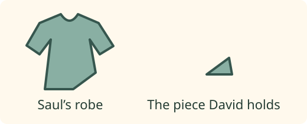

# 1 Samuel 24 — David spares Saul in the cave

**About this chapter**

Saul enters the cave where David is hiding. Later David shows Saul a piece of cloth. It helps Saul understand what happened in the cave.

## Saul searches for David

## 1 Samuel 24:1

Saul came back from chasing the Philistines.

Someone told him, “David is in the wilderness of En-gedi.”

## 1 Samuel 24:2

Saul chose 3,000 men from all over Israel.

They searched for David and his men near the Rocks of the Wild Goats.

## 1 Samuel 24:3

Beside the road were pens for sheep and a cave.

Saul went into the cave to use the toilet.

David and his men were hiding deep inside.

## David holds his men back

## 1 Samuel 24:4

David’s men said, “This is the day the LORD told you about!

He promised to put your enemy in your power.

You can do whatever you want with him.”

David quietly cut a corner off Saul’s robe.

## 1 Samuel 24:5

Afterward David felt guilty about cutting Saul’s robe.

## 1 Samuel 24:6

He told his men, “The LORD chose Saul to be king.

May the LORD keep me from harming my master.

I must never attack the king the LORD anointed.”

**Reading help**

To anoint a king was to pour oil on him as a sign that God had chosen him to rule.

## 1 Samuel 24:7

David’s words held his men back.

He refused to let them attack Saul.

Saul left the cave and went on his way.

**Pause and answer**

Why did David stop his men from attacking Saul?

## David calls to Saul

## 1 Samuel 24:8

Then David came out and called, “My lord the king!”

Saul turned around.

David bowed with his face to the ground to show respect.

## 1 Samuel 24:9

David asked, “Why listen to people who say I want to hurt you?

## 1 Samuel 24:10

Today in the cave the LORD put you in my power.

My men told me to kill you, but I let you live.

I said, ‘I will never hurt my master.

The LORD anointed him as king.’

## David shows Saul the cloth

## 1 Samuel 24:11

Look, my father! I am holding a corner of your robe.

I cut it off and left you alive.

You can see that I have no plan to harm you or rebel against you.

I have done you no wrong, yet you hunt me to kill me.

**Reading help**

David calls Saul “my father.” David had married Saul’s daughter Michal.

**Pause and answer**

What did the piece of cloth show Saul?

## 1 Samuel 24:12

May the LORD decide which of us has done wrong.

May he repay you for the wrong you have done.

I will never attack you.

## 1 Samuel 24:13

An old saying goes, ‘Wicked people do wicked things.’

I will never attack you.

## 1 Samuel 24:14

Who is the king of Israel chasing?

A dead dog? A flea?

**Reading help**

A flea is a tiny insect. David compares himself to a flea and a dead dog to say how little danger he poses to a king.

## 1 Samuel 24:15

May the LORD judge between us.

May he see what is happening and speak up for me.

May he save me from you.”

## Saul weeps and answers David

## 1 Samuel 24:16

When David finished speaking, Saul called back, “David, my son, is that your voice?”

Then Saul cried aloud.

## 1 Samuel 24:17

Saul said, “You have done what is right more than I have.

I did evil to you, and you did good to me.

## 1 Samuel 24:18

Today you have shown me how well you treated me.

The LORD put me in your power, and you let me live.

## 1 Samuel 24:19

Who finds an enemy and lets him go unharmed?

May the LORD do good to you for what you did for me today.

**Pause and answer**

How did Saul say David had treated him?

## Saul asks for a promise

## 1 Samuel 24:20

Now I know you will be king.

You will rule firmly over Israel.

## 1 Samuel 24:21

Make me a promise in the LORD’s name.

Let my children and their children live.

Let my name continue in my father’s family.”

## 1 Samuel 24:22

David made that promise to Saul.

Saul went home.

David and his men went back up to their place of safety.

**Pause and answer**

What promise did David make to Saul?
