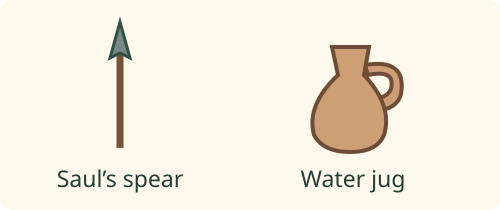

# 1 Samuel 26 — David values Saul’s life

**About this chapter**

David finds Saul asleep. Abishai wants to kill him. David spares Saul and later tells him why.

## Saul looks for David again

## 1 Samuel 26:1

People from Ziph went to see Saul at Gibeah.

They said, “David is hiding on the hill of Hachilah, across from Jeshimon.”

## 1 Samuel 26:2

Saul took 3,000 men chosen from Israel.

They went to look for David in the wilderness of Ziph.

## 1 Samuel 26:3

Saul camped beside the road on the hill of Hachilah, across from Jeshimon.

David was living in the wilderness.

He learned that Saul had followed him there.

## 1 Samuel 26:4

David sent men to check.

They found that Saul had indeed come.

## 1 Samuel 26:5

David went to see Saul’s camp.

He saw where Saul and his army commander Abner had lain down.

Abner was the son of Ner.

Saul lay in the middle of the camp, with his soldiers around him.

## Abishai goes with David

## 1 Samuel 26:6

David spoke to Ahimelech the Hittite and to Abishai.

Abishai was Zeruiah’s son and Joab’s brother.

David asked, “Who will go down to Saul’s camp with me?”

Abishai said, “I will go.”

## 1 Samuel 26:7

That night David and Abishai found Saul asleep among his men.

Saul’s spear stood in the ground beside his head.

Abner and the other men lay around him.

**Pause and answer**

Who went to Saul’s camp with David?

## 1 Samuel 26:8

Abishai said, “God has put your enemy in your power today.

Let me kill him with the spear.

One blow will be enough.”

## David refuses to kill Saul

## 1 Samuel 26:9

David answered, “Do not kill him.

Who can harm the king the LORD anointed and still be innocent?”

**Reading help**

To anoint a king meant to pour oil on him to show that God had chosen him to rule.

## 1 Samuel 26:10

David said, “As surely as the LORD lives, the LORD himself will bring Saul’s life to an end.

Saul may die when his time comes, or he may die in battle.

## 1 Samuel 26:11

May the LORD keep me from harming his anointed king.

Take the spear and water jug beside his head.

Then let us leave.”

## 1 Samuel 26:12

David took the spear and water jug, and the two men left.

Nobody saw them leave or knew they had come.

Nobody woke up, because the LORD had made them sleep deeply.

**Pause and answer**

Why did nobody wake up?

## David calls to Abner

## 1 Samuel 26:13

David crossed over and stood on a distant hilltop.

There was a wide gap between David and Saul’s men.

## 1 Samuel 26:14

David called out to the soldiers and to Abner.

“Abner, will you answer me?”

Abner called back, “Who are you to call out to the king?”

## 1 Samuel 26:15

David asked, “Abner, who in Israel is a match for you?

Why did you fail to guard your king?

Someone came into the camp wanting to kill him.”

## 1 Samuel 26:16

David said, “You were wrong to let this happen.

As surely as the LORD lives, you all deserve to die.

You failed to guard the king the LORD anointed.

Look around. Where are the spear and water jug that were beside his head?”

**Pause and answer**

Which two things did David ask Abner to look for?

## Saul recognizes David’s voice

## 1 Samuel 26:17

Saul knew David’s voice.

He asked, “Is that you, David my son?”

David answered, “Yes, my lord and king.”

## 1 Samuel 26:18

David asked, “Why are you chasing me, your servant?

What have I done wrong?”

## 1 Samuel 26:19

“Please listen to me, my king.

If the LORD has turned you against me, may he accept an offering.

If people have done this, may the LORD curse them.

They have driven me away from my share in the land the LORD gave us.

It is as if they told me, ‘Go and serve other gods.’

## 1 Samuel 26:20

Please do not let me die far from the LORD’s presence.

The king of Israel has come looking for a flea!

You hunt me like a partridge in the mountains.”

**Reading help**

A flea is a tiny insect. David uses it to show how little threat he poses to Saul. A partridge is a bird. David feels like a bird someone is hunting.

## Saul admits he was wrong

## 1 Samuel 26:21

Saul answered, “I have sinned.

Come back, David my son.

You valued my life today. I will never hurt you again.

I have been foolish and done something terribly wrong.”

## 1 Samuel 26:22

David answered, “Here is your spear, my king.

Send one of your young men to get it.

## 1 Samuel 26:23

May the LORD reward each person who does right and stays faithful.

The LORD put you in my power today.

I refused to harm the king he had anointed.

## 1 Samuel 26:24

I valued your life today.

May the LORD value my life and save me from every trouble.”

**Pause and answer**

What did David ask the LORD to do for him?

## 1 Samuel 26:25

Saul said, “May God bless you, David my son.

You will do great things and succeed.”

David went on his way, and Saul went home.
