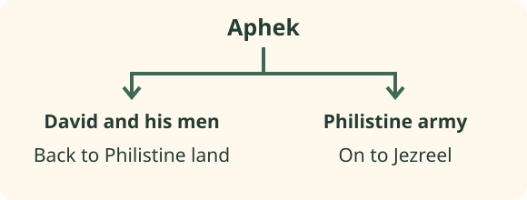

# 1 Samuel 29 — Achish sends David back

**About this chapter**

David and his men march with King Achish. The other Philistine leaders recognize David. They fear he may turn against them.

## The leaders see David

## 1 Samuel 29:1

The Philistines gathered their whole army at Aphek.

Israel’s army camped beside a spring at Jezreel.

**Reading help**

A spring is a place where water flows from the ground.

## 1 Samuel 29:2

The Philistine leaders marched with their soldiers.

Some groups had hundreds of men. Others had thousands.

David and his men marched behind them with Achish.

## 1 Samuel 29:3

The Philistine commanders asked, “What are these Hebrews doing here?”

Achish answered, “This is David. He served King Saul of Israel.

He came over to me a long time ago.

Since then, I have found nothing wrong in him.”

**Reading help**

The commanders call David and his men Hebrews because they come from Israel.

## The commanders want David to leave

## 1 Samuel 29:4

The commanders were angry with Achish.

They said, “Send David back to the place you gave him.

He might turn against us in battle.

He could win Saul’s favor again by killing our men.”

## 1 Samuel 29:5

They asked, “Isn’t this the David people sing about when they dance?

They sing, ‘Saul has killed his thousands, and David his tens of thousands.’”

**Pause and answer**

Why were the commanders afraid to take David with them?

## Achish tells David what the leaders decided

## 1 Samuel 29:6

Achish called David to him.

He said, “As surely as the LORD lives, you have been honest with me.

I would gladly have you serve in my army.

I have found no fault in you since you came to me.

But the other leaders do not accept you.

## 1 Samuel 29:7

Turn back now and go in peace.

That way you will give the Philistine leaders no reason to be angry.”

## 1 Samuel 29:8

David asked, “What have I done wrong?

Have you found any fault in me since I came to serve you?

Why can’t I go and fight the king’s enemies?”

## 1 Samuel 29:9

Achish answered, “To me you are as welcome as an angel of God.

But the Philistine commanders say you must stay out of the battle.

**Reading help**

An angel is a messenger from God.

Achish uses this comparison to tell David how highly he thinks of him.

## 1 Samuel 29:10

Get up early tomorrow with the men who came with you from Saul.

Leave as soon as it is light.”

## The two groups part

## 1 Samuel 29:11

David and his men got up early.

They went back to the land of the Philistines.

The Philistine army went on to Jezreel.

**Pause and answer**

Which group went on to Jezreel?
