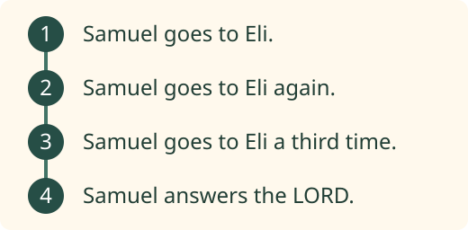

# 1 Samuel 3 — The LORD calls Samuel

**About this chapter**

Samuel hears someone call him at night. Three times he goes to Eli. Then Eli helps Samuel understand who is calling.

## Samuel lies down in the LORD’s house

## 1 Samuel 3:1

Samuel was still a boy.

He served the LORD under Eli’s care.

In those days people rarely heard messages from the LORD.

Few people saw visions.

**Reading help**

A vision is something God shows a person.

## 1 Samuel 3:2

One night Eli lay down in his room.

His eyes had grown so weak he could no longer see.

## 1 Samuel 3:3

Samuel lay down in the LORD’s house.

God’s sacred chest, the ark, was there.

God’s lamp was still burning.

## Samuel runs to Eli

## 1 Samuel 3:4

The LORD called Samuel.

Samuel answered, “Here I am.”

## 1 Samuel 3:5

Samuel ran to Eli.

“Here I am,” Samuel said. “You called me.”

Eli answered, “I did not call you.

Go back and lie down.”

So Samuel went back and lay down.

## 1 Samuel 3:6

Again the LORD called, “Samuel!”

Samuel got up and went to Eli.

“Here I am,” Samuel said. “You called me.”

Eli answered, “My son, I did not call you.

Go back and lie down.”

**Pause and answer**

Who did Samuel think was calling him?

## 1 Samuel 3:7

Samuel did not yet know the LORD.

The LORD had not yet made his word known to Samuel.

## Eli understands who is calling

## 1 Samuel 3:8

The LORD called Samuel a third time.

Samuel got up and went to Eli.

“Here I am,” Samuel said. “You called me.”

Then Eli understood that the LORD was calling Samuel.

## 1 Samuel 3:9

Eli said, “Go back and lie down.

If he calls you, say, ‘Speak, LORD.

Your servant is listening.’”

Samuel went back and lay down.

## 1 Samuel 3:10

The LORD came and stood there.

He called again, “Samuel! Samuel!”

Samuel answered, “Speak.

Your servant is listening.”

**Pause and answer**

What did Samuel say when the LORD called again?

## The LORD gives Samuel a message

## 1 Samuel 3:11

The LORD said to Samuel, “I am about to do something in Israel.

Everyone who hears the news will be shocked.

## 1 Samuel 3:12

That day I will do everything I said I would do to Eli’s family.

I will carry it out from beginning to end.

## 1 Samuel 3:13

I told Eli I would judge his family forever.

Eli knew the wrong his sons were doing.

His sons spoke against God, and Eli did not stop them.

## 1 Samuel 3:14

So I made this solemn promise about Eli’s family.

No sacrifice or offering will ever take away their guilt.”

**Reading help**

A sacrifice or offering is a gift people bring to God. Eli’s family could bring no gift that would take away the guilt of this wrong.

## Eli asks to hear the whole message

## 1 Samuel 3:15

Samuel lay down until morning.

Then he opened the doors of the LORD’s house.

Samuel was afraid to tell Eli about the vision.

## 1 Samuel 3:16

Eli called, “Samuel, my son.”

Samuel answered, “Here I am.”

## 1 Samuel 3:17

Eli asked, “What did the LORD tell you?

Tell me the whole message.

May God punish you severely if you hide any of it from me.”

## 1 Samuel 3:18

Samuel told Eli everything.

Eli answered, “He is the LORD.

Let him do what he sees is good.”

**Pause and answer**

How much of the LORD’s message did Samuel tell Eli?

## Israel recognizes Samuel as a prophet

## 1 Samuel 3:19

Samuel grew up, and the LORD was with him.

The LORD made every message Samuel gave come true.

**Reading help**

The Bible says none of Samuel’s words “fell to the ground.” This means that people could trust the messages Samuel gave them from God.

## 1 Samuel 3:20

People knew this from Dan in the north to Beersheba in the south.

All Israel knew the LORD had chosen Samuel as his prophet.

**Reading help**

A prophet is someone who speaks God’s message to people.

## 1 Samuel 3:21

The LORD kept appearing at Shiloh.

There the LORD spoke to Samuel and made himself known.

**Pause and answer**

Where did the LORD keep speaking to Samuel?
