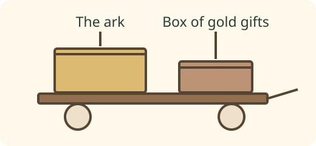

# 1 Samuel 6 — The ark returns to Israel

**About this chapter**

The Philistines send the ark away on a cart. Two cows pull it into Israel, where people are gathering wheat.

## The Philistines ask for advice

## 1 Samuel 6:1

The LORD’s ark stayed in Philistine land for seven months.

## 1 Samuel 6:2

The Philistines called their priests and diviners together.

They asked, “What should we do with the LORD’s ark?

How can we send it back where it belongs?”

**Reading help**

The ark was Israel’s sacred chest. Diviners were people who looked for signs to guide decisions.

## 1 Samuel 6:3

The priests and diviners answered, “Send a gift with the ark of Israel’s God.

Give him a guilt offering.

Then you will get well.

You will understand why he has kept punishing you.”

**Reading help**

A guilt offering was a gift people brought when they had done wrong.

## Gold gifts for Israel’s God

## 1 Samuel 6:4

The Philistines asked, “What should we give him?”

Their advisers said, “Send five gold tumors and five gold rats.

You have five rulers.

The same sickness struck you and your rulers.

## 1 Samuel 6:5

Make gold shapes like the lumps on your bodies.

Make gold shapes like the rats ruining your land.

Give honor to Israel’s God.

Perhaps he will stop punishing you, your gods, and your land.

## 1 Samuel 6:6

Why be stubborn like Pharaoh and the Egyptians?

Remember how God made them suffer.

In the end they let the Israelites leave.

**Pause and answer**

What were the gold rats meant to show?

## Two cows and a new cart

## 1 Samuel 6:7

Get a new cart and two cows that give milk.

Choose cows that have never worn a yoke.

Hitch them to the cart.

Keep their calves behind in a pen.

**Reading help**

A yoke is a wooden bar that joins animals so they can pull a load together.

## 1 Samuel 6:8

Set the LORD’s ark on the cart.

Put your gold gifts in a box beside it.

Then send the ark on its way.

## 1 Samuel 6:9

Watch where it goes.

The road to Beth-shemesh leads back to Israel.

If the cows take that road, the LORD caused our suffering.

If they go another way, we will know it happened by chance.”

## The cows take the road to Beth-shemesh

## 1 Samuel 6:10

The men followed this advice.

They hitched two milk cows to the cart.

They kept the calves in a pen.

## 1 Samuel 6:11

They set the LORD’s ark on the cart.

Beside it they put the box with the gold rats and gold tumors.

## 1 Samuel 6:12

The cows went straight along the road to Beth-shemesh.

They called out as they walked.

They stayed on the same road the whole way.

The Philistine rulers followed them to the border of Beth-shemesh.

**Pause and answer**

Which road did the cows take?

## People look up from their harvest

## 1 Samuel 6:13

The people of Beth-shemesh were cutting wheat in the valley.

They looked up and saw the ark.

They were full of joy.

## 1 Samuel 6:14

The cart stopped beside a large rock in a field.

The field belonged to Joshua of Beth-shemesh.

The people chopped up the cart for firewood.

They burned the cows as an offering to the LORD.

## 1 Samuel 6:15

The Levites lifted the ark and the box of gold gifts off the cart.

They set both on the large rock.

That day the men of Beth-shemesh brought sacrifices to the LORD.

They also brought him burnt offerings.

**Reading help**

The Levites belonged to Israel’s tribe of Levi. They helped care for the ark.

## 1 Samuel 6:16

The five Philistine rulers saw what happened.

They went back to Ekron that same day.

**Pause and answer**

Where did the Levites put the ark?

## What the gold gifts stood for

## 1 Samuel 6:17

The Philistines had sent one gold tumor for each of five cities.

Those cities were Ashdod, Gaza, Ashkelon, Gath, and Ekron.

These gifts were a guilt offering to the LORD.

## 1 Samuel 6:18

The gold rats stood for all the towns under the five rulers.

These included walled cities and the villages around them.

When this account was written, the large rock still stood in Joshua’s field.

That was where the Levites had placed the ark.

## Beth-shemesh sends a message

## 1 Samuel 6:19

Some men of Beth-shemesh looked inside the LORD’s ark.

Because of this, God struck down seventy men.

The people grieved because the LORD had taken so many lives.

## 1 Samuel 6:20

The men of Beth-shemesh asked, “Who can stand before the LORD, this holy God?

Where can we send the ark now?”

## 1 Samuel 6:21

They sent messengers to the people of Kiriath-jearim.

“The Philistines have sent back the LORD’s ark.

Come down and take it back with you.”

**Pause and answer**

Who did the people ask to come for the ark?
