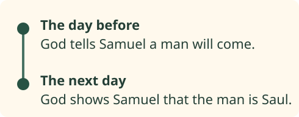

# 1 Samuel 9 — Saul meets Samuel

**About this chapter**

Saul leaves home to find his father’s donkeys. His servant suggests asking a man of God for help. That man is Samuel.

## Kish sends Saul to find the donkeys

## 1 Samuel 9:1

Kish was a powerful man from the tribe of Benjamin.

His father was Abiel.

Abiel’s father was Zeror.

Zeror’s father was Becorath.

Becorath’s father was Aphiah, from Benjamin.

## 1 Samuel 9:2

Kish had a son named Saul.

No one in Israel was as handsome as Saul.

He stood a head taller than anyone else.

## 1 Samuel 9:3

One day Kish’s donkeys wandered away.

Kish told Saul, “Take a servant with you.

Go and look for the donkeys.”

## 1 Samuel 9:4

Saul and the servant searched the hills of Ephraim.

They searched the land of Shalishah and then Shaalim.

They also searched the land of Benjamin.

They still could not find the donkeys.

**Pause and answer**

What had Kish asked Saul to find?

## The servant suggests asking for help

## 1 Samuel 9:5

When they reached Zuph, Saul said, “Let’s go home.

Soon my father will forget about the donkeys and start worrying about us.”

## 1 Samuel 9:6

The servant said, “A man of God is in this town.

People respect him.

What he says always comes true.

Let’s go see him.

Perhaps he can tell us where to go.”

## 1 Samuel 9:7

Saul asked, “What can we give him?

We have eaten all the bread we brought.

Do we have a gift for the man of God?”

## 1 Samuel 9:8

The servant answered, “I have a little silver in my hand.

It weighs a quarter of a shekel.

I can give him that, and he will show us where to go.”

## 1 Samuel 9:9

In earlier times people in Israel called a prophet a seer.

When they wanted to ask God something, they would say, “Let’s go to the seer.”

**Reading help**

A prophet speaks God’s message to people. Samuel is the seer the men are looking for.

## 1 Samuel 9:10

Saul said, “Good. Let’s go.”

They headed for the town where the man of God was.

**Pause and answer**

Why did the servant want to visit the man of God?

## Young women point the way

## 1 Samuel 9:11

Saul and the servant climbed the hill toward town.

They met young women coming out to get water.

The men asked, “Is the seer here?”

## 1 Samuel 9:12

“Yes,” the women said. “He is just ahead of you.

Hurry! He came to town today.

The people are offering a sacrifice at the place of worship up on the hill.

## 1 Samuel 9:13

You can find him when you enter town, before he goes up to eat.

The people will wait for him to bless the sacrifice.

Then the guests will eat.

Go now, and you will find him.”

## 1 Samuel 9:14

Saul and his servant went up to town.

As they entered, Samuel came toward them.

Samuel was on his way to the place of worship.

## What the LORD had told Samuel

## 1 Samuel 9:15

The day before Saul came, the LORD had spoken to Samuel.

## 1 Samuel 9:16

The LORD had said, “Tomorrow at this time I will send you a man from Benjamin.

Anoint him to rule my people Israel.

He will rescue them from the Philistines.

I have seen my people’s trouble and heard their cry.”

**Reading help**

To anoint someone means to pour oil on that person. Here the oil would show whom God had chosen to rule.

## 1 Samuel 9:17

Now Samuel saw Saul.

The LORD told him, “This is the man I told you about.

He will rule my people.”

**Pause and answer**

What did the LORD say the man from Benjamin would do for Israel?

## Saul asks Samuel for directions

## 1 Samuel 9:18

Saul came up to Samuel at the town gate.

He asked, “Please tell me where the seer lives.”

## 1 Samuel 9:19

Samuel said, “I am the seer.

Go ahead of me to the place of worship.

Today you will eat with me.

Tomorrow morning I will send you on your way.

Then I will tell you about everything on your mind.

## 1 Samuel 9:20

Your donkeys went missing three days ago.

You can stop worrying. Someone has found them.

All Israel is looking to you and your father’s family for what it wants.”

**Reading help**

The people had asked for a king. Saul had come looking for donkeys.

## 1 Samuel 9:21

Saul asked, “Why say this to me?

I belong to Benjamin, the smallest tribe in Israel.

My family group is the least important one in Benjamin.”

## Samuel saves a place for Saul

## 1 Samuel 9:22

Samuel took Saul and his servant into the dining room.

About thirty guests were there.

Samuel gave Saul and his servant the seats of honor.

## 1 Samuel 9:23

Samuel told the cook, “Bring the part I gave you to keep.”

## 1 Samuel 9:24

The cook brought the leg of meat with everything attached to it.

He set it in front of Saul.

Samuel said, “Eat this portion.

I saved it for you when I invited the guests.”

So Saul ate with Samuel that day.

**Pause and answer**

What had Samuel asked the cook to save for Saul?

## Samuel has a message for Saul

## 1 Samuel 9:25

Samuel and Saul came down the hill into town.

They talked on the roof of Samuel’s house.

## 1 Samuel 9:26

They got up early.

Just before dawn, Samuel called to Saul on the roof.

“Get ready, and I will send you on your way.”

Saul got ready, and the two men went outside.

## 1 Samuel 9:27

As they walked toward the edge of town, Samuel said to Saul, “Tell your servant to go ahead.

You stay here a while.

I have a message from God for you.”

So the servant went ahead.

**Pause and answer**

Why did Samuel ask Saul to stay behind?
