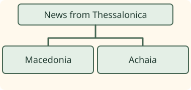

# 1 Thessalonians 1 — News of your faith has spread

**About this chapter**

Three friends write to believers in Thessalonica.

They have heard how these believers live.

## Why we thank God

## 1 Thessalonians 1:1

Paul, Silvanus, and Timothy send this letter.

We write to the church in Thessalonica.

You belong to God the Father and the Lord Jesus Christ.

May you receive grace and peace.

**Help with these words**

Grace is kindness God gives freely.

## 1 Thessalonians 1:2

We always thank God for all of you.

We remember you in our prayers.

## 1 Thessalonians 1:3

Before God our Father, we remember what you do because you trust him.

Love makes you work hard for others.

Hope in our Lord Jesus Christ helps you keep going.

**Pause and answer**

What helps the believers keep going?

## How you welcomed the message

## 1 Thessalonians 1:4

Brothers and sisters, God loves you.

We know that he chose you.

## 1 Thessalonians 1:5

When we told you the good news, you heard more than words.

The Holy Spirit showed his power.

We spoke with deep certainty.

You saw how we lived among you for your sake.

## 1 Thessalonians 1:6

You followed our example and the Lord’s example.

Though you suffered greatly, you welcomed the message.

The Holy Spirit gave you joy.

## 1 Thessalonians 1:7

So all the believers in Macedonia and Achaia could follow your example.

**Pause and answer**

Who gave the believers joy when they suffered?

## Other people tell your story

## 1 Thessalonians 1:8

The Lord’s message rang out from you across Macedonia and Achaia.

People everywhere have heard about your trust in God.

We have nothing more to add.

| Where the message was welcomed | Where the news spread |
| --- | --- |
| Thessalonica | Macedonia, Achaia, and beyond |

People beyond these places also heard about the believers’ faith.

## 1 Thessalonians 1:9

People tell us how warmly you welcomed us.

They tell how you turned from idols to God.

Now you serve the living and true God.

**Help with these words**

An idol is an object people worship as a god.

## 1 Thessalonians 1:10

You are waiting for his Son to come from heaven.

God raised his Son Jesus from death.

Jesus rescues us from God’s coming anger.

**Pause and answer**

Whom are the believers waiting for?
