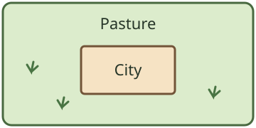

# 2 Chronicles 11 — Rehoboam sends the soldiers home

**About this chapter**

Rehoboam is king in Jerusalem.

He wants to win back the tribes that follow Jeroboam.

The LORD tells Rehoboam to let the soldiers go home.

## The LORD stops a war

## 2 Chronicles 11:1

When Rehoboam reached Jerusalem, he gathered 180,000 chosen soldiers.

They came from the tribes of Judah and Benjamin.

Rehoboam wanted them to fight the other tribes of Israel.

He wanted to rule the whole kingdom again.

## 2 Chronicles 11:2

But the LORD spoke to Shemaiah, a man who served God.

## 2 Chronicles 11:3

The LORD said, “Take my message to Rehoboam.

He is Solomon’s son and king of Judah.

Tell all the Israelites in Judah and Benjamin too.

## 2 Chronicles 11:4

“Do not fight your brothers, the other Israelites.

Each of you must go home.

I have brought about this division.”

They listened to the LORD.

They turned back instead of fighting Jeroboam.

## Rehoboam makes the cities stronger

## 2 Chronicles 11:5

Rehoboam lived in Jerusalem.

He built up cities to protect Judah.

## 2 Chronicles 11:6

He strengthened Bethlehem, Etam, and Tekoa.

## 2 Chronicles 11:7

He strengthened Beth-zur, Soco, and Adullam.

## 2 Chronicles 11:8

He strengthened Gath, Mareshah, and Ziph.

## 2 Chronicles 11:9

He strengthened Adoraim, Lachish, and Azekah.

## 2 Chronicles 11:10

He also strengthened Zorah, Aijalon, and Hebron.

These cities guarded the lands of Judah and Benjamin.

## 2 Chronicles 11:11

Rehoboam made the cities harder to attack.

He put officers in charge of them.

He stored food, oil, and wine there.

## 2 Chronicles 11:12

He supplied every city with shields and spears.

The cities now had strong defenses.

Judah and Benjamin remained under his rule.

## People come to Jerusalem to worship

## 2 Chronicles 11:13

Priests and Levites throughout Israel supported Rehoboam.

Levites were people from the tribe of Levi.

## 2 Chronicles 11:14

The Levites left their property and their pastureland.

Pastureland is land where animals feed.

They came to Judah and Jerusalem.

Jeroboam and his sons had refused to let them serve as priests of the LORD.

## 2 Chronicles 11:15

Jeroboam chose his own priests for the hilltop places of worship.

He made idols shaped like goats and calves.

His priests served the goat demons and the calf idols there.

## 2 Chronicles 11:16

People from every tribe of Israel followed the Levites to Jerusalem.

These people wanted to seek the LORD their God.

They came to offer sacrifices to the God their ancestors worshiped.

Sacrifices were gifts that people offered to God.

## 2 Chronicles 11:17

For three years these people made Judah stronger.

They supported Rehoboam, Solomon’s son.

During those years they followed the example of David and Solomon.

## Rehoboam chooses a son to be king

## 2 Chronicles 11:18

Rehoboam married Mahalath.

Her father was Jerimoth, a son of David.

Her mother was Abihail, a daughter of Eliab.

Eliab was a son of Jesse.

## 2 Chronicles 11:19

Mahalath and Rehoboam had three sons.

Their names were Jeush, Shemariah, and Zaham.

## 2 Chronicles 11:20

Later Rehoboam married Maacah, a daughter of Absalom.

Their children were Abijah, Attai, Ziza, and Shelomith.

## 2 Chronicles 11:21

Rehoboam loved Maacah more than his other wives and concubines.

A concubine was a partner with lower standing than a wife.

Rehoboam had eighteen wives and sixty concubines.

He had twenty-eight sons and sixty daughters.

## 2 Chronicles 11:22

Rehoboam put Maacah’s son Abijah in charge of his brothers.

Rehoboam planned for Abijah to become king.

## 2 Chronicles 11:23

Rehoboam acted wisely in sending some sons across Judah and Benjamin.

They went to live throughout the districts and the fortified cities.

Rehoboam gave his sons plenty of supplies.

He also looked for many wives for them.

**Pause and answer**

What did the LORD tell the soldiers to do?
