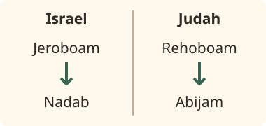

# 2 Chronicles 13 — Judah calls to the LORD for help

**About this chapter**

Jeroboam rules the northern kingdom, Israel. Abijah rules the southern kingdom, Judah. When the two armies meet, Abijah reminds Israel of God’s promise to David.

The picture calls Abijah by his other name, Abijam. Look for him under Judah.

## Two kings go to war

## 2 Chronicles 13:1

Jeroboam was in his eighteenth year as king of Israel.

That year Abijah became king of Judah.

## 2 Chronicles 13:2

Abijah ruled in Jerusalem for three years.

His mother was Micaiah, daughter of Uriel, from Gibeah.

Abijah and Jeroboam went to war against each other.

## 2 Chronicles 13:3

Abijah brought 400,000 chosen soldiers into battle.

Jeroboam brought 800,000 strong, brave soldiers to face them.

## Abijah reminds Israel of God’s promise

## 2 Chronicles 13:4

Abijah stood on Mount Zemaraim in the hills of Ephraim.

He called out, “Jeroboam and all Israel, listen to me!

## 2 Chronicles 13:5

The LORD, the God of Israel, gave David the right to rule.

He promised that David’s family would rule Israel forever.

This was a covenant of salt, a promise meant to last.

## 2 Chronicles 13:6

Jeroboam son of Nebat served Solomon, David’s son.

Yet Jeroboam turned against his master.

## 2 Chronicles 13:7

Wicked men joined Jeroboam against Solomon’s son Rehoboam.

Rehoboam was young and had little experience.

He could not stand up to them.

## 2 Chronicles 13:8

Now you think you can stand against the LORD’s kingdom.

He put that kingdom in the care of David’s family.

You have a huge army.

You have the gold calves Jeroboam made for you to worship.

## 2 Chronicles 13:9

You forced out the LORD’s priests, the descendants of Aaron.

You forced out the Levites who helped them.

You choose priests like the people of other lands.

Anyone who brings a young bull and seven male sheep can become a priest.

But the things those priests worship are no gods at all.

## Abijah describes worship in Judah

## 2 Chronicles 13:10

The LORD is our God. We still follow him.

Aaron’s descendants serve him as priests.

The Levites do the work given to them.

## 2 Chronicles 13:11

Every morning and evening our priests bring burnt offerings to the LORD.

They also burn incense, which makes sweet-smelling smoke.

They lay out rows of bread on a table made clean for worship.

Each evening they light the lamps on the gold lampstand.

We do what the LORD our God asks. You have left him.

## 2 Chronicles 13:12

God himself leads us.

His priests sound their trumpets to call us to battle.

People of Israel, do not fight the LORD, the God of your ancestors.

You cannot win against him.”

**Pause and answer**

**Who did Abijah say was leading Judah?**

## Judah asks for help

## 2 Chronicles 13:13

Jeroboam faced Judah with part of his army.

Other soldiers from Israel were already behind Judah.

## 2 Chronicles 13:14

Judah’s soldiers turned and saw enemies in front and behind.

They called to the LORD for help.

The priests blew their trumpets.

## 2 Chronicles 13:15

Judah’s men gave a loud shout.

As they shouted, God made Jeroboam and his army turn and run from Judah.

## 2 Chronicles 13:16

Israel’s soldiers fled. God gave Judah victory over them.

## 2 Chronicles 13:17

Abijah and his men defeated Israel’s army.

They killed 500,000 of Israel’s chosen soldiers.

## 2 Chronicles 13:18

That day Judah overcame Israel.

Judah’s people had trusted the LORD, the God of their ancestors.

**Pause and answer**

**What did Judah’s soldiers do when they saw enemies on both sides?**

## What happened to the two kings

## 2 Chronicles 13:19

Abijah followed Jeroboam and took three of his cities.

They were Bethel, Jeshanah, and Ephron.

He also took the villages around them.

## 2 Chronicles 13:20

While Abijah lived, Jeroboam never regained his power.

The LORD struck Jeroboam down, and he died.

## 2 Chronicles 13:21

Abijah grew stronger. He married fourteen wives.

He had twenty-two sons and sixteen daughters.

## 2 Chronicles 13:22

The prophet Iddo wrote more about Abijah.

His account tells how Abijah lived and what he said and did.
