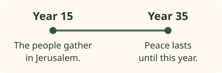

# 2 Chronicles 15 — Asa and the people promise to seek the LORD

**About this chapter**

Azariah brings King Asa a message from God.

His words give Asa courage.

People gather in Jerusalem to make a promise together.

## Azariah meets Asa

## 2 Chronicles 15:1

The Spirit of God came upon Azariah, the son of Oded.

## 2 Chronicles 15:2

Azariah went out to meet Asa.

He said, “Listen, Asa, and everyone from Judah and Benjamin.

The LORD is with you when you stay with him.

If you seek him, you will find him.

If you leave him, he will leave you.

## 2 Chronicles 15:3

“For many years Israel lived without the true God.

The people had no priest to teach them.

They lived without God’s law.

## 2 Chronicles 15:4

“Then trouble came, and they turned to the LORD, Israel’s God.

They looked for him and found him.

## 2 Chronicles 15:5

“In those days it was dangerous to travel.

People throughout the lands were fighting.

## 2 Chronicles 15:6

“One nation crushed another.

One city crushed another.

God brought all kinds of trouble on them.

## 2 Chronicles 15:7

“But you must be strong.

Take courage and keep working.

God will reward your work.”

## Asa repairs the altar

## 2 Chronicles 15:8

Azariah’s message from God gave Asa courage.

Asa removed the idols from all Judah and Benjamin.

Idols are objects people worship as gods.

He also removed them from towns he had captured in Ephraim’s hills.

Then Asa repaired the LORD’s altar in front of the temple porch.

An altar is a place to offer gifts to God.

## 2 Chronicles 15:9

Asa called together everyone in Judah and Benjamin.

People from Ephraim, Manasseh, and Simeon had settled among them.

Many had come from Israel to join Asa.

They had seen that the LORD his God was with him.

Asa called them to the gathering too.

## The people make a promise

## 2 Chronicles 15:10

They gathered in Jerusalem in the third month.

It was Asa’s fifteenth year as king.

## 2 Chronicles 15:11

The people had brought back animals they had taken in battle.

From these they offered the LORD 700 oxen and 7,000 sheep.

## 2 Chronicles 15:12

Together they made a covenant, a solemn agreement.

They promised to seek the LORD, the God of their ancestors.

They would do this with all their heart and soul.

## 2 Chronicles 15:13

The agreement called for death for anyone who refused to seek Israel’s God.

It applied to men and women, young and old.

## 2 Chronicles 15:14

The people spoke their promise to the LORD in loud voices.

They shouted and blew trumpets and rams’ horns.

## 2 Chronicles 15:15

All Judah rejoiced because they meant every word of their promise.

They had sought the LORD with all their heart and found him.

The LORD gave them peace on every side.

## Asa removes the queen mother

## 2 Chronicles 15:16

Asa’s grandmother Maacah held the royal title of queen mother.

She had made a pole for worshiping the goddess Asherah.

Asa took away Maacah’s title.

He chopped down the pole and broke it to pieces.

Then he burned it in the Kidron Valley.

## 2 Chronicles 15:17

Hilltop places of worship still stood in Israel.

Yet Asa remained devoted to the LORD all his life.

## 2 Chronicles 15:18

Asa and his father had set gifts aside for God.

These included silver, gold, and other objects.

Asa brought them into God’s temple.

## 2 Chronicles 15:19

There was no war until Asa’s thirty-fifth year as king.

**Pause and answer**

What did the people promise to do with all their heart?
