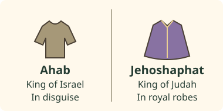

# 2 Chronicles 18 — Micaiah warns King Ahab

**About this chapter**

Ahab, king of Israel, wants Jehoshaphat, king of Judah, to join him in battle. Jehoshaphat asks to hear from the LORD first. Four hundred prophets agree, but Micaiah has a different message.

## Two kings ask about going to war

## 2 Chronicles 18:1

Jehoshaphat had great wealth and honor.

A marriage between his family and Ahab’s family made the kings allies.

## 2 Chronicles 18:2

Some years later Jehoshaphat visited Ahab in Samaria.

Ahab sacrificed many sheep and cattle for his visitors.

He urged Jehoshaphat to join him at Ramoth-gilead.

## 2 Chronicles 18:3

Ahab asked, “Will you go to war with me against Ramoth-gilead?” Jehoshaphat answered, “I stand with you.

My people stand with yours.

We will go with you.”

## 2 Chronicles 18:4

Jehoshaphat added, “Please ask the LORD what he says first.”

## 2 Chronicles 18:5

Ahab called together four hundred prophets.

“Should we attack Ramoth-gilead or stay here?” he asked.

They answered, “Go!

God will give the king the city.”

## 2 Chronicles 18:6

Jehoshaphat asked, “Is there another prophet here who can ask the LORD for us?”

## 2 Chronicles 18:7

Ahab answered, “We can ask the LORD through Micaiah son of Imlah.

But I hate him.

He only ever tells me bad news.” Jehoshaphat said, “A king should not speak that way!”

## 2 Chronicles 18:8

Ahab called an official.

“Bring Micaiah son of Imlah here at once.”

## A messenger asks Micaiah to agree

## 2 Chronicles 18:9

The two kings wore royal robes and sat on thrones near Samaria’s gate.

They sat on the open ground where people separated grain from its husks.

The prophets spoke before them.

## 2 Chronicles 18:10

Zedekiah son of Chenaanah had made iron horns.

He said, “The LORD says you will defeat the Arameans.

You will be like an animal striking with these horns until its enemies are gone.”

## 2 Chronicles 18:11

The other prophets agreed.

“March to Ramoth-gilead and win!

The LORD will give the city to the king.”

## 2 Chronicles 18:12

The messenger who fetched Micaiah said, “Every prophet has promised the king success.

Please give the king the same good news.”

## 2 Chronicles 18:13

Micaiah replied, “As surely as the LORD lives, I will say what my God tells me.”

## 2 Chronicles 18:14

When he arrived, Ahab asked, “Micaiah, should we attack Ramoth-gilead or stay here?” At first Micaiah echoed the others.

“Go and win!

The enemy will fall into your hands.”

## 2 Chronicles 18:15

Ahab said, “How many times must I make you promise to tell me the truth in the LORD’s name?”

## 2 Chronicles 18:16

Then Micaiah said, “I saw all Israel scattered across the hills like sheep without a shepherd.

The LORD said, ‘They have no leader.

Let each one go home in peace.’”

## 2 Chronicles 18:17

Ahab turned to Jehoshaphat.

“Didn’t I tell you?

He only brings me bad news!”

**Pause and answer**

What did the sheep without a shepherd show about Israel?

## Micaiah explains what he saw

## 2 Chronicles 18:18

Micaiah said, “Hear the LORD’s message.

I saw the LORD on his throne.

All the hosts of heaven stood on either side of him.

## 2 Chronicles 18:19

The LORD asked, ‘Who will persuade Ahab to go to Ramoth-gilead, where he will die?’ Those standing there offered different answers.

## 2 Chronicles 18:20

A spirit stepped forward. ‘I will persuade him,’ the spirit said.

The LORD asked, ‘How?’

## 2 Chronicles 18:21

The spirit answered, ‘I will make all his prophets tell lies.’ The LORD said, ‘You will persuade him.

Go and do it.’

## 2 Chronicles 18:22

Ahab, the LORD has sent a lying spirit to speak through your prophets.

The LORD has announced disaster for you.”

## 2 Chronicles 18:23

Zedekiah son of Chenaanah slapped Micaiah’s face.

“Which way did the LORD’s Spirit go when he left me to speak to you?” he demanded.

## 2 Chronicles 18:24

Micaiah replied, “You will find out when you go into an inner room to hide.”

## 2 Chronicles 18:25

Ahab gave an order.

“Take Micaiah back to Amon, the city governor, and to my son Joash.

## 2 Chronicles 18:26

Tell them to put Micaiah in prison.

Give him only bread and water until I come back safely.”

## 2 Chronicles 18:27

Micaiah answered, “If you come back safely, the LORD has not spoken through me.”

Then Micaiah called to everyone there, “All of you, remember what you heard!”

## The battle at Ramoth-gilead

## 2 Chronicles 18:28

Ahab and Jehoshaphat went to Ramoth-gilead.

## 2 Chronicles 18:29

Ahab told Jehoshaphat, “I will go into battle in disguise.

You wear your royal robes.” Ahab changed his appearance and went into battle.

## 2 Chronicles 18:30

The king of Aram had told his chariot commanders to fight only the king of Israel.

They were to leave everyone else alone.

## 2 Chronicles 18:31

The commanders saw Jehoshaphat and thought he was Israel’s king.

They turned to attack him.

Jehoshaphat cried out.

The LORD helped him and drew them away.

## 2 Chronicles 18:32

Once the commanders realized who he was, they stopped chasing him.

## 2 Chronicles 18:33

Meanwhile, a soldier shot an arrow without aiming at anyone in particular.

It struck Ahab through a gap in his armor.

Ahab told his chariot driver, “Turn around!

Take me out of the battle.

I am badly hurt.”

## 2 Chronicles 18:34

The fighting went on all day.

Ahab held himself upright in his chariot, facing the Arameans until evening.

At sunset he died.

**Pause and answer**

Which king did the LORD help when he cried out?
