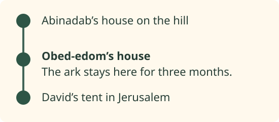

# 2 Chronicles 1 — Solomon asks God for wisdom

**About this chapter**

Solomon becomes king after his father David.

God invites Solomon to ask for a gift.

Solomon thinks about the people he must lead.

## Solomon and the people worship at Gibeon

## 2 Chronicles 1:1

Solomon, David’s son, became firmly established as king.

The LORD his God was with him.

The LORD gave Solomon great honor.

## 2 Chronicles 1:2

Solomon spoke to all Israel.

Some army officers led thousands of men.

Others led hundreds.

Solomon spoke to them, the judges, and all the family leaders.

## 2 Chronicles 1:3

Solomon and the whole gathering went to Gibeon.

They went to the place of worship on the hill.

God’s Tent of Meeting stood there.

Moses had made that tent in the desert.

Moses was the LORD’s servant.

## 2 Chronicles 1:4

God’s ark was a sacred chest.

David had already brought it from Kiriath-jearim to Jerusalem.

He had set up a tent in Jerusalem for the ark.

## 2 Chronicles 1:5

The bronze altar still stood outside the LORD’s tent at Gibeon.

An altar is a place to offer gifts to God.

Bezalel had made this altar.

His father was Uri, and his grandfather was Hur.

Solomon and the people sought God there.

## 2 Chronicles 1:6

Solomon went to the bronze altar at the Tent of Meeting.

There Solomon gave the LORD a thousand burnt offerings.

These were gifts burned on the altar.

## God asks what Solomon wants

## 2 Chronicles 1:7

That night God appeared to Solomon.

God said, “Ask me for something, and I will give it to you.”

## 2 Chronicles 1:8

Solomon answered, “You showed my father David great and faithful love.

Now you have made me king in his place.

## 2 Chronicles 1:9

“LORD God, please keep your promise to my father David.

You made me king over so many people.

Counting them would be like counting specks of dust on the ground.

## 2 Chronicles 1:10

“Please give me wisdom and knowledge to lead them.

Who could govern all these people of yours without help?”

Wisdom helps someone choose what is right.

## 2 Chronicles 1:11

God told Solomon, “I know what you want most.

I made you king over my people.

You asked for wisdom and knowledge to lead them.

You could have asked for riches or honor for yourself.

You did not ask me to kill your enemies.

You did not even ask for a long life.

## 2 Chronicles 1:12

“So I give you wisdom and knowledge.

I will also give you wealth and honor.

No king before you has had so much.

No king after you will have so much either.”

## Solomon’s wealth and trade

## 2 Chronicles 1:13

Solomon left the Tent of Meeting at Gibeon.

He returned to Jerusalem and ruled over Israel.

## 2 Chronicles 1:14

Solomon gathered 1,400 chariots and 12,000 horses.

Chariots were carts pulled by horses.

He kept some in cities set aside for chariots.

He kept others with him in Jerusalem.

## 2 Chronicles 1:15

Under Solomon, silver and gold were as common as stones in Jerusalem.

There was plenty of cedar wood too.

It was as common as sycamore trees in the low hills.

## 2 Chronicles 1:16

Solomon’s horses came from Egypt and Kue.

The king’s traders bought horses in Kue.

## 2 Chronicles 1:17

A chariot from Egypt cost 600 shekels of silver.

A horse cost 150 shekels of silver.

A shekel was a measure of weight.

The traders also sold chariots and horses to the Hittite kings and the kings of Aram.

**Pause and answer**

What did Solomon ask God to give him so he could lead the people?
