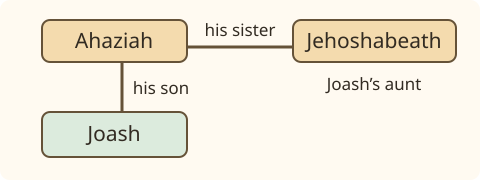

# 2 Chronicles 22 — An aunt saves Joash

**About this chapter**

Ahaziah becomes king of Judah.

After Ahaziah dies, his mother tries to kill the royal children.

Ahaziah’s sister hides his son Joash.

## Ahaziah becomes king

## 2 Chronicles 22:1

Raiders came into the camp with the Arabs.

They killed the older sons of Jehoram, king of Judah.

Ahaziah was Jehoram’s youngest son.

The people of Jerusalem chose Ahaziah to be their next king.

## 2 Chronicles 22:2

Ahaziah was twenty-two when he became king.

He ruled in Jerusalem for one year.

His mother was Athaliah, a granddaughter of Omri.

## 2 Chronicles 22:3

Athaliah advised her son to do wrong.

So Ahaziah lived as Ahab’s family had lived.

## 2 Chronicles 22:4

After his father died, Ahaziah took advice from Ahab’s family.

Like them, Ahaziah did what the LORD saw was evil.

Their advice led to his death.

## Ahaziah goes to visit a wounded king

## 2 Chronicles 22:5

Ahaziah followed the family’s advice and went to war.

He joined Joram, Ahab’s son and king of Israel.

Together they fought Hazael, king of Aram, at Ramoth-gilead.

Soldiers from Aram wounded Joram there.

## 2 Chronicles 22:6

Joram went back to Jezreel to recover from his wounds.

He had received them fighting Hazael at Ramah, also called Ramoth-gilead.

King Ahaziah of Judah went to Jezreel to visit him.

## 2 Chronicles 22:7

God used this visit to bring about Ahaziah’s downfall.

Ahaziah and Joram went out together to meet Jehu.

Jehu was the son of Nimshi.

The LORD had chosen Jehu to destroy Ahab’s royal family.

Anointing Jehu with oil had marked him for this task.

## Jehu’s men find Ahaziah

## 2 Chronicles 22:8

Jehu began carrying out God’s judgment on Ahab’s family.

He found some leaders of Judah.

He also found sons of Ahaziah’s brothers who served Ahaziah.

Jehu killed them.

## 2 Chronicles 22:9

Then Jehu searched for Ahaziah.

His soldiers found Ahaziah hiding in Samaria.

They brought Ahaziah to Jehu and killed him.

They buried him because they remembered his grandfather.

They said, “He is Jehoshaphat’s grandson.

Jehoshaphat sought the LORD with all his heart.”

No one in Ahaziah’s family was strong enough to rule.

## Jehoshabeath hides her nephew

## 2 Chronicles 22:10

Athaliah learned that her son Ahaziah was dead.

She set out to kill everyone in Judah’s royal family who could become king.

## 2 Chronicles 22:11

Ahaziah’s sister Jehoshabeath was a daughter of King Jehoram.

Her husband was Jehoiada the priest.

While the king’s sons were being killed, Jehoshabeath rescued one.

She slipped away with Joash, Ahaziah’s son.

She hid Joash in a bedroom with his nurse.

His nurse was the woman who cared for him.

Athaliah could not find Joash to kill him.

## 2 Chronicles 22:12

Joash stayed hidden with them in God’s temple for six years.

During those years Athaliah ruled Judah.

**Pause and answer**

Who hid Joash from Athaliah?
