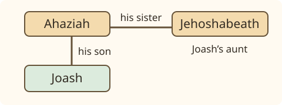

# 2 Chronicles 23 — Joash comes out of hiding and becomes king

**About this chapter**

Joash was the son of King Ahaziah. His aunt had saved his life. For six years Joash stayed hidden while Athaliah ruled Judah. Now the priest Jehoiada brings Joash before the people.

## The people meet Joash

## 2 Chronicles 23:1

In the seventh year, Jehoiada took courage.

Five officers made a covenant with him, a serious promise.

Each officer commanded a hundred men.

Two were named Azariah. Their fathers were Jeroham and Obed.

The others were Ishmael son of Jehohanan, Maaseiah son of Adaiah, and Elishaphat son of Zichri.

## 2 Chronicles 23:2

The officers traveled through Judah.

They gathered Levites from Judah’s towns and leaders of Israel’s families.

Together they went to Jerusalem.

## 2 Chronicles 23:3

Everyone gathered in God’s house made a covenant with Joash.

Jehoiada said, “Look! Here is the king’s son.

He must rule. The LORD promised that David’s family would rule.”

## Jehoiada keeps watch over Joash

## 2 Chronicles 23:4

Jehoiada gave the priests and Levites their duties.

They worked in groups on the Sabbath, the weekly rest day.

One group coming on duty would watch the doors.

## 2 Chronicles 23:5

Other groups would watch the palace and the Foundation Gate.

The rest of the people would stay in the temple courtyards.

These were open spaces around the LORD’s house.

## 2 Chronicles 23:6

Only priests and Levites serving in the temple could enter it.

The LORD had set them apart for this work.

Everyone had to respect the LORD’s rule.

## 2 Chronicles 23:7

The Levites were to guard Joash wherever he went.

They carried weapons. Anyone who entered the temple without permission would die.

## 2 Chronicles 23:8

The Levites and the people of Judah followed Jehoiada’s instructions.

The groups starting Sabbath duty came with their leaders.

The groups finishing duty stayed too.

Jehoiada had kept everyone on duty.

## 2 Chronicles 23:9

King David’s spears and shields were in God’s house.

Jehoiada gave the officers the spears and shields, large and small.

## 2 Chronicles 23:10

The guards stood around Joash near the altar and the temple.

They held their weapons.

The guards stretched from one side of the temple to the other.

## 2 Chronicles 23:11

Jehoiada and his sons brought Joash out.

They placed a crown on his head.

They gave him the Testimony, a written record of God’s law.

They poured oil on him to show he was king.

They announced, “Long live the king!”

**Pause and answer**

**Whose head did Jehoiada and his sons put the crown on?**

## Athaliah hears the celebration

## 2 Chronicles 23:12

Athaliah heard people running and cheering for the king.

She went to the LORD’s house to see them.

## 2 Chronicles 23:13

Joash stood beside the king’s pillar at the entrance.

Officers and trumpet players stood beside him.

The people celebrated and blew trumpets.

Singers played instruments and led songs of praise.

Athaliah tore her clothes. She screamed, “Treason! Treason!”

She meant that the people had turned against her rule.

## 2 Chronicles 23:14

Jehoiada told the army officers to take Athaliah outside.

He ordered them to kill anyone who followed her.

He said Athaliah must not die in the LORD’s house.

## 2 Chronicles 23:15

The officers seized Athaliah at the Horse Gate.

This gate was on the palace grounds. They killed her there.

## The people make a promise

## 2 Chronicles 23:16

Jehoiada made a covenant with the king and the people.

Together they promised to be the LORD’s people.

## 2 Chronicles 23:17

The people tore down the temple of a god called Baal.

They smashed its altars and its idols, images people worshiped.

They killed Mattan, Baal’s priest, in front of the altars.

## 2 Chronicles 23:18

Jehoiada put priests from Levi’s tribe in charge of the LORD’s house.

They served in the groups David had appointed.

They burned offerings to the LORD as the law of Moses required.

They sang with joy, as David had directed.

## 2 Chronicles 23:19

Jehoiada put gatekeepers at the entrances to the LORD’s house.

They kept out anyone unclean under the laws for worship.

## 2 Chronicles 23:20

Jehoiada went with the army officers, nobles, leaders, and people.

They brought Joash down from the LORD’s house.

They entered the palace through the Upper Gate.

They seated King Joash on the royal throne.

## 2 Chronicles 23:21

People throughout the land rejoiced.

After Athaliah’s death, the city was quiet.

**Pause and answer**

**What did the king, Jehoiada, and the people promise together?**
