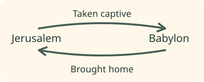

# 2 Chronicles 33 — Manasseh prays in Babylon

**About this chapter**

King Manasseh leads Judah away from the LORD. In Babylon he asks God for help. When he returns to Jerusalem, he changes what he does. Later his son Amon becomes king.

## Manasseh worships other gods

## 2 Chronicles 33:1

Manasseh was twelve years old when he became king.

He ruled in Jerusalem for fifty-five years.

## 2 Chronicles 33:2

He did what the LORD saw was evil.

He copied the terrible practices of the nations the LORD had driven out when Israel came.

## 2 Chronicles 33:3

His father Hezekiah had torn down places of worship on the hills.

Manasseh built them again.

He built altars for gods called the Baals.

He made poles for the goddess Asherah.

He even worshiped and served the stars in the sky.

## 2 Chronicles 33:4

Manasseh built altars for other gods inside the LORD’s temple.

The LORD had said, “Jerusalem will bear my name forever.”

## 2 Chronicles 33:5

The temple had two courtyards, open spaces around the building.

In both of them Manasseh built altars to worship the stars.

## 2 Chronicles 33:6

In the Valley of Ben-hinnom he offered his sons as sacrifices in the fire.

He used magic and looked for signs to tell the future.

He asked people who claimed to speak to spirits for advice.

The LORD saw this great evil and was angry.

## The LORD speaks, but the people refuse to listen

## 2 Chronicles 33:7

Manasseh put a carved idol in God’s temple.

God had told David and his son Solomon, “Of all the places in Israel, I have chosen Jerusalem.

This temple and this city will bear my name forever.

## 2 Chronicles 33:8

I gave this land to your ancestors.

If Israel obeys all the laws I gave through Moses, I will never again make them leave.”

## 2 Chronicles 33:9

Manasseh led Judah and Jerusalem away from God.

They did even worse things than the nations the LORD had destroyed before Israel came.

## 2 Chronicles 33:10

The LORD spoke to Manasseh and his people.

They refused to listen.

## Manasseh asks the LORD for help

## 2 Chronicles 33:11

So the LORD sent the king of Assyria’s commanders against them.

They captured Manasseh, put a hook in his nose, and bound him with bronze chains.

They took him to Babylon.

## 2 Chronicles 33:12

In his trouble Manasseh begged the LORD his God for kindness.

He set aside his pride before the God his ancestors had worshiped.

## 2 Chronicles 33:13

The LORD heard his prayer and granted his request.

He brought Manasseh back to Jerusalem to rule again.

Then Manasseh knew that the LORD is God.

**Pause and answer**

Where did God bring Manasseh after he prayed?

## Manasseh changes what he does in Jerusalem

## 2 Chronicles 33:14

Manasseh rebuilt the outer wall of the City of David.

It ran through the valley west of Gihon to the Fish Gate.

He took the wall around the hill of Ophel and made it much higher.

He put army commanders in all Judah’s walled cities.

## 2 Chronicles 33:15

He cleared the foreign gods and the carved idol out of the temple.

He removed the altars he had built on the temple hill and in Jerusalem.

He threw them all outside the city.

## 2 Chronicles 33:16

He repaired the LORD’s altar.

There he brought peace offerings and gifts to thank the LORD.

He told Judah’s people to serve the LORD, the God of Israel.

## 2 Chronicles 33:17

The people still offered sacrifices at the hilltop places of worship.

Now they offered them only to the LORD their God.

## 2 Chronicles 33:18

A book called the Chronicles of the Kings of Israel tells more about Manasseh.

It records his prayer and the words of the seers.

Seers were people who brought him messages from the LORD, Israel’s God.

## 2 Chronicles 33:19

The Records of the Seers also tells how God answered his prayer.

It describes the wrong he did before he set aside his pride.

It names the places where he built hilltop shrines and set up Asherah poles and idols.

## 2 Chronicles 33:20

Manasseh died, and people buried him at his palace.

His son Amon became king.

## Amon keeps serving the idols

## 2 Chronicles 33:21

Amon was twenty-two when he became king.

He ruled in Jerusalem for two years.

## 2 Chronicles 33:22

Amon did evil in the LORD’s sight, as his father once had.

He served all the idols his father had made and offered sacrifices to them.

## 2 Chronicles 33:23

Manasseh had humbled himself before the LORD.

Amon held on to his pride and did still more wrong.

## 2 Chronicles 33:24

Amon’s servants made a secret plan against him.

They killed him in his palace.

## 2 Chronicles 33:25

The people of Judah killed everyone who had plotted to kill Amon.

They made Amon’s son Josiah king.

**Pause and answer**

How did Amon respond differently from his father when he did wrong?
