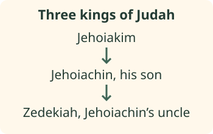

# 2 Chronicles 36 — Jerusalem falls, and Cyrus calls the people home

**About this chapter**

Four kings rule Judah after Josiah. The army of Babylon destroys the temple and takes people far from home. Years later, a king of Persia invites them to return to Jerusalem.

## Egypt chooses a king for Judah

## 2 Chronicles 36:1

The people chose Jehoahaz, son of Josiah, as their king.

He took his father’s place in Jerusalem.

## 2 Chronicles 36:2

Jehoahaz was twenty-three when he became king.

He ruled for three months.

## 2 Chronicles 36:3

The king of Egypt removed Jehoahaz from the throne.

He ordered Judah to pay a hundred talents of silver and one talent of gold.

A talent was a large measure of weight.

## 2 Chronicles 36:4

Neco, king of Egypt, chose Jehoahaz’s brother Eliakim to rule Judah and Jerusalem.

Neco gave Eliakim a new name, Jehoiakim.

He took Jehoahaz away to Egypt.

## Babylon takes away treasure and kings

## 2 Chronicles 36:5

Jehoiakim was twenty-five when he became king.

He ruled in Jerusalem for eleven years.

The LORD his God saw the evil he did.

## 2 Chronicles 36:6

Nebuchadnezzar, king of Babylon, came against Jehoiakim.

He put bronze chains on Jehoiakim to take him to Babylon.

## 2 Chronicles 36:7

Nebuchadnezzar took some objects from the LORD’s house.

He put them in his own temple in Babylon.

## 2 Chronicles 36:8

The Book of the Kings of Israel and Judah tells more about Jehoiakim.

It records the terrible things he did and the charges against him.

His son Jehoiachin became king.

## 2 Chronicles 36:9

Jehoiachin was eighteen when he became king.

He ruled in Jerusalem for three months and ten days.

He did what the LORD saw was evil.

## 2 Chronicles 36:10

In spring Nebuchadnezzar sent for Jehoiachin and took him to Babylon.

He also took valuable objects from the LORD’s house.

He made Zedekiah, a relative of Jehoiachin, king over Judah and Jerusalem.

**Pause and answer**

Who became king after Jehoiachin?

## The people refuse to listen

## 2 Chronicles 36:11

Zedekiah was twenty-one when he became king.

He ruled in Jerusalem for eleven years.

## 2 Chronicles 36:12

He did what the LORD his God saw was evil.

Jeremiah the prophet spoke to him for the LORD.

Zedekiah was too proud to listen.

## 2 Chronicles 36:13

Nebuchadnezzar had made Zedekiah swear a promise in God’s name.

Yet Zedekiah rebelled against Nebuchadnezzar.

He stubbornly refused to turn back to the LORD, Israel’s God.

## 2 Chronicles 36:14

The leading priests and the people kept turning against God.

They copied the terrible things other nations did.

They treated the temple as unholy, although the LORD had set it apart for himself.

## 2 Chronicles 36:15

The LORD, the God of their ancestors, cared deeply for his people and his house.

Again and again he sent messengers to warn them.

## 2 Chronicles 36:16

The people laughed at God’s messengers.

They treated his words as worthless and made fun of his prophets.

At last nothing could hold back the LORD’s anger.

## Jerusalem falls

## 2 Chronicles 36:17

The LORD brought Nebuchadnezzar, king of the Chaldeans of Babylon, against them.

His army killed young men in the holy place.

They showed no mercy to young men or women, to old people or to the weak.

God let Nebuchadnezzar take power over them all.

## 2 Chronicles 36:18

Nebuchadnezzar took everything to Babylon.

From God’s house he took objects both large and small.

He took the temple treasures and the treasures of the king and his officials.

## 2 Chronicles 36:19

The Chaldeans burned God’s house and broke down Jerusalem’s wall.

They burned the palaces and destroyed everything of value there.

## 2 Chronicles 36:20

Nebuchadnezzar took the survivors away to Babylon.

They had to serve him and his sons there until Persia came to power.

## 2 Chronicles 36:21

While the land lay empty, it had its Sabbath rest.

For seventy years the land rested.

This fulfilled what the LORD had said through Jeremiah.

## Cyrus sends a message

## 2 Chronicles 36:22

In his first year as king of Persia, Cyrus sent word throughout his kingdom.

He also put his message in writing.

The LORD moved him to do this to fulfill his word through Jeremiah.

## 2 Chronicles 36:23

Cyrus said, “The LORD, the God of heaven, gave me all the kingdoms of the earth.

He has chosen me to build him a house in Jerusalem in Judah.

Those of you who belong to his people may go up to Jerusalem.

May the LORD your God be with you.”

**Pause and answer**

What did Cyrus say God had chosen him to build?
