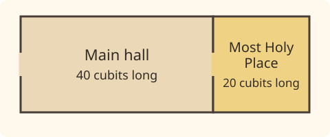

# 2 Chronicles 3 — Solomon builds the temple in Jerusalem

**About this chapter**

King Solomon begins building a temple for the LORD.

This chapter takes us inside the temple.

It also tells us the names of two pillars outside.

## Solomon begins work on Mount Moriah

## 2 Chronicles 3:1

Solomon began building the LORD’s temple in Jerusalem.

He built it on Mount Moriah.

The LORD had appeared there to Solomon’s father David.

Ornan the Jebusite had used this place to thresh grain.

That means he separated the grain from the stalks there.

David had prepared the site for the temple.

## 2 Chronicles 3:2

Work began in Solomon’s fourth year as king.

It was the second day of the second month.

## 2 Chronicles 3:3

Solomon laid the foundation, the base of the building.

People measured it using the old cubit.

A cubit was about the length from elbow to fingertip.

The base was 60 cubits long and 20 cubits wide.

## 2 Chronicles 3:4

A porch ran across the front of the temple.

It was 20 cubits across and 20 cubits high.

Solomon covered the inside of the porch with pure gold.

## The main room and the inner room

## 2 Chronicles 3:5

Solomon lined the main room with cypress wood.

He covered the wood with fine gold.

He decorated it with pictures of palm trees and chains.

## 2 Chronicles 3:6

Solomon added precious stones to make the temple beautiful.

The gold came from a place called Parvaim.

## 2 Chronicles 3:7

He covered the beams, walls, and doors with gold.

He covered the sills beneath the doors too.

On the walls he carved figures called cherubim.

Cherubim are heavenly beings with wings.

## 2 Chronicles 3:8

Solomon made an inner room called the Most Holy Place.

It reached across the whole width of the temple.

It was 20 cubits long and 20 cubits wide.

He covered its inside with 600 talents of fine gold.

A talent was a unit for weighing heavy loads.

## 2 Chronicles 3:9

The gold in the nails weighed 50 shekels.

A shekel was a small unit of weight.

Solomon covered the upstairs rooms with gold too.

## Two winged figures stand in the inner room

## 2 Chronicles 3:10

Solomon made two figures of cherubim for the Most Holy Place.

He covered both figures with gold.

## 2 Chronicles 3:11

Together their wings stretched across 20 cubits.

One wing of the first figure touched the wall.

Its other wing touched a wing of the second figure.

Each wing of the first figure was 5 cubits long.

## 2 Chronicles 3:12

One wing of the second figure touched the opposite wall.

Its other wing met the wing of the first figure.

Each wing of the second figure was also 5 cubits long.

## 2 Chronicles 3:13

Together their wings stretched from wall to wall, 20 cubits.

Both figures stood on their feet.

They faced the temple’s main room.

## 2 Chronicles 3:14

Solomon made a curtain from fine linen and colored yarn.

The yarn was blue, purple, and deep red.

Pictures of cherubim formed part of the woven cloth.

## Two pillars stand in front of the temple

## 2 Chronicles 3:15

Solomon made two pillars for the front of the temple.

Their heights added together came to 35 cubits.

Each pillar had a decorated top, 5 cubits high.

## 2 Chronicles 3:16

Solomon put woven chains on top of the pillars.

He made 100 decorations shaped like pomegranates.

A pomegranate is a round fruit with many seeds.

He fastened the decorations to the chains.

## 2 Chronicles 3:17

Solomon set up one pillar on the south side.

He named it Jachin.

He set up the other on the north side.

He named it Boaz.

**Pause and answer**

Which room held the two gold-covered figures?
